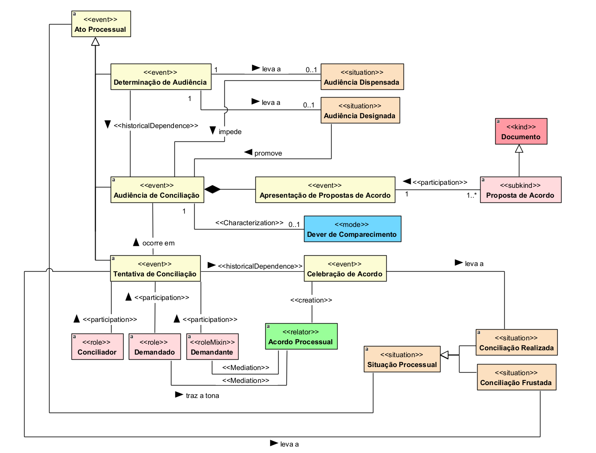
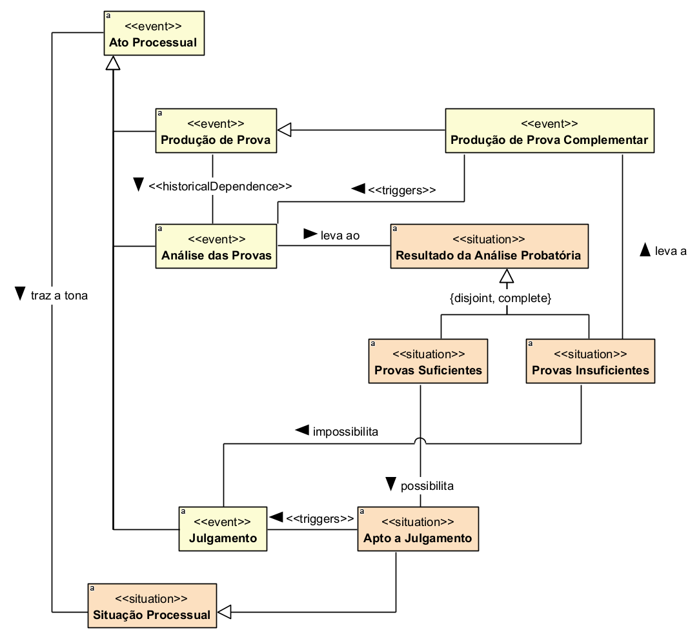

<!-- Start of picture text -->
xexDEPAL D0 So $ % gL3 BeoO 5 > > z = i) J QA ee© Te ounes® <!-- End of picture text -->

###### UNIVERSIDADE FEDERAL DO ESPÍRITO SANTO CENTRO TECNOLÓGICO 

###### COLEGIADO DO CURSO DE CIÊNCIA DA COMPUTAÇÃO 

Léo Cassini Scardini 

### Título do Trabalho 

Vitória, ES 

2020 

##### Título do Trabalho 

Monografia apresentada ao Curso de Ciência da Computação do Centro Tecnológico da Universidade Federal do Espírito Santo, como requisito parcial para obtenção do Grau de Bacharel em Ciência da Computação. 

Universidade Federal do Espírito Santo – UFES 

Centro Tecnológico 

Colegiado do Curso de Ciência da Computação 

Orientador: Nome do Orientador Coorientador: Nome do Co-orientador 

Vitória, ES 

2020 

Nome do Aluno Título do Trabalho/ Nome do Aluno. – Vitória, ES, 202028 p. : il. (algumas color.) ; 30 cm. Orientador: Nome do Orientador 

Monografia (PG) – Universidade Federal do Espírito Santo – UFES Centro Tecnológico Colegiado do Curso de Ciência da Computação, 2020. 

1. Palavra-chave1. 2. Palavra-chave2. I. Souza, Vítor Estêvão Silva. II. Universidade Federal do Espírito Santo. IV. Título do Trabalho 

CDU 02:141:005.7 

##### Título do Trabalho 

Monografia apresentada ao Curso de Ciência da Computação do Centro Tecnológico da Universidade Federal do Espírito Santo, como requisito parcial para obtenção do Grau de Bacharel em Ciência da Computação. 

Trabalho aprovado. Vitória, ES, (dia) de (mês) de (ano): 

###### **Nome do Orientador** Orientador 

**Nome do Membro da Banca** Nome da Instituição 

**Nome do Membro da Banca** Nome da Instituição 

Vitória, ES 2020 

_Lorem ipsum dolor sit amet, consectetur adipiscing elit. Duis malesuada laoreet leo at interdum. Nullam neque eros, dignissim sed ipsum sed, sagittis laoreet nisi._ 

# Agradecimentos 

Lorem ipsum dolor sit amet, consectetur adipiscing elit. Duis malesuada laoreet leo at interdum. Nullam neque eros, dignissim sed ipsum sed, sagittis laoreet nisi. Duis a pulvinar nisl. Aenean varius nisl eu magna facilisis porttitor. Cum sociis natoque penatibus et magnis dis parturient montes, nascetur ridiculus mus. Ut mattis tortor nisi, facilisis molestie arcu hendrerit sed. Donec placerat velit at odio dignissim luctus. Suspendisse potenti. Integer tristique mattis arcu, ut venenatis nulla tempor non. Donec at tincidunt nulla. Cras ac dignissim neque. Morbi in odio nulla. Donec posuere sem finibus, auctor nisl eu, posuere nisl. Duis sit amet neque id massa vehicula commodo dapibus eu elit. Sed nec leo eu sem viverra aliquet. Nam at nunc nec massa rutrum aliquam sed ac ante. 

Vivamus nec quam iaculis, tempus ipsum eu, cursus ante. Phasellus cursus euismod auctor. Fusce luctus mauris id tortor cursus, volutpat cursus lacus ornare. Proin tristique metus sed est semper, id finibus neque efficitur. Cras venenatis augue ac venenatis mollis. Maecenas nec tellus quis libero consequat suscipit. Aliquam enim leo, pretium non elementum sit amet, vestibulum ut diam. Maecenas vitae diam ligula. 

Fusce ac pretium leo, in convallis augue. Mauris pulvinar elit rhoncus velit auctor finibus. Praesent et commodo est, eu luctus arcu. Vivamus ut porta tortor, eget facilisis ex. Nunc aliquet tristique mauris id sollicitudin. Donec quis commodo metus, sit amet accumsan nibh. Cum sociis natoque penatibus et magnis dis parturient montes, nascetur ridiculus mus. 

_“Lorem ipsum dolor sit amet, consectetur adipiscing elit. Duis malesuada laoreet leo at interdum. Nullam neque eros, dignissim sed ipsum sed, sagittis laoreet nisi. (Lipsum generator)_ 

# Resumo 

Lorem ipsum dolor sit amet, consectetur adipiscing elit. Duis malesuada laoreet leo at interdum. Nullam neque eros, dignissim sed ipsum sed, sagittis laoreet nisi. Duis a pulvinar nisl. Aenean varius nisl eu magna facilisis porttitor. Cum sociis natoque penatibus et magnis dis parturient montes, nascetur ridiculus mus. Ut mattis tortor nisi, facilisis molestie arcu hendrerit sed. Donec placerat velit at odio dignissim luctus. Suspendisse potenti. Integer tristique mattis arcu, ut venenatis nulla tempor non. Donec at tincidunt nulla. Cras ac dignissim neque. Morbi in odio nulla. Donec posuere sem finibus, auctor nisl eu, posuere nisl. Duis sit amet neque id massa vehicula commodo dapibus eu elit. Sed nec leo eu sem viverra aliquet. Nam at nunc nec massa rutrum aliquam sed ac ante. 

Vivamus nec quam iaculis, tempus ipsum eu, cursus ante. Phasellus cursus euismod auctor. Fusce luctus mauris id tortor cursus, volutpat cursus lacus ornare. Proin tristique metus sed est semper, id finibus neque efficitur. Cras venenatis augue ac venenatis mollis. Maecenas nec tellus quis libero consequat suscipit. Aliquam enim leo, pretium non elementum sit amet, vestibulum ut diam. Maecenas vitae diam ligula. 

Fusce ac pretium leo, in convallis augue. Mauris pulvinar elit rhoncus velit auctor finibus. Praesent et commodo est, eu luctus arcu. Vivamus ut porta tortor, eget facilisis ex. Nunc aliquet tristique mauris id sollicitudin. Donec quis commodo metus, sit amet accumsan nibh. Cum sociis natoque penatibus et magnis dis parturient montes, nascetur ridiculus mus. 

Duis elementum dictum tristique. Integer mattis libero sit amet pretium euismod. Cura-bitur auctor eu augue ut ornare. Integer bibendum eros ullamcorper rhoncus convallis. Pellentesque non pretium ligula, sit amet bibendum eros. Nam venenatis ex felis, quis blandit nunc auctor sit amet. Maecenas ut eros pharetra, lobortis neque id, fermentum arcu. Cras neque dui, rhoncus feugiat leo id, semper facilisis lorem. Fusce non ex turpis. Nullam venenatis sed ligula ac lacinia. 

**Palavras-chave**: lorem. ipsum. dolor. sit. amet. 

# Lista de ilustrações 

Figura 1 – Exemplo de figura. ............................................................................................. 24 Figura 2 – Exemplo de figura em modo paisagem: um modelo de objetivos (SOUZA; MYLOPOULOS, 2013). ..................................................................................... 25 

# Lista de tabelas 

|Tabela 1 –|Exemplo de tabela com diferentes alinhamentos de conteúdo......................24|
|---|---|
|Tabela 2 –|Exemplo que especifica largura de coluna e usa lista enumerada (adap- tada de (SOUZA; MYLOPOULOS, 2013))....................................................24|
|Tabela 3 –|Exemplo que mostra equações em duas colunas (adaptada de (SOUZA;|
||MYLOPOULOS, 2013))..................................................................................26|
|Tabela 4 –|Exemplo que utiliza o pacotetabularx, extraído de um artigo ainda|
||não publicado.....................................................................................................26|

## Lista de abreviaturas e siglas 

UML Unified Modeling Language 

# Sumário 

##### Sumário 

|Título d|o Trabalho.......................................................................................................................................... 2|
|---|---|
|Título d|o Trabalho.......................................................................................................................................... 4|
|Agradecim|entos .................................................................................................................................................. 6|
|Resumo ...|......................................................................................................................................................... 8|
|Lista de ilus|trações ................................................................................................................................................ 9|
|Lista de tabe|las ................................................................................................................................................... 10|
|Sumário ...|....................................................................................................................................................... 12|
|1 Introd|ução ............................................................................................................................................... 13|
|1.1|Motivação e Justificativa............................................................................................................... 14|
|1.2|Objetivos .................................................................................................................................... 14|
|1.3|Método de Desenvolvimento do Trabalho........................................................................................ 15|
|1.4|Organização da Monografia........................................................................................................... 16|
|2 Refer|encial Teórico e Tecnologias Utiliza-das ......................................................................................... 17|
|2.1 O|ntologias...................................................................................................................................... 17|
|2.2U|FO - Unified Foundational Ontology ........................................................................................... 18|
|2.3 C|ore OntologyUFO-L ................................................................................................................... 21|
|2.4 E|ngenharia de Ontologia............................................................................................................... 22|
|3 Aspe|ctos Metodológicos........................................................................................................................... 28|
|3.1|Abordagem para desenvolvimento da ontologia ....................................................................... 28|
|3.2|Propósito e delimitação do domínio .......................................................................................... 28|
|3.3|Aquisição do conhecimento do domínio ................................................................................... 29|
|3.4|Levantamento dos requisitos ..................................................................................................... 30|
|3.5|Reúso de ontologia .................................................................................................................... 30|
|3.6|Captura e modelagem da ontologia ........................................................................................... 32|
|3.7|Modularização da ontologia ...................................................................................................... 33|
|3.8|Verificação por rastreabilidade e instanciação simulada (paginação a atualizar)|
|4 Resul|tados............................................................................................................................................... 35|
|4.1|Visão geral da ontologia ............................................................................................................ 35|
|4.2|Pacote Estrutural ........................................................................................................................ 38|
|4.3|Pacote Procedimental ................................................................................................................ 44|
|4.4|Rastreabilidade das questões de competência e instanciações simuladas (paginação a atualizar)|
|5 Conc|lusão ............................................................................................................................................... 59|
|5.1|ConsideraçõesFinais ................................................................................................................... 59|
|5.2|TrabalhosFuturos ........................................................................................................................ 59|
|Referência|s..................................................................................................................................................... 60|

# 1 Introdução 

O domínio do Direito é caracterizado por elevada complexidade, em razão da grande quantidade de normas, conceitos, procedimentos e relações jurídicas que precisam ser compreendidos para que o cidadão possa conhecer, reivindicar e exercer seus direitos. Nesse contexto, o acesso à justiça busca assegurar a efetividade de princípios fundamentais, especialmente a isonomia. Entretanto, esse princípio nem sempre é plenamente concretizado, pois parcela significativa da população encontra dificuldades para compreender e aplicar as normas jurídicas, seja pela falta de conhecimento técnico, seja pela ausência de ferramentas que facilitem a identificação e a utilização dos meios adequados para a proteção de seus direitos. 

No âmbito do Poder Judiciário, essa dificuldade torna-se ainda mais evidente. Um processo judicial pode envolver diversos sujeitos, como autor, réu, juiz, advogado, perito e servidores judiciais, além de diferentes recursos e elementos processuais, tais como provas, atos processuais, decisões, embargos e recursos. Embora essas informações sejam registradas e disponibilizadas ao público por meio de sistemas e documentos processuais, elas geralmente não são organizadas de forma semanticamente estruturada, voltada à compreensão do cidadão comum. Como consequência, a interpretação, a localização e a utilização dessas informações podem se tornar difíceis para pessoas sem formação jurídica. 

Em um Estado Democrático de Direito, uma justiça eficiente, acessível e compreensível deve constituir objetivo permanente. Com a finalidade de ampliar o acesso à justiça e reduzir obstáculos econômicos e burocráticos, foram criados os Juizados Especiais, destinados à apreciação de causas de menor complexidade. Esses órgãos foram concebidos para oferecer uma forma mais simples, célere e econômica de prestação jurisdicional, especialmente às pessoas que não possuem condições financeiras ou sociais para suportar os custos e a demora inerentes aos procedimentos judiciais tradicionais. Nesse sentido, os Juizados Especiais Federais Cíveis buscam aproximar o cidadão da Justiça Federal, inclusive ao prever, em determinadas hipóteses, a dispensa de advogado e a inexistência de custas em primeiro grau. 

Entretanto, os documentos, os atos processuais e as informações disponibilizadas nos sistemas judiciais são produzidos predominantemente para operadores do Direito, utilizando linguagem técnica e relações conceituais que não são explicitadas de forma acessível ao cidadão. Dessa maneira, um instrumento criado para reduzir barreiras de acesso pode continuar limitado pela dificuldade de compreensão das informações jurídicas, contribuindo para a baixa utilização ou para o uso inadequado dos mecanismos disponíveis pela sociedade. 

Assim, as ontologias inserem-se em contextos como esse, pois são úteis para representar o conhecimento de forma explícita e formal. Elas possibilitam a categorização dos conceitos relacionados aos Juizados Especiais de maneira estruturada e intuitiva, facilitando o alcance social que esse instituto visa promover. Dessa forma, podem prover conhecimento útil para a compreensão e aplicação de conceitos jurídicos, bem como atuar como artefatos computacionais capazes de auxiliar na implementação de sistemas. 

As ontologias podem ser compreendidas como formas de categorizar conceitos e relações de um domínio de conhecimento. Elas podem ser organizadas em três níveis, conforme seu grau de abrangência: ontologias de fundamentação, voltadas a conceitos mais gerais e independentes de domínio; ontologias de núcleo, direcionadas a conceitos compartilhados por diferentes domínios; e ontologias de domínio, destinadas à <u>representação</u> de conceitos específicos de determinada área de conhecimento. 

Ademais, as ontologias podem ser expandidas e reutilizadas em modelos de mesma ênfase ou em domínios relacionados. Também podem ser desenvolvidas como ontologias operacionais, sendo utilizadas como artefatos para compor a lógica de uma aplicação, como ocorre em abordagens baseadas em regras de negócio. Desse modo, contribuem para a representação de relações mais precisas, consistentes e semanticamente estruturadas entre os conceitos presentes em determinado domínio. 

Portanto, este trabalho visa ao desenvolvimento de uma ontologia de domínio jurídico com foco no Juizado Especial Federal Cível, abordando e expondo os benefícios trazidos pela Lei nº 10.259, de 12 de julho de 2001, especialmente quanto à ampliação do acesso à justiça, à simplificação procedimental e à aproximação do cidadão com a Justiça Federal. 

##### 1.1 Motivação e Justificativa 

A motivação deste trabalho está relacionada à possibilidade de aplicar os conhecimentos adquiridos ao longo da graduação no desenvolvimento de um artefato conceitual voltado à representação do conhecimento jurídico. A construção de uma ontologia permite aprofundar o estudo teórico do domínio escolhido, ao mesmo tempo em que contribui para tornar seus conceitos, relações e procedimentos mais compreensíveis para outros usuários, especialmente aqueles que não possuem formação jurídica. 

Justifica-se a escolha do domínio do Juizado Especial Federal Cível devido à sua relevância social, uma vez que esse instituto foi criado para facilitar o acesso à justiça, sem necessariamente necessitar de um ente terceiro. Nesse sentido, a ontologia proposta poderá servir como base para a organização semântica desse conhecimento, permitindo a identificação e a categorização dos principais elementos envolvidos no procedimento judicial. Além disso, o artefato desenvolvido poderá futuramente ser expandido e consolidado em um sistema voltado à produção de petições, ao peticionamento eletrônico e ao acompanhamento de processos judiciais, contribuindo para a automação e a melhoria do acesso à informação jurídica. 

#### 1.2 Objetivos 

O objetivo geral deste trabalho é desenvolver uma ontologia de domínio jurídico com foco no Juizado Especial Federal Cível, visando representar seus principais conceitos, relações, sujeitos, documentos e etapas processuais de forma estruturada e semanticamente consistente. 

Para alcançar esse objetivo geral, foram definidos os seguintes objetivos específicos: 

- i. Identificar os principais conceitos jurídicos e processuais relacionados ao Juizado Especial Federal Cível e analisar os sujeitos, papéis processuais, atos, documentos, pedidos, provas, decisões e recursos presentes nesse domínio; 

- ii. levantar os requisitos necessários para a construção da ontologia, considerando o escopo e as perguntas de competência do modelo; 

- iii. obter conhecimento do domínio por meio da análise de normas, literatura jurídica e materiais relacionados ao funcionamento dos Juizados Especiais Federais Cíveis; 

- iv. modelar e ampliar a ontologia de domínio, representando os conceitos e relações identificados de forma clara e consistente; 

- v. validar a ontologia proposta por meio de testes, análise de consistência e verificação das perguntas de competência definidas para o modelo. 

##### 1.3 Método de Desenvolvimento do Trabalho 

O desenvolvimento deste trabalho será realizado por meio das seguintes etapas: 

- i. Realizar pesquisa bibliográfica sobre ontologias, representação do conhecimento, tecnologias envolvidas, ontologias jurídicas e Juizados Especiais Federais Cíveis e analisar normas e materiais jurídicos relacionados ao domínio; 

- ii. Delimitar o escopo da ontologia, definindo quais conceitos, sujeitos, documentos, atos processuais, pedidos, provas, decisões, recursos e fases procedimentais serão representados; 

- iii. Definir perguntas de competência para orientar a construção da ontologia e verificar se o modelo é capaz de responder às principais questões do domínio; 

- iv. Modelar a ontologia conceitual, representando classes, relações, papéis, eventos e demais elementos relevantes de forma estruturada e semanticamente consistente; 

- v. Analisar e validar a consistência da modelagem, verificando se os conceitos e relações representados estão coerentes com o domínio jurídico estudado e se a ontologia responde às perguntas de competência; 

- vi. Ajustar a modelagem, quando necessário, a partir dos problemas ou inconsistências identificados durante a etapa de validação. 

##### 1.4 Organização da Monografia 

Além desta introdução, esta monografia é composta por outros quatro capítulos: 

- O Capítulo 2 apresenta os aspectos relativos ao conteúdo teórico relevante para o trabalho; 

- O Capítulo 3 descreve os aspectos metodológicos do desenvolvimento da ontologia; 

- O Capítulo 4 apresenta os resultados, incluindo a organização da ontologia, a descrição dos seus diagramas e a verificação por rastreabilidade e instanciação simulada; 

- O Capítulo 5 apresenta as considerações finais do trabalho; 

# 2 Referencial Teórico e Tecnologias Utilizadas 

#### 2.1 Ontologias 

Uma ontologia pode ser entendida como um modelo conceitual utilizado para representar, de forma explícita e estruturada, os tipos de entidades existentes em determinado domínio, suas propriedades e as relações que podem ser estabelecidas entre elas. O termo ontologia aproxima-se de sua origem filosófica, pois busca descrever categorias fundamentais da realidade e auxiliar na construção de modelos capazes de representar conceitos de maneira precisa e semanticamente consistente (GUIZZARDI et al., 2011). Nesse sentido, uma ontologia não se limita a listar termos ou conceitos de um domínio. Ela procura destrinchar o significado desses conceitos e as relações existentes entre eles. Assim, uma ontologia pode auxiliar na resposta a perguntas como: 

- i. O que é um objeto? 

- ii. O que é um evento? 

- iii. O que é uma pessoa? 

- iv. O que diferencia uma pessoa de um papel que ela pode exercer em determinado contexto, como paciente, autor, réu ou advogado? 

- v. Quais propriedades são essenciais para uma entidade e quais são apenas temporárias? 

- vi. Que tipos de relações podem existir entre as entidades representadas? 

A construção de ontologias é de extrema relevância nos domínios mais complexos, nos quais há grande quantidade de conceitos, regras e relações. No domínio jurídico, essa complexidade é evidente, pois normas, sujeitos, papéis, atos, documentos, decisões e procedimentos se relacionam de maneira dinâmica. Por isso, a representação ontológica pode contribuir para organizar o conhecimento jurídico, reduzir ambiguidades conceituais e favorecer tanto a compreensão humana quanto o uso computacional dessas informações. 

Segundo Scherp et al. (2011), as ontologias podem ser classificadas de acordo com seu grau de generalidade. Entre as classificações, tem-se: 

i. Ontologias de fundamentação, essas possuem maior abrangência e descrevem conceitos gerais, independentes de um domínio específico, servindo como base teórica para a construção de modelos conceituais mais precisos como, por exemplo, a Unified Foundational Ontology (UFO); 

ii. Ontologias de núcleo, que, por sua vez, representam conceitos estruturais de uma determinada área do conhecimento, possuindo um nível intermediário de generalidade. Elas são mais específicas que as ontologias de fundamentação, mas mais gerais que as ontologias de domínio. No campo jurídico, por exemplo, uma ontologia de núcleo pode representar conceitos comuns a diferentes subdomínios do Direito, como relações jurídicas, sujeitos de direito, normas, situações jurídicas e atos jurídicos; 

iii. Ontologias de domínio que são voltadas à representação de um recorte específico da realidade. Elas descrevem conceitos dependentes de determinado domínio, como medicina, educação, biologia ou Direito. No contexto deste trabalho, a ontologia a ser desenvolvida caracteriza-se como uma ontologia de domínio jurídico, pois tem como foco representar o Juizado Especial Federal Cível, abrangendo seus principais sujeitos, papéis processuais, atos, documentos, pedidos, provas, decisões e etapas procedimentais. 

Essa delimitação é crucial devido à complexidade do domínio jurídico. Conforme aponta Griffo (2018), o Direito não pode ser tratado como um sistema fechado de regras, pois envolve diferentes nuances, interpretações e relações. Por isso, é necessário estabelecer um recorte da realidade jurídica a ser representada, selecionando os conceitos e relações considerados relevantes para o objetivo da ontologia (GRIFFO, 2018). 

#### 2.2 UFO - Unified Foundational Ontology 

A construção de ontologias de domínio exige uma base conceitual capaz de orientar a identificação dos tipos de entidades existentes, suas propriedades e suas relações. Para isso, podem ser utilizadas ontologias de fundamentação, que fornecem categorias gerais aplicáveis a diferentes áreas do conhecimento. Entre essas ontologias, destaca-se a Unified Foundational Ontology (UFO), proposta como uma ontologia de fundamentação voltada ao apoio da modelagem conceitual e à representação semanticamente precisa de domínios complexos (GUIZZARDI, 2005; GUIZZARDI et al., 2015). 

A UFO tem como objetivo oferecer categorias ontológicas capazes de auxiliar a modelagem a distinguir diferentes elementos da realidade, como objetos, eventos, propriedades, papéis, relações e entidades sociais. Essa distinção é importante porque, em muitos domínios, os conceitos não possuem a mesma natureza, alguns representam entidades que mantêm sua identidade ao longo do tempo, enquanto outros representam papéis temporários, eventos que ocorrem em determinado momento ou relações dependentes de outros elementos. 

A UFO costuma ser apresentada em três partes principais: UFO-A, UFO-B e UFO-C. A UFO-A trata de entidades substanciais, propriedades, tipos e relações estruturais; a UFO-B aborda eventos e ocorrências temporais; e a UFO-C trata de aspectos sociais e intencionais, como agentes, papéis sociais, compromissos e relações sociais (GUIZZARDI, 2005; GUIZZARDI et al., 2015). Essa divisão permite analisar um domínio a partir de diferentes dimensões, o que é útil para representar áreas complexas, como o Direito. 

###### 2.2.1 UFO-A 

A UFO-A é a parte da Unified Foundational Ontology voltada à representação de entidades chamadas de endurantes, isto é, entidades que persistem no tempo mantendo sua identidade, ainda que possam sofrer mudanças. Essas entidades são diferentes dos eventos, pois não acontecem no tempo, mas permanecem através dele. Uma pessoa, uma organização, um documento e um processo podem ser analisados como exemplos de entidades que conservam identidade ao longo de sua existência. 

Figura 1 – Taxonomia de UFO-A 

<!-- Start of picture text -->
[rons] A {disjoint, complete} [pawersal [inawiul L\ tasjont) A [a at L\ (sont) As [sertatniversa] [neseuniversa] [sebetontnl] [Moment ra {disjoint} L casio, complete} A A A\ A L\ taint, comolete) (een cme) | noe, comet XK £\ /\ [jena] [Semon] [piece] [Role] [fatesory] [Reterce] [ee] [pete] [ee] [Rey <!-- End of picture text -->

Fonte: GUIZZARDI, 2005 

Um dos conceitos centrais da UFO-A é a distinção entre tipos que fornecem identidade e tipos que apenas classificam uma entidade em determinado contexto. Essa distinção é essencial para a modelagem conceitual, pois permite compreender que nem todo conceito atribuído a uma entidade define aquilo que ela é. Alguns conceitos indicam apenas papéis temporários ou classificações contextuais. No domínio jurídico, essa diferença pode ser observada na distinção entre “Pessoa” e “Autor”. Uma pessoa é uma entidade que possui identidade própria, independentemente de participar ou não de um processo judicial. Já “Autor” é um papel exercido por uma pessoa ou organização quando ocupa o polo ativo de uma demanda judicial. Assim, a pessoa não deixa de ser pessoa quando o processo termina, mas deixa de exercer o papel de autora naquele contexto específico. O mesmo raciocínio pode ser aplicado aos papéis de réu, advogado, testemunha ou perito. 

###### 2.2.2 UFO-B 

A UFO-B é a parte da Unified Foundational Ontology voltada à representação de eventos, isto é, entidades que ocorrem no tempo. Diferentemente dos objetos, que permanecem ao longo do tempo mantendo sua identidade, os eventos possuem natureza temporal, pois acontecem, desenvolvem-se e se encerram em determinado intervalo. Assim, enquanto uma pessoa, uma organização ou um documento podem ser analisados como entidades que persistem, uma audiência, uma perícia, uma citação ou a prolação de uma sentença devem ser compreendidas como acontecimentos processuais. 

No contexto da modelagem conceitual, a distinção entre objetos e eventos é relevante porque permite representar adequadamente a dinâmica dos domínios analisados. Em muitos 

modelos, atos, atividades e acontecimentos são tratados como simples objetos ou registros, o que pode gerar perda de significado. A UFO-B contribui para evitar esse problema ao permitir que ocorrências temporais sejam modeladas como eventos, evidenciando sua relação com o tempo, com os participantes envolvidos e com os efeitos que produzem no domínio (GUIZZARDI et al., 2013; GUIZZARDI et al., 2015). 

Figura 2. Taxonomia de UFO-B 

<!-- Start of picture text -->
A A heres n> 1 L\ < beginpoint 1 {disjoint ( Endurant] : brings about > A a {disjont) A 2 has part L\ 1 1 {disjoint, complete} participatia qctewey 4} 1 [amicevent [ stuation | ‘7 A . ' manfested by > < activates [Fact <!-- End of picture text -->

Fonte: GUIZZARDI et al., 2013 

A representação de eventos também é relevante porque os atos processuais possuem relação direta com prazos, fases e consequências jurídicas. O ajuizamento, a apresentação de contestação, a tentativa de conciliação ou o cumprimento de uma decisão são acontecimentos que podem alterar o andamento do processo. Desse modo, a UFO-B fornece suporte para modelar não apenas quais elementos existem no domínio, mas também como eles se desenvolvem ao longo do tempo. 

###### 2.2.3 UFO-C 

A UFO-C é a parte da Unified Foundational Ontology voltada à representação de aspectos sociais, intencionais e institucionais da realidade. Enquanto a UFO-A trata principalmente de entidades que persistem no tempo e a UFO-B trata de eventos, a UFO-C permite representar agentes, papéis sociais, relações sociais, compromissos, intenções e ações comunicativas. Essa dimensão é especialmente relevante para domínios em que há interação entre pessoas, organizações e instituições, como ocorre no Direito (GUIZZARDI, 2005; GUIZZARDI et al., 2015). 

Figura 3. As categorias da ontologia de agentes UFO-C 0.2. 

<!-- Start of picture text -->
[Physical Object (from UFO-A) . [Moment Individual ZX Event (from OFO-A) {disjoint} perce ZX L\ erodives (from UFO-B)] RelationalMoment Intrinsicry Non-Agentive {disjoint}disjoint; : Moment Object [ActionEvent | Non-Action ZX is LN * inheres in 4 . creates Event Physical OY sisoint) TAN ommunicativeActionEvent Belief Perception + 'SocialMoment « Dears |Communicating ZX * 2" Physicalagent Receiver {aisjoint)disjoint’ Dp ommunicatingAgent Commitment Institutional 1." Agent InternalAgent 0 <!-- End of picture text -->

Fonte: GUIZZARDI; WAGNER, 2005 

A noção de agente é central para a representação de relações sociais e institucionais. Guizzardi e Wagner (2005) destacam que a UFO foi proposta como uma ontologia de fundamentação para a modelagem conceitual, incluindo a fundamentação de conceitos relacionados a agentes. Essa abordagem contribui para a modelagem do domínio jurídico, pois permite diferenciar agentes, como pessoas e organizações, dos papéis que eles exercem no processo judicial, como autor, réu, advogado, juiz ou perito. 

A UFO-C também auxilia na compreensão das relações jurídicas e processuais como relações socialmente reconhecidas e normativamente estruturadas. A relação entre autor e réu, por exemplo, não é uma simples associação entre duas entidades, mas uma relação processual gerada a partir de uma demanda judicial. Essa relação envolve direitos, deveres, poderes, faculdades e ônus processuais que decorrem do ordenamento jurídico e dos atos praticados no processo. 

#### 2.3 Core Ontology UFO-L 

A UFO-L é uma ontologia núcleo voltada à representação de aspectos jurídicos, desenvolvida por Griffo (2018) com base na Unified Foundational Ontology (UFO). Sua construção parte da perspectiva das relações jurídicas, relacionando conceitos do Direito às categorias ontológicas fornecidas pela UFO, de modo a estabelecer uma estrutura conceitual reutilizável na construção de ontologias de domínio jurídico. 

Figura 4. Padrão de modelagem para Legal Relator 

<!-- Start of picture text -->
L>|_Legal Agent |] {disjoint} Legal RoleMixin —— a cmaterialy 7 -_ Legal RoleMixin 1 1 : i afi 1 : grounds p : mediates = 1.* 1.* i 1* mediates ae Legal Relator «mediation» 1 1 Lt; «characterization» aT aeons«characterization» externally depends on ‘“characterizauion> «characterization <!-- End of picture text -->

Fonte: GRIFFO, 2018 

A ontologia introduz categorias próprias do domínio jurídico, entre elas Legal Agent, Legal Role, Legal RoleMixin, Legal Moment, Legal Relator e Legal Event. Na UFO-L, os Legal Agents são agentes que podem ocupar posições em relações jurídicas e carregar Legal Moments. Esses momentos representam posições jurídicas, como direitos, deveres, permissões, poderes e sujeições. As relações entre os agentes podem ser reificadas por meio de Legal Relators, que são compostos por momentos jurídicos externamente dependentes. 

As posições jurídicas representadas pela UFO-L não são tratadas de forma isolada. Direitos e deveres, por exemplo, apresentam relações de correlação: um direito atribuído a determinado agente corresponde a um dever jurídico atribuído a outro agente. A UFO-L representa essas posições correlatas como partes de um _Legal Relator_ , permitindo explicitar não somente os participantes de uma relação jurídica, mas também as posições jurídicas que cada um assume no contexto dessa relação. 

No contexto deste trabalho, a UFO-L fornece conceitos jurídicos de nível intermediário que podem ser reutilizados na construção da ontologia do Juizado Especial Federal. Dessa forma, conceitos específicos do domínio processual podem ser modelados a partir de categorias mais gerais da ontologia núcleo, permitindo representar agentes, papéis jurídicos, relações, posições jurídicas e eventos processuais de maneira fundamentada e semanticamente consistente. 

#### 2.4 Engenharia de Ontologia 

A Engenharia de Ontologias compreende o conjunto de métodos, técnicas e atividades utilizados para apoiar a construção sistemática de ontologias. Seu processo envolve não apenas a identificação e a representação dos conceitos de um domínio, mas também a definição do propósito e do escopo da ontologia, a aquisição do conhecimento, a especificação de requisitos, a modelagem conceitual, a documentação e a avaliação do modelo produzido. Dessa forma, 

busca-se reduzir ambiguidades e favorecer a construção de representações mais claras, consistentes e reutilizáveis do conhecimento (FALBO, 2014). O desenvolvimento de uma ontologia também pode envolver diferentes recursos metodológicos e tecnológicos, cada um desempenhando uma função específica durante o processo de construção. 

###### 2.4.1 SABiO 

A construção de ontologias exige o uso de metodologias para orientar o processo de desenvolvimento, desde a identificação do domínio até a avaliação do modelo produzido. Nesse contexto, destaca-se a SABiO, sigla para _Systematic Approach for Building Ontologies_ , proposta por Falbo (2014), que consiste em uma abordagem sistemática para a construção de ontologias de domínio. A SABiO foi desenvolvida com o objetivo de apoiar o processo de engenharia de ontologias, fornecendo atividades, papéis, artefatos e processos de apoio para a elaboração de modelos ontológicos mais consistentes e reutilizáveis. 

Segundo Falbo (2014), as ontologias podem ser distinguidas em ontologias de referência e ontologias operacionais. As ontologias de referência são voltadas à representação conceitual do domínio, tendo como principal objetivo descrever, com clareza e precisão, os conceitos e relações existentes em determinada área de conhecimento. Já as ontologias operacionais são voltadas ao uso computacional, sendo implementadas em linguagens computacionais, como OWL. Essa distinção é relevante porque permite separar a fase de compreensão e modelagem conceitual do domínio da fase de implementação da ontologia. 

Figura 5 – Metodologia SABiO 

<!-- Start of picture text -->
Processo de desenvolvimento Processo de suporte ¥v «—_ ——_ Es a oo ——— -— <!-- End of picture text -->

Fonte: FALBO, 2014 

A primeira etapa proposta pela SABiO consiste na identificação do propósito da ontologia e no levantamento de requisitos. Nessa fase, são definidos o objetivo da ontologia, seus possíveis usos e as questões que ela deverá ser capaz de responder. Essas questões são denominadas perguntas de competência e funcionam como requisitos funcionais da ontologia, pois delimitam quais conhecimentos devem ser representados no modelo (FALBO, 2014). No caso deste trabalho, exemplos de perguntas de competência seriam: Qual é o tipo da ação proposta? Existe requerimento de tutela provisória? O réu apresentou contestação? Qual foi o resultado da sentença? Em que fase está meu processo? 

Após a definição dos requisitos, a SABiO propõe a captura e a formalização da ontologia. Essa etapa envolve a identificação dos conceitos relevantes do domínio, suas propriedades, relações e restrições. Para isso, o conhecimento pode ser obtido a partir de especialistas do domínio, materiais bibliográficos, normas, documentos técnicos, modelos de referência e demais fontes consolidadas de conhecimento. 

A SABiO também recomenda que a modelagem conceitual seja orientada por uma ontologia de fundamentação. Nesse sentido, Falbo (2014) destaca a possibilidade de utilização da OntoUML como linguagem de modelagem para ontologias de referência, uma vez que ela incorpora representações ontológicas da Unified Foundational Ontology (UFO). Essa orientação é compatível com a proposta deste trabalho, que utiliza conceitos da UFO-L e da OntoUML para representar o domínio jurídico. 

Outro ponto relevante da SABiO é a possibilidade de modularização da ontologia. Em domínios complexos, como o jurídico, a repartição em módulos ou subontologias pode facilitar o desenvolvimento, a manutenção e a reutilização do modelo. No caso do Juizado Especial Federal Cível, a ontologia pode ser organizada em módulos relacionados, por exemplo, aos sujeitos processuais, à demanda judicial, às competências e aos procedimentos. Essa divisão contribui para reduzir a complexidade da modelagem e permite que cada parte do domínio seja analisada de maneira mais clara. 

Além das atividades principais de desenvolvimento, a SABiO também recomenda processos de apoio, como aquisição de conhecimento, documentação, gerenciamento de configuração,  avaliação e reuso. A documentação é especialmente importante para registrar as decisões tomadas durante a modelagem, os conceitos definidos e as relações. Já a avaliação busca verificar se a ontologia atende ao propósito para o qual foi construída, se responde às perguntas de competência e se apresenta clareza, coerência e consistência conceitual. 

Dessa forma, a SABiO contribui diretamente para o desenvolvimento deste trabalho, pois oferece um caminho metodológico adequado para a construção da ontologia proposta. Neste trabalho, são contempladas as atividades relacionadas à construção de uma ontologia de referência: identificação de requisitos, definição de perguntas de competência, captura do conhecimento, modelagem conceitual, modularização e avaliação da ontologia. Essa abordagem permite que o modelo seja desenvolvido de forma mais sistemática e alinhada aos objetivos da pesquisa. 

###### 2.4.2 OntoUML 

A OntoUML é uma linguagem de modelagem conceitual fundamentada na Unified 

Foundational Ontology (UFO), desenvolvida a partir dos estudos de Guizzardi (2005) sobre fundamentos ontológicos para modelos conceituais estruturais. Seu objetivo é oferecer uma forma mais precisa de representar conceitos de um domínio, permitindo que o modelador diferencie a natureza ontológica dos elementos representados. Assim, a OntoUML não se limita à representação gráfica de classes e associações, mas busca explicitar se determinado elemento corresponde a um tipo essencial, a um papel, a uma fase, a uma propriedade, a uma relação ou a outro tipo de entidade conceitual. 

A principal diferença entre a UML tradicional e a OntoUML está no uso de estereótipos ontológicos. Enquanto a UML permite representar classes, atributos, associações e generalizações, a OntoUML permite indicar se determinado conceito corresponde, por exemplo, a um tipo que fornece identidade, a um papel contextual, a uma fase, a uma propriedade, a uma categoria ou a uma entidade relacional. Desse modo, a linguagem não apenas representa os conceitos de um domínio, mas também explicita o tipo de entidade que cada conceito representa. 

Quadro 1 – Estereótipos de classes da linguagem OntoUML 

|**Classe**|**Descrição**|
|---|---|
|**_Kind_**|Representa uma categoria ontológica que fornece princípio de identidade aos seus indivíduos.|
|**_Subkind_**|Representa uma especialização rígida que herda o princípio de identidade fornecido por seu supertipo.|
|**_Role_**|Representa um conceito antirrígido que define o papel exercido por uma entidade em determinado contexto.|
|**_Phase_**|Representa uma fase antirrígida de uma classe que possui princípio de identidade.|
|**_Mode_**|Representa uma propriedade intrínseca existencialmente dependente de uma entidade.|
|**_Category_**|Agrega propriedades essenciais, mas não fornece princípio de identidade.|
|**_Mixin_**|Representa propriedades essenciais para algumas instâncias e ocasionais para outras.|
|**_RoleMixin_**|Representa um conceito antirrígido e relacionalmente dependente, aplicável a indivíduos com diferentes princípios de identidade.|
|**_Collective_**|Representa um tipo que fornece princípio de identidade a coletivos, como um baralho ou um grupo de pessoas.|
|**_Quantity_**|Representa entidades de massa, como água, areia ou vinho.|
|**_Relator_**|Representa uma entidade relacional que fundamenta relações entre outras entidades.|

Fonte: Adaptado de Guimarães et al. (2017) e Guizzardi (2005). 

Guimarães et al. (2017) apresentam os principais estereótipos de classes da linguagem OntoUML, os quais permitem distinguir a natureza ontológica dos conceitos representados em um modelo conceitual. O Quadro 1 sintetiza esses estereótipos e suas respectivas funções. 

<u>Quadro 2: Estereótipos de Relacionamentos da linguagem OntoUML.</u> 

**<u>Relação Descrição</u>** 

|**_Mediação_** **_(mediation)_**|Representam um tipo de relação formal que relaciona um relator aos objetos que ele media.|
|---|---|
|**_Material_**|Representa um tipo de relação que é induzida por um relator.|
|**_Derivação_**|Representa a relação formal de derivação que ocorre entre uma relação material do relator que essa relação material é derivada.|
|**_Caracterização_**|Relação formal que ocorre entre um mode e a classe que este mode caracteriza|
|**_Formal_**|Representa uma relação formal, ou seja, uma relação de comparação a partir de propriedades intrínsecas das classes relacionadas, ou uma relação interna|
|**_Componentof_**|Representa uma composição funcional. é uma relação todo-parte entre dois complexos funcionais (kind ou um subtipo de um kind).|
|**_Memberof_**|Uma relação todo-parte e existe para relacionar membros a conjuntos|
|**_SubCollectionOf_**|Uma relação todo parte que explicita relações de subgrupo entre collectives|

Fonte: Adaptado de Guimarães et al. (2017). 

Essa distinção entre tipos, papéis e relações é especialmente relevante para a modelagem jurídica. Conforme Griffo (2018), a construção de ontologias jurídicas exige atenção às relações jurídicas e aos papéis exercidos por agentes dentro de estruturas normativas. Desse modo, a OntoUML contribui para representar o Direito de forma mais precisa, pois permite diferenciar uma entidade que possui identidade própria, como uma pessoa ou organização, dos papéis que ela pode exercer em determinado processo, como autor, réu, advogado, perito ou testemunha. A tese de Griffo, inclusive, apresenta a UFO-L como uma ontologia núcleo jurídica construída sob a perspectiva das relações jurídicas, reforçando a importância de uma modelagem juridicamente fundamentada. 

A utilização da OntoUML também se relaciona ao método de desenvolvimento de ontologias adotado neste trabalho. Falbo (2014), ao propor a SABiO, diferencia ontologias de referência e ontologias operacionais, indicando que as ontologias de referência possuem foco na representação conceitual do domínio. Nesse sentido, a OntoUML é adequada para a construção da ontologia proposta, pois permite elaborar um modelo conceitual independente de uma implementação computacional específica, servindo como base para posteriores transformações em ontologias operacionais ou sistemas de apoio jurídico. 

###### 2.4.3 Visual Paradigm e o plugin OntoUML 

Para a construção gráfica de modelos conceituais em OntoUML, podem ser utilizadas ferramentas de modelagem que ofereçam suporte aos elementos específicos da linguagem. Entre elas está o Visual Paradigm, ambiente voltado à criação de modelos e diagramas, que pode ser estendido por meio do plugin OntoUML, possibilitando a elaboração de modelos conceituais 

ontologicamente fundamentados. 

O plugin OntoUML acrescenta ao Visual Paradigm recursos próprios da linguagem, permitindo aplicar às classes e relações os estereótipos apresentados nos Quadros 1 e 2, como kind, role, relator e mode. Além disso, oferece mecanismos de apoio à modelagem, como sugestões de estereótipos e verificação do modelo segundo as regras da OntoUML. A Figura 6 exemplifica a representação desses elementos e de suas relações no ambiente de modelagem. 

Figura 6. Exemplo de modelagem OntoUML no Visual Paradigm. 

<!-- Start of picture text -->
p Pessoa | enores_| Loma Ld1] <<Mediation>> Estresse _|—— 7 |_Empregado — ContratoTrabalho <!-- End of picture text -->

Fonte: Elaborado pelo autor (2026). 

## 3 Aspectos Metodológicos 

#### 3.1 Abordagem para desenvolvimento da ontologia 

O desenvolvimento da ontologia proposta neste trabalho foi conduzido com base na Systematic Approach for Building Ontologies (SABiO), apresentada por Falbo (2014). A abordagem organiza a construção de ontologias por meio de um processo sistemático, envolvendo atividades de desenvolvimento e processos de apoio que acompanham a construção do artefato ontológico. Conforme apresentado no referencial teórico, o processo de desenvolvimento parte do levantamento dos requisitos e da identificação do propósito da ontologia, avança para a captura e formalização do conhecimento e resulta, inicialmente, na construção de uma ontologia de referência. 

A SABiO prevê ainda etapas posteriores relacionadas ao design e à implementação, nas quais a ontologia de referência pode ser transformada em uma representação voltada ao uso computacional, resultando, por exemplo, em uma ontologia operacional. Apoiando as atividades de desenvolvimento, a abordagem oferece processos de apoio, como aquisição de conhecimento, documentação, gerenciamento de configuração, avaliação e reúso. Esses processos não necessariamente ocorrem de maneira isolada ou estritamente sequencial, podendo acompanhar diferentes momentos do desenvolvimento da ontologia. No próprio referencial deste trabalho, esses processos são apresentados como mecanismos de suporte à construção e à avaliação do modelo. 

Considerando que o objetivo deste trabalho é desenvolver uma ontologia de referência para o domínio do Juizado Especial Federal Cível, foram adotadas principalmente as atividades da SABiO relacionadas à identificação do propósito e levantamento dos requisitos, aquisição do conhecimento, captura e formalização do domínio, reúso, modelagem conceitual e avaliação. As etapas destinadas ao design e à implementação de uma ontologia operacional não integram o escopo deste trabalho. Nas seções seguintes, são descritas as atividades realizadas durante esse processo, iniciando-se pela definição do propósito e pela delimitação do domínio da ontologia, seguida da aquisição do conhecimento, do levantamento das Questões de Competência e da captura e modelagem dos conceitos identificados. 

#### 3.2 Propósito e delimitação do domínio 

Esta seção corresponde à etapa de levantamento de requisitos e identificação do propósito da ontologia prevista pela SABiO. Nessa etapa são estabelecidos o objetivo do artefato a ser desenvolvido, o domínio que será representado e os limites de seu escopo, de modo a orientar as atividades posteriores de aquisição de conhecimento e modelagem. 

A ontologia desenvolvida neste trabalho tem como propósito representar, de forma conceitual e estruturada, o domínio do Juizado Especial Federal Cível, organizando os principais elementos envolvidos no funcionamento e na tramitação de uma demanda judicial nesse contexto. Busca-se explicitar os conceitos e relações existentes entre os participantes do processo, seus papéis, as demandas apresentadas, os atos praticados, as provas produzidas, as decisões proferidas e os mecanismos de impugnação e cumprimento. 

A definição do escopo partiu da necessidade de estabelecer um recorte do domínio jurídico que fosse suficientemente abrangente para representar o funcionamento do Juizado Especial Federal Cível, sem pretender modelar todo o Direito Processual Civil ou toda a estrutura da Justiça Federal. Dessa forma, o trabalho concentrou-se no percurso de uma demanda no JEF Cível, desde sua propositura até os possíveis desdobramentos decorrentes da decisão judicial. 

Foram considerados no escopo conceitos relacionados aos sujeitos e papéis processuais, ação judicial, competência do Juizado, pedidos, tutela provisória, atos processuais, fases e estados do processo, produção de provas, conciliação, sentença, obrigações decorrentes da decisão, recursos e cumprimento da decisão. Também foram contemplados os órgãos e agentes que participam desses procedimentos, sempre na medida necessária para representar as relações relevantes ao domínio estudado. 

Essa delimitação orientou tanto a formulação das Questões de Competência quanto a identificação inicial dos conceitos e relações posteriormente refinados durante a modelagem ontológica. Assim, elementos que não contribuíam diretamente para responder às questões definidas ou que pertenciam a outros ramos e procedimentos da Justiça Federal permaneceram fora do escopo da ontologia. 

#### 3.3 Aquisição do conhecimento do domínio 

Na SABiO, a aquisição de conhecimento é caracterizada como um processo de apoio ao desenvolvimento da ontologia, podendo ocorrer ao longo das diferentes atividades de construção do modelo. Neste trabalho, esse processo teve papel especialmente relevante nas etapas de definição dos requisitos e de captura da ontologia, uma vez que forneceu o conhecimento necessário para a identificação dos conceitos, relações e restrições existentes no domínio do Juizado Especial Federal Cível. 

A aquisição do conhecimento necessário à construção da ontologia foi realizada por meio de pesquisa bibliográfica e análise documental. Para a compreensão do domínio jurídico, foram consideradas principalmente a Lei nº 10.259/2001, que institui os Juizados Especiais Cíveis e Criminais no âmbito da Justiça Federal, e a Lei nº 9.099/1995, aplicada subsidiariamente aos Juizados Especiais Federais quando não houver conflito com a legislação específica. 

Também foram utilizados trabalhos da literatura jurídica voltados ao funcionamento e às características dos Juizados Especiais Federais, especialmente quanto à competência, aos sujeitos processuais, ao procedimento, aos atos praticados e aos mecanismos de acesso à justiça. Entre esses trabalhos, destaca-se o estudo de Ribeiro e Sanzovo (2011), utilizado como apoio para a compreensão da estrutura e das particularidades do Juizado Especial Federal Cível. 

Além da análise das fontes documentais e bibliográficas, o desenvolvimento contou com acompanhamento e validação por especialistas do domínio jurídico, que auxiliou na verificação da adequação dos conceitos, relações e situações processuais representadas. Essa participação contribuiu para confrontar a modelagem com a prática jurídica e para identificar eventuais imprecisões ou lacunas durante o refinamento da ontologia. 

No âmbito da modelagem ontológica, foram utilizadas como referências a UFO e a 

OntoUML, bem como a UFO-L, proposta por Griffo (2018), que fornece conceitos jurídicos gerais reutilizáveis na construção de ontologias de domínio. Também foi analisada a OntoRS, uma ontologia de referência desenvolvida em OntoUML para representar o Pedido de Uniformização de Interpretação de Lei Federal no âmbito dos Juizados Especiais Federais e da Turma Nacional de Uniformização. O conhecimento obtido por meio dessas fontes, aliado ao acompanhamento e à validação realizados com especialista do domínio, foi utilizado na formulação das Questões de Competência e no refinamento dos conceitos e relações posteriormente representados na ontologia. 

#### 3.4 Levantamento dos requisitos 

O levantamento dos requisitos integra a etapa de identificação do propósito e dos requisitos da ontologia prevista pela SABiO. Enquanto a delimitação apresentada na Seção 3.2 estabeleceu o domínio e os limites da ontologia, nesta etapa buscou-se determinar quais conhecimentos deveriam ser contemplados pelo modelo para que ele atendesse ao propósito definido. 

Os requisitos funcionais da ontologia foram expressos por meio de Questões de Competência (QCs), formuladas em linguagem natural. Essas questões especificam o conhecimento que a ontologia deve ser capaz de representar e servem como orientação para a identificação dos conceitos, relações e módulos necessários ao modelo. Além de orientar a captura e a modelagem do domínio, as QCs também fornecem uma referência para a posterior avaliação da ontologia, permitindo verificar se o modelo construído contempla os elementos necessários para responder às questões inicialmente estabelecidas. 

As Questões de Competência foram elaboradas a partir do conhecimento adquirido sobre o funcionamento do Juizado Especial Federal Cível e organizadas em grupos temáticos relacionados aos principais aspectos identificados no domínio, Questões sobre: Sujeitos processuais; Ação judicial; Procedimento; Provas; Sentença e cumprimento; Recursos. Essa organização auxiliou tanto na identificação dos elementos conceituais necessários quanto na posterior divisão da ontologia em diagramas relacionados entre si. 

Além das questões destinadas à representação conceitual do processo, foram formuladas questões sob a perspectiva do cidadão que utiliza o Juizado Especial Federal, considerando que um dos objetivos do trabalho é contribuir para uma representação do domínio que também possa apoiar, futuramente, sistemas voltados ao acesso e à compreensão da informação jurídica. 

As Questões de Competência serviram como referência durante as etapas seguintes de desenvolvimento. A partir delas, foram identificados os conceitos e relações necessários à representação do domínio e realizadas sucessivas revisões do modelo. Posteriormente, as questões foram retomadas na avaliação da ontologia, de modo a verificar se os diagramas elaborados forneciam suporte conceitual para as respostas esperadas. 

#### 3.5 Reúso de ontologia 

O reúso constitui um dos processos de apoio previstos pela SABiO e permite incorporar à ontologia em desenvolvimento conceitos e estruturas já estabelecidos em ontologias existentes. Neste trabalho, o reúso ocorreu principalmente a partir da UFO-L, utilizada como 

ontologia núcleo para a representação dos aspectos jurídicos, e da OntoRS, utilizada como referência de domínio por representar conceitos relacionados aos Juizados Especiais Federais. 

A UFO-L forneceu estruturas conceituais utilizadas em diferentes partes do modelo. A distinção entre Legal Role e Legal RoleMixin foi empregada na representação dos participantes do processo. Assim, categorias como Participante Processual, Parte Processual e Demandante foram modeladas como roleMixins, enquanto papéis específicos, como Demandado, Representante Processual, Testemunha, Perito e Conciliador, foram representados como roles. Na UFO-L, os agentes jurídicos desempenham papéis jurídicos nas relações das quais participam, e os Legal RoleMixins permitem reunir papéis que podem ser exercidos por diferentes tipos de agentes. 

Também foi reutilizada a concepção de Legal Relator para representar relações jurídicas existentes no domínio processual. A UFO-L trata as relações jurídicas como entidades reificadas que vinculam agentes em determinadas posições jurídicas. A partir dessa análise foram modelados, entre outros, Relação Jurídico-Processual, Representação Processual, Obrigação Judicial, Competência Jurisdicional, Acordo Processual e Relação Recursal. 

As posições jurídicas definidas pela UFO-L também foram especializadas no modelo. Os conceitos de Right e Duty fundamentaram a representação de Direito à Prestação e Dever de Prestação, relacionados à Obrigação Judicial, enquanto o conceito de Legal Power foi utilizado na representação do Poder Jurisdicional. Da mesma forma, a estrutura de Legal Norm e sua especialização em Rule foi empregada na representação de Norma Jurídica, Regra Jurídica e de regras específicas, como Regra de Competência e Regra de Prazo Recursal. 

A OntoRS foi considerada por possuir maior proximidade com o domínio deste trabalho, uma vez que representa o Pedido de Uniformização no âmbito dos Juizados Especiais Federais. Alguns de seus conceitos foram reutilizados e especializados. Em particular, a concepção de Judicial Process como relator foi empregada na representação de Processo Judicial Federal, enquanto a concepção de Petition, também modelada como relator na OntoRS, foi adotada para Petição. A categoria Party também serviu como referência para Parte Processual, posteriormente especializada segundo os papéis existentes no domínio do JEF Cível. 

O reúso não ocorreu de forma integral. A OntoRS possui escopo específico voltado ao Pedido de Uniformização e à atuação da TNU, enquanto a ontologia proposta neste trabalho busca representar um conjunto mais amplo de elementos do Juizado Especial Federal Cível. Dessa forma, os conceitos reutilizados foram especializados ou adaptados às Questões de Competência e ao escopo definido para a ontologia, e diversas estruturas próprias foram desenvolvidas para representar aspectos não contemplados pela OntoRS. 

<u>Quadro 3: Mapeamento do reúso.</u> 

|**Origem**|**Conceito de origem**|**Entidades**|
|---|---|---|
|UFO-L|_Legal Role_|_Demandado, Representante_ _Processual, Testemunha, Perito,_ _Conciliador, Auxiliar da_ _Justiça, Pessoa Física Autora,_|
|||_Microempresa Autora, Empresa_|
|||_de Pequeno Porte Autora, JEF_|

|||_Competente_|
|---|---|---|
|UFO-L|_Legal RoleMixin_|_Participante Processual, Parte_ _Processual, Demandante_|
|UFO-L|_Legal Relator_|_Relação Jurídico-Processual,_ _Representação Processual,_ _Obrigação Judicial,_ _Competência Jurisdicional,_ _Acordo Processual, Relação_ _Recursal_e outros relators específicos|
|UFO-L|_Right_/_Duty_|_Direito à Prestação e Dever de_ _Prestação,_vinculados à _Obrigação Judicial_|
|UFO-L|_Legal Power_|_Poder Jurisdicional_|
|UFO-L|_Legal Norm_/_Rule_|_Norma Jurídica, Regra_ _Jurídica, Regra de Competência_ _e Regra de Prazo Recursal_|
|OntoRS|_Judicial Process_|_Processo Judicial Federal,_ especializado para o domínio do trabalho|
|OntoRS|_Petition_|_Petição_, mantida como_relator_|
|OntoRS|_Party_|_Parte Processual,_adaptada ao modelo geral do JEF|

Fonte: Elaborado pelo autor (2026). 

#### 3.6 Captura e modelagem da ontologia 

Esta etapa corresponde à captura e formalização da ontologia prevista pela SABiO. A partir das Questões de Competência e do conhecimento adquirido nas fontes do domínio, foram identificados os principais conceitos e relações necessários à representação do Juizado Especial Federal Cível. O levantamento inicial serviu como ponto de partida para a construção do modelo, sendo posteriormente refinado à medida que os conceitos eram analisados sob uma perspectiva ontológica. 

Durante esse processo, buscou-se não apenas identificar os elementos presentes no domínio jurídico, mas também compreender a natureza ontológica de cada um deles. Assim, foi necessário distinguir, por exemplo, entidades que possuem identidade própria, papéis assumidos pelos participantes do processo, relações que vinculam esses participantes, eventos que ocorrem durante a tramitação e situações resultantes desses eventos. A UFO forneceu a fundamentação para essas distinções, enquanto a UFO-L auxiliou na representação dos aspectos especificamente jurídicos e a OntoUML foi utilizada como linguagem para expressar graficamente o modelo conceitual. 

A modelagem foi realizada de forma iterativa e incremental. Os conceitos inicialmente identificados foram progressivamente revistos, especializados ou reorganizados conforme novas relações eram identificadas e as Questões de Competência eram avaliadas com o modelo. Dessa forma, a construção dos diagramas não consistiu apenas na transcrição dos termos encontrados na legislação ou na literatura; foi um processo de análise e refinamento conceitual focado no aprofundamento da compreensão das entidades e relações relevantes para o domínio. 

Esse refinamento é importante, por exemplo, para diferenciar os participantes e papéis processuais na representação de relações jurídico-processuais por meio de relators e na distinção entre atos processuais, modelados como eventos, e as situações produzidas por esses atos. Também foram representados elementos como documentos, normas, pedidos, posições jurídicas, obrigações e poderes, conforme sua natureza e sua função dentro do processo judicial. 

À medida que a modelagem avançou, o número de conceitos e relações tornou inadequada sua representação em um único diagrama. Para preservar a legibilidade e facilitar a compreensão do modelo, a ontologia foi organizada em módulos conceituais inter-relacionados, cada um concentrado em determinado aspecto do domínio. Essa modularização também permitiu relacionar os diferentes grupos de Questões de Competência às partes correspondentes da ontologia e é apresentada na seção seguinte. 

#### 3.7 Modularização da ontologia 

Durante o processo de modelagem, verificou-se que a representação de todos os conceitos e relações do Juizado Especial Federal Cível em um único diagrama comprometeria a legibilidade e dificultaria a compreensão do modelo. Por esse motivo, a ontologia foi organizada de forma modular, distribuindo os conceitos em diferentes diagramas de acordo com os aspectos do domínio que representam. 

A modularização não significa construções de ontologias independentes. Os diagramas representam diferentes perspectivas de uma mesma ontologia e compartilham conceitos que funcionam como pontos de integração entre os módulos. Entre esses conceitos estão, por exemplo, Processo Judicial Federal, Ato Processual, Situação Processual, Participante Processual, Parte Processual e Documento, que aparecem em diferentes partes do modelo e permitem estabelecer continuidade entre os aspectos estruturais e dinâmicos do processo. 

A organização dos diagramas acompanhou os principais grupos conceituais identificados durante o levantamento das Questões de Competência e o refinamento do domínio. Foram desenvolvidos modelos relacionados aos Representantes; Serventuários; Organizações; Sujeitos e papéis; Demanda, causa e pedidos; Competência do JEF; Instauração e desenvolvimento do procedimento; Contestação; Conciliação; Produção de provas; Análise e Julgamento; Sentença e obrigações decorrentes da decisão; Recursos; e Cumprimento da sentença. 

Essa divisão permitiu representar com maior clareza tanto os aspectos estruturais quanto os aspectos dinâmicos do domínio. Enquanto alguns diagramas concentram-se na identificação das entidades, papéis e relações existentes no processo, outros evidenciam eventos processuais e as situações produzidas por esses eventos. Os módulos permanecem semanticamente relacionados e devem ser compreendidos de forma integrada. A separação em diagramas teve, portanto, finalidade principalmente organizacional e de apresentação, permitindo reduzir a complexidade visual sem perder as relações existentes entre os diferentes elementos da ontologia. A organização global desses módulos foi representada por meio de um Diagrama de Pacotes, utilizado para explicitar a divisão da ontologia e as dependências existentes entre suas diferentes partes. Esse diagrama oferece uma visão geral da arquitetura conceitual adotada, 

enquanto os diagramas de classes apresentam detalhadamente os conceitos e relações pertencentes a cada módulo. 

#### 3.8 Verificação por rastreabilidade e instanciação simulada

Como parte da verificação da ontologia de referência, foram construídos uma matriz de rastreabilidade das 38 Questões de Competência e um conjunto de instanciações com dados inteiramente fictícios. A matriz relaciona cada questão aos conceitos, às relações e aos diagramas que oferecem suporte à sua resposta. As instanciações, por sua vez, exemplificam a aplicação desses elementos em situações hipotéticas, permitindo examinar a distinção entre entidades, papéis, documentos, eventos e situações processuais. Essa atividade segue a orientação da SABiO de verificar a competência da ontologia por correspondência com os requisitos e de utilizar instanciações como instrumento de avaliação conceitual (FALBO, 2014).

O procedimento compreendeu quatro atividades: identificação dos elementos necessários a cada resposta; localização desses elementos nos diagramas; construção de fragmentos de instâncias e relações para seis cenários; e registro das respostas esperadas, das premissas externas e das lacunas observadas. Foram utilizados identificadores estáveis para permitir o acompanhamento de uma mesma entidade em diferentes relações e recortes do cenário. Uma pessoa e o papel por ela exercido não foram representados como dois indivíduos distintos.

A análise distinguiu o suporte direto à descrição de fatos já informados, o suporte parcial e a ausência de suporte suficiente para a decisão solicitada. Essa distinção é relevante porque algumas questões solicitam a identificação de informações, enquanto outras exigem decidir sobre necessidade, possibilidade ou obrigatoriedade jurídica. A existência de uma classe que registra um acontecimento não é suficiente para representar a regra que determina se ele deve ocorrer.

Os resultados são apresentados na Seção 4.4. As instanciações constituem fragmentos conceituais, e não populações completas de todos os diagramas. Não foi executada verificação formal das cardinalidades, da satisfatibilidade ou dos axiomas da OntoUML. As regras jurídicas utilizadas para contextualizar os exemplos foram identificadas separadamente como premissas externas. Portanto, essa atividade não substitui a validação por especialistas nem os testes de uma eventual ontologia operacional.

## 4 Resultados 

#### 4.1 Visão geral da ontologia 

A ontologia desenvolvida tem como propósito representar conceitualmente o percurso de uma demanda no Juizado Especial Federal Cível, desde os elementos necessários à sua propositura até os possíveis desdobramentos decorrentes do julgamento, da interposição de recursos e do cumprimento da decisão. O escopo adotado não pretende representar todo o Direito Processual Civil ou toda a estrutura da Justiça Federal, mas os elementos considerados relevantes para a compreensão do funcionamento do JEF Cível e para o atendimento das Questões de Competência estabelecidas durante o desenvolvimento. 

As Questões de Competência que foram elaboradas para o desenvolvimento dos artefatos foram as seguintes: 

**1. Sujeitos Processuais:** 

QC1. Quem são os participantes do processo e qual papel processual cada um exerce? 

QC2. O autor é pessoa física, microempresa ou empresa de pequeno porte? 

QC3. O réu é a União, uma autarquia, uma fundação pública federal ou uma empresa pública federal? 

QC4. Quem representa juridicamente as partes? 

QC5. Há advogado constituído ou é necessária representação por advogado na fase atual? 

QC6. Há perito, conciliador, testemunha ou outro auxiliar da justiça vinculado ao processo? 

**2. Ação Judicial** 

QC7. Qual é o tipo da ação proposta? 

QC8. Qual é o pedido principal formulado pelo autor? 

QC9. A ação busca obrigação de fazer, não fazer, pagar valores ou outra providência? 

QC10. Existe requerimento de tutela provisória? 

**3. Procedimento:** 

QC11. Em qual status ou fase o processo se encontra? 

QC12. O réu apresentou contestação? 

QC13. Pode haver proposta ou realização de acordo entre as partes? 

QC14. É necessária audiência de conciliação? 

QC15. Há necessidade de produção de provas? 

**4. Provas:** 

QC16. Quais provas foram apresentadas pelas partes? 

QC17. Há testemunhas indicadas ou necessidade de produção de prova testemunhal? 

QC18. As provas disponíveis são suficientes para julgamento antecipado? 

QC19. A ausência de alguma prova impede o julgamento do pedido? 

###### **5. Sentença e Cumprimento:** 

QC20. Qual foi o resultado da sentença? 

QC21. Qual obrigação foi imposta ao réu: pagar, fazer, não fazer ou entregar algo? 

QC22. A sentença transitou em julgado? 

QC23. A obrigação reconhecida na sentença foi cumprida? 

QC24. O cumprimento da sentença foi concluído? 

QC25. O processo pode ser arquivado por satisfação da obrigação? 

**6. Recursos:** 

QC26. Foi interposto recurso contra a sentença? 

QC27. Qual é o prazo para apresentação do recurso? 

QC28. O recurso exige representação por advogado? 

QC29. O processo foi encaminhado à Turma Recursal? 

QC30. Qual foi o resultado do julgamento do recurso? 

**7. Questões voltadas ao cidadão:** 

QC31. Meu caso pode ser levado ao Juizado Especial Federal? 

QC32. Preciso contratar advogado para iniciar a ação? 

QC33. Contra qual órgão ou entidade federal devo propor minha ação? 

QC34. Quais documentos preciso reunir para apresentar meu pedido? 

QC35. O que acontece depois que eu entro com a ação? 

QC36. Em que fase está meu processo? 

QC37. Preciso comparecer a alguma audiência ou perícia? 

QC38. O que acontece depois que a sentença reconhece meu direito? 

Assim, como resultado do processo de captura e refinamento, foram produzidos 15 diagramas de classes em OntoUML, além de um Diagrama de Pacotes, responsável por apresentar a organização global da ontologia. Os diagramas desenvolvidos são: Representação Processual, Serventuários, Organização, Sujeitos e Papéis, Demanda, Causa e Pedido, Competência, Sentença, Recursos, Cumprimento e Encerramento, Procedimentos, Instauração, Contestação, Conciliação, Produção de Prova e Análise Probatória e Julgamento. 

A Figura 7 apresenta o Diagrama de Pacotes da ontologia, oferecendo uma visão em nível mais abstrato de sua organização. Por meio dele, é possível visualizar a distribuição dos modelos e as dependências existentes entre os diferentes módulos, enquanto os diagramas de classes apresentados posteriormente detalham os conceitos e relações que compõem cada parte da ontologia. 

Figura 7. Diagrama de pacotes. 

<!-- Start of picture text -->
. 7 <!-- End of picture text -->

Fonte: elaborado pelo autor (2026) 

A organização apresentada no Diagrama de Pacotes é detalhada pelos diagramas de classes que compõem a ontologia. O Quadro 4 sintetiza esses diagramas e o principal aspecto do domínio representado em cada um deles. 

<u>Quadro 4: Visão geral dos diagramas da ontologia</u> 

|**Diagrama**|**Foco da representação**|
|---|---|
|**Sujeitos e Papéis**|Participantes do processo e papéis processuais desempenhados|
|**Organizações**|Organizações e estruturas institucionais presentes no domínio|
|**Representantes**|Relações de representação jurídica das partes|
|**Serventuários**|Agentes e auxiliares envolvidos no funcionamento do Juizado|
|**Demanda, Causa e** **Pedido**|Elementos constitutivos da demanda e tipos de pedido|
|**Competência**|Cabimento no JEF, competência jurisdicional e interesse de agir|
|**Procedimentos**|Estrutura geral dos atos e situações processuais|
|**Instauração**|Peticionamento, protocolização e formação da demanda|
|**Contestação**|Citação, prazo e apresentação ou ausência de contestação|
|**Conciliação**|Tentativa de composição, propostas e celebração de acordo|
|**Produção de Prova**|Produção documental, testemunhal e pericial|
|**Análise e**|Análise da suficiência das provas e aptidão para|

|**Julgamento**|julgamento|
|---|---|
|**Sentença**|Resultado do julgamento, obrigação judicial e trânsito em julgado|
|**Recursos**|Interposição, tramitação e julgamento do recurso|
|**Cumprimento e** **Encerramento**|Cumprimento da obrigação e encerramento do processo|

Fonte: Elaborado pelo autor (2026). 

#### 4.2 Pacote Estrutural 

O pacote Estrutural reúne os modelos responsáveis pela representação dos principais elementos que constituem a estrutura do domínio do Juizado Especial Federal Cível. Nele são representadas as organizações envolvidas, os sujeitos que participam do processo, os papéis processuais assumidos por esses sujeitos, as relações de representação e os elementos relacionados à competência jurisdicional. 

O pacote é composto pelos diagramas Organizações, Sujeitos e Papéis, Representantes, Serventuários e Competência. Esses modelos estão relacionados entre si, uma vez que os conceitos definidos em um diagrama são utilizados em diferentes contextos da ontologia. O modelo de Sujeitos e Papéis, por exemplo, utiliza conceitos provenientes dos diagramas de Organizações, Representantes e Serventuários para caracterizar os diferentes participantes que podem integrar uma relação processual. 

###### 4.2.1 Sujeitos e Papéis 

O diagrama <u>Sujeitos e Papéis</u> representa os principais participantes envolvidos na relação processual e os papéis que podem ser desempenhados no contexto do Juizado Especial Federal Cível. A estrutura parte dos `kinds` <u>Pessoa e Organização, que representam entidades</u> com identidade própria, enquanto os diferentes papéis assumidos durante o processo são representados por roles e `roleMixins` . 

O Participante Processual é modelado como `roleMixin` e constitui o conceito mais abrangente para os sujeitos que participam do processo. A partir dele são especializados Parte <u>Processual, também representada como</u> `roleMixin` , além dos `roles` <u>Representante Processual, Auxiliar da Justiça e Testemunha. Essa estrutura permite reunir em uma mesma</u> categoria participantes de naturezas distintas, sem atribuir a esses papéis um princípio de identidade próprio. 

A <u>Parte Processual especializa-se em Demandante</u> e <u>Demandado. O Demandante</u> é representado como `roleMixin` , pois essa posição pode ser ocupada por diferentes tipos de entidades. No modelo, são representados os roles Pessoa Física Autora, Microempresa Autora e Empresa de Pequeno Porte Autora. Já o Demandado é modelado como `role` desempenhado por uma Organização Federal, representando a entidade contra a qual a demanda é proposta no recorte considerado pela ontologia. 

Além dos papéis processuais, o diagrama representa a Relação <u>Jurídico-Processual</u> 

como `relator` , responsável por explicitar a relação estabelecida entre os participantes no contexto do processo. A <u>Representação Processual</u> também é modelada como `relator` , formalizando o vínculo existente entre uma Parte Processual e seu Representante Processual, com cardinalidade indicando que parte pode, ou não, depender de um representante. Dessa forma, o modelo distingue os próprios participantes das relações jurídicas que justificam os papéis exercidos por eles. 

Os conceitos apresentados nesse diagrama constituem uma base compartilhada por diferentes partes da ontologia. <u>Demandante, Demandado, Parte Processual, Representante Processual</u> e outros participantes reaparecem nos modelos referentes à competência, instauração, contestação, conciliação, produção de provas, recursos e demais etapas do procedimento. 

Figura 8. Diagrama de Sujeitos e Papéis. 

<!-- Start of picture text -->
<<Mediation>> oe Representagao Processual<<relator>>  | 7 OF <<Mediation>> <<Mediation>> oe Relacdo Juridico-Processual<<relator> hs <tediaion>> te <<roleMixin>> °. Participante Processual |<} <<roleMixin>> [ <ekina>> mn Parte Processual Organizagao A A — Prccrotemiine> | fF <croien> |__p f° <<subkina>> Pessoa Demandante Demandado Organizagdo Federal A A my ,» f <<role>> <<role>> — Ropresentante Processual | | Auxiiar da Justica |__| Testemunha = =a Pessoa Fisica Autora Microempresa Autora <<role>> Empresa de pequeno Porte Autora <!-- End of picture text -->

Fonte: elaborado pelo autor (2026) 

###### 4.2.2 Organizações 

O diagrama Organizações apresenta a estrutura das principais entidades organizacionais consideradas no domínio do Juizado Especial Federal Cível. O conceito mais geral é <u>Organização, modelado como</u> `kind` , a partir do qual se especializa <u>Organização Federal,</u> representada como `subkind` . Essa estrutura permite reunir, sob uma mesma base ontológica, as diferentes organizações federais relevantes para a atuação e o funcionamento do JEF. 

A Organização Federal especializa-se nos `subkinds` <u>Empresa Pública Federal, União Federal, Autarquia Federal, Fundação Pública Federal e Órgão Julgador. As quatro primeiras</u> categorias representam diferentes tipos de entidades federais que podem participar do domínio processual, especialmente na posição de parte demandada. O <u>Órgão Julgador, por sua vez,</u> representa a estrutura responsável pelo exercício da função jurisdicional. 

As especializações de <u>Organização Federal</u> estão organizadas em um conjunto de 

generalização definido como `{disjoint, complete}` . Dessa forma, no escopo adotado pela ontologia, as categorias representadas são consideradas mutuamente exclusivas e abrangem as possibilidades previstas para a classificação das organizações federais modeladas. 

O <u>Órgão Julgador é ainda especializado nos</u> `subkinds` <u>Juiz</u> e <u>Turma Recursal,</u> permitindo representar os diferentes elementos responsáveis pela apreciação e decisão das demandas em momentos distintos do procedimento. Esses conceitos são posteriormente utilizados em outros diagramas da ontologia, especialmente no modelo de Recursos, nos quais a atuação jurisdicional é detalhada em relação aos demais elementos processuais. 

Figura 9. Diagrama de Organização. 

<!-- Start of picture text -->
(4 <<kind>> Organizagao A i <<subkind>> Organizagao Federal TAN (disjoint, complete} <<subkind>> <<subkind>> <<subkind>> <<subkind>> <<subkind>> Empresa Publica Federal | |Unido Federal | | Autarquia Federal | |Fundacdo Publica Federal | |Orgao Julgador L\ PAN <<subkind>> | |" <<subkind>> Juiz Turma Recursal <!-- End of picture text -->

Fonte: elaborado pelo autor (2026) 

###### 4.2.3 Representantes 

O diagrama Representantes apresenta os diferentes papéis de representação processual considerados na ontologia. A estrutura parte do `kind` <u>Pessoa, do qual se especializa o</u> `role` <u>Representante Processual. Essa modelagem evidencia que a representação processual não</u> constitui uma característica essencial da pessoa, mas um papel assumido por ela quando atua na representação de uma das partes em determinado processo. 

O <u>Representante Processual é especializado nos roles Representante Designado, Advogado Constituído, Defensor Público Federal</u> e <u>Representante Jurídico Federal. O Representante Designado contempla a pessoa que exerce a representação em razão de</u> designação específica, enquanto o Advogado Constituído representa o profissional escolhido pela parte para atuar em sua defesa. O <u>Defensor Público Federal representa a atuação da</u> Defensoria Pública da União no processo, e o <u>Representante Jurídico Federal agrupa os</u> diferentes papéis de representação jurídica das entidades federais contempladas pelo modelo. 

O `role` <u>Representante Jurídico Federal é posteriormente especializado em Procurador Federal, Advogado da União, Procurador da Fazenda Nacional e Advogado de Empresa Pública Federal. Essa distinção permite representar, de maneira mais específica, os diferentes papéis</u> que podem ser exercidos na representação jurídica da parte federal, mantendo todos eles subordinados a uma categoria processual comum. 

Nos dois níveis de especialização foram utilizados conjuntos de generalização `{disjoint, complete}` . No escopo estabelecido pelo modelo, isso indica que cada instância de <u>Representante Processual</u> pertence a uma das categorias representadas, consideradas mutuamente exclusivas. O mesmo princípio é aplicado às especializações de <u>Representante Jurídico Federal.</u> 

Esse diagrama complementa o modelo de <u>Sujeitos e Papéis, no qual o Representante Processual participa da Representação Processual juntamente com a Parte Processual. Enquanto</u> aquele diagrama evidencia a relação existente entre representante e parte, o diagrama <u>Representantes</u> detalha os diferentes tipos de papéis que podem ocupar a posição de representação no processo. 

Figura 10. Diagrama de Representantes. 

<!-- Start of picture text -->
mn <<iol>> Representante Processuat 4 disoin, complete) <croio>> <ol> <ol> <ol> Representante Designado| | Advogade Constituido | | Defensor Piblice Federat| | Representante Jurdico Federal B {sjnt, compote) Procuradoraes Federal | |Advogadooeda Unido | | Procurador da<<>> Fazenda Nacional | | Advogado de Empresa<roe>> Pilblica Federal <!-- End of picture text -->

Fonte: elaborado pelo autor (2026) 

###### 4.2.4 Serventuários 

O diagrama <u>Serventuários</u> representa os principais papéis exercidos por pessoas que atuam no funcionamento do Juizado Especial Federal Cível. A estrutura parte do `kind` <u>Pessoa,</u> a partir do qual é especializado o `role` <u>Serventuário da Justiça. Essa modelagem evidencia que</u> a atuação como serventuário não corresponde a uma característica essencial da pessoa, mas a um papel assumido em razão de sua participação no contexto institucional e processual da Justiça. 

O Serventuário da Justiça é especializado nos roles Servidor Judicial, Oficial de Justiça, <u>Perito</u> e <u>Conciliador. O Servidor Judicial</u> representa os agentes responsáveis por atividades administrativas e de apoio à tramitação processual; o Oficial de Justiça corresponde ao agente encarregado do cumprimento de atos externos determinados pelo juízo; o Perito representa o profissional que atua na produção de conhecimento técnico necessário ao esclarecimento de questões relevantes para o processo; e o Conciliador representa o participante responsável por auxiliar na tentativa de composição entre as partes. 

As especializações de Serventuário da Justiça foram organizadas em um conjunto de generalização `{disjoint, complete}` . No escopo definido pela ontologia, isso indica que os papéis representados são tratados como categorias distintas e que os tipos de serventuários considerados relevantes para o modelo estão contemplados por essas especializações. 

Esses conceitos são reutilizados em diferentes partes da ontologia. O Perito participa 

dos eventos relacionados à produção de prova pericial, enquanto o <u>Conciliador</u> aparece no modelo de conciliação. Já Servidor Judicial e Oficial de Justiça representam agentes de apoio ao funcionamento e à prática dos atos necessários à tramitação processual. Dessa forma, o diagrama complementa o modelo de <u>Sujeitos e Papéis</u> ao detalhar os papéis institucionais desempenhados por pessoas vinculadas à atividade judiciária. 

Figura 11. Diagrama de Serventuários. 

<!-- Start of picture text -->
P <<kind>> Pessoa L\ <<role>> Serventuario da Justica 4 {disjoint, complete} IM <<role>> <<role>> <<role>> <<role>> Servidor Judicial Oficial de Justica Conciliador <!-- End of picture text -->

Fonte: elaborado pelo autor (2026) 

###### 4.2.5 Competência 

O diagrama <u>Competência</u> representa os elementos utilizados para determinar o cabimento de uma demanda no Juizado Especial Federal Cível e a existência de competência jurisdicional para sua apreciação. O modelo articula aspectos relacionados ao processo, às partes, ao valor da causa, à instrução documental, ao eventual requerimento administrativo prévio e às regras jurídicas que fundamentam a competência do órgão julgador. 

O Processo Judicial Federal é modelado como `relator` e constitui um dos elementos centrais do diagrama. Ele se relaciona à <u>Demanda, representada como</u> `kind` , que é caracterizada pela `quality` <u>Valor da Causa. Essa propriedade permite representar um dos</u> elementos considerados na verificação do cabimento da demanda perante o Juizado Especial Federal. O processo também se relaciona às partes envolvidas, representadas pelos papéis <u>Demandante e Demandado, sendo este último desempenhado por uma Organização Federal.</u> 

A representação jurídica das partes é formalizada pelo `relator` <u>Representação Processual, que media a Parte Processual e o Representante Processual. Essa estrutura permite</u> que a existência ou ausência de representação seja tratada de maneira independente da identidade da parte, mantendo a distinção entre o participante do processo e o papel eventualmente desempenhado por seu representante. 

A instrução do processo é representada pelo `relator` <u>Instrução Documental do Processo, que relaciona o Processo Judicial Federal aos Documentos Necessários ao Processo.</u> Estes são modelados como `role` de Documento, indicando que um documento assume essa 

função quando é relevante para a instrução de determinada demanda. Entre os documentos representados encontra-se o <u>Documento de Requerimento Administrativo, modelado como</u> `subkind` de Documento e relacionado ao `event` <u>Requerimento Administrativo.</u> 

O Requerimento Administrativo representa a provocação realizada previamente perante a Administração quando pertinente ao caso modelado. Esse evento pode resultar nas `situations` <u>Indeferimento Administrativo e Resistência Administrativa, ou apresentar uma</u> situação de <u>Demora Excessiva. No modelo, essas situações evidenciam a</u> `intention` <u>Interesse de Agir, permitindo representar circunstâncias que demonstram a necessidade de</u> atuação jurisdicional. O requerimento administrativo também é relacionado ao processo como evento que pode antecedê-lo, sem que essa estrutura signifique que todo processo necessariamente dependa de requerimento administrativo prévio. 

A competência propriamente dita é representada pelo `relator` <u>Competência Jurisdicional. Esse relator conecta o Processo Cabível no JEF ao JEF Competente, explicitando</u> a relação pela qual determinado processo pode ser submetido a um Juizado Especial Federal específico. O Processo Cabível no JEF é modelado como `role` de Processo Judicial Federal, evidenciando que o cabimento perante o Juizado depende das condições presentes no contexto da demanda. 

O <u>JEF Competente, por sua vez, é representado como</u> `role` de <u>Juizado Especial Federal,</u> `subkind` de Órgão Judicial. O papel de JEF Competente é caracterizado pelo `mode` <u>Poder Jurisdicional, representando o poder atribuído ao órgão para apreciar e decidir a demanda</u> dentro de sua esfera de competência. 

Por fim, a determinação dessa competência é vinculada à estrutura normativa. O `kind` <u>Norma Jurídica é especializado em Regra Jurídica e, posteriormente, em Regra de Competência.</u> No modelo, a Regra de Competência define a Competência Jurisdicional, tornando explícita a dependência entre a atribuição de competência ao órgão judicial e as normas jurídicas aplicáveis ao caso. 

Dessa forma, o diagrama integra em uma mesma estrutura os elementos relacionados ao cabimento da demanda, às partes, à documentação, ao interesse de agir e à competência jurisdicional. Esses conceitos fornecem suporte especialmente às Questões de Competência relacionadas à possibilidade de ajuizamento perante o JEF, à identificação da entidade federal demandada, à documentação necessária e à determinação do órgão competente. 

Figura 12. Diagrama de Competência. 

<!-- Start of picture text -->
Saas = “pon cesame = ee ee ear = |= : Sn =. <!-- End of picture text -->

Fonte: elaborado pelo autor (2026) 

#### 4.3 Pacote Procedimental 

O pacote Procedimental reúne os modelos responsáveis pela representação da dinâmica do processo no Juizado Especial Federal Cível. Diferentemente do pacote Estrutural, que concentra os sujeitos, papéis, organizações e relações mais estáveis do domínio, este pacote representa os principais acontecimentos, documentos, relações e situações que surgem ao longo da tramitação da demanda. 

O pacote é composto pelos diagramas Demanda, Causa e Pedido, Procedimentos, Instauração, Contestação, Conciliação, Produção de Prova, Análise Probatória e Julgamento, Sentença, Recursos e Cumprimento e Encerramento. Em conjunto, esses modelos representam o percurso processual contemplado pela ontologia, desde a formulação e o ajuizamento da demanda até os possíveis desdobramentos decorrentes da decisão judicial, incluindo a interposição de recurso e o cumprimento da obrigação reconhecida. 

###### 4.3.1 Demanda, Causa e Pedido 

O diagrama <u>Demanda, Causa e Pedido</u> representa os elementos utilizados para caracterizar a pretensão submetida ao Juizado Especial Federal Cível. O modelo distingue a própria Demanda, os fundamentos que a sustentam e aquilo que é solicitado ao órgão judicial, permitindo representar separadamente conceitos que, embora relacionados, possuem funções distintas no processo. 

A Demanda é modelada como `kind` e constitui o elemento central dessa estrutura. Ela se fundamenta em uma Causa de Pedir, também representada como `kind` , que corresponde aos fundamentos associados à pretensão apresentada. A demanda também possui um <u>Pedido Processual, modelado como</u> `kind` , permitindo explicitar aquilo que se pretende obter por meio 

do processo. 

O <u>Pedido Processual é especializado em diferentes modalidades de providência</u> representadas no domínio. Entre elas estão os `subkinds` <u>Pedido de Fazer, Pedido de Não Fazer, Pedido de Pagar, Pedido de Tutela Provisória</u> e <u>Pedido de Outra Providência. Essa</u> estrutura permite diferenciar a natureza da prestação ou medida requerida sem confundir o pedido com a própria demanda ou com os fundamentos que a justificam. 

A <u>Demanda é ainda caracterizada pela</u> `quality` <u>Valor da Causa. A inclusão desse</u> elemento permite representar uma propriedade relevante da demanda e que também é utilizada em outras partes da ontologia, especialmente no modelo de Competência, no qual o valor da causa participa da análise do cabimento do processo perante o Juizado Especial Federal. 

O diagrama também relaciona a Demanda ao `relator` <u>Processo Judicial Federal. Essa</u> distinção permite separar a pretensão formulada pelo demandante do vínculo processual constituído no âmbito judicial. A partir de <u>Processo Judicial Federal, o modelo contempla</u> especializações relacionadas às diferentes matérias consideradas no escopo da ontologia, incluindo processos de natureza previdenciária, assistencial e indenizatória, além das matérias relacionadas ao FGTS e às questões habitacionais representadas no modelo. 

Dessa forma, o diagrama explicita que a caracterização de uma demanda não depende apenas da identificação de um tipo de processo, mas também da combinação entre sua Causa <u>de Pedir, seu Pedido Processual e seu Valor da Causa. Esses elementos fornecem a base para a</u> representação das Questões de Competência relacionadas ao tipo da ação proposta, ao pedido formulado pelo autor, à natureza da obrigação pretendida e à existência de pedido de tutela provisória. 

Figura 13. Diagrama de Demanda, Causa e Pedido. 

<!-- Start of picture text -->
<<subkind>> <<subkind>> <<subkind>> <<subkind>> <<subkind>> Pedido de Fazer | | Pedido de Nao Fazer | | Pedido de Pagar | | Pedido de Tutela Provisdria| _| Pedido de Outra Providencia {disjoint, completey - 7 YZ <<kind>> <<kind>> Causa de Pedir Pedido Processual 12 fundamenta-seem <<kind>> possui Demanda | 1.” | <<Characterization>> °  <<quality>> possui Valor da Causa 1 <<relator>> Processo Judicial Federal A <<subkind>> <<subkind>> <<subkind>> Processo Previdenciaria Processo Assistencial | | Processo Indenizatoria aN <<subkind>> <<subkind>> Processo FGTS Processo Habitacional <!-- End of picture text -->

Fonte: elaborado pelo autor (2026) 

###### 4.3.2 Procedimentos 

O diagrama Procedimento representa, de forma geral, a sequência de atos e situações que marcam o desenvolvimento de uma demanda no Juizado Especial Federal Cível. Seu objetivo é fornecer uma visão sintética da dinâmica processual, evidenciando os principais eventos que ocorrem ao longo da tramitação e as situações produzidas por esses acontecimentos. 

O elemento mais abrangente do diagrama é o `event` <u>Ato Processual, que representa os</u> acontecimentos processuais praticados no curso da demanda. Esse evento geral está relacionado, por meio da relação `participation` , ao Participante Processual, indicando que os atos processuais envolvem a participação de sujeitos já representados no pacote estrutural. Além disso, Ato Processual se relaciona à Situação Processual, modelada como `situation` , permitindo representar os estados ou condições produzidas ao longo do processo. 

A partir de Ato Processual, o diagrama especializa alguns eventos considerados centrais para a estrutura procedimental do modelo: Ajuizamento, Citação, Apresentação de Contestação e <u>Julgamento, todos representados como</u> `event` . O <u>Ajuizamento representa o ato inicial de</u> instauração da demanda judicial. No modelo, esse evento leva a situação Processo Instaurado e, adicionalmente, por meio da relação `creation` , dá origem ao Processo Judicial Federal, modelado como `relator` . 

O evento <u>Citação</u> mantém uma relação de `historicalDependence` com o <u>Ajuizamento, indicando que sua ocorrência depende da instauração prévia do processo. A</u> citação leva a situação <u>Demandado Citado, representando o estado processual decorrente da</u> ciência formal do réu acerca da demanda proposta. 

Em seguida, o evento Apresentação de Contestação é representado como historicamente dependente da Citação, expressando a lógica segundo a qual a contestação somente pode ser apresentada após a citação do demandado. Esse evento se conecta à situação Apto a Julgamento por meio da relação `triggers` , indicando que a apresentação da resposta do réu pode desencadear a formação da condição necessária para o julgamento da causa. 

Por fim, o evento Julgamento também se relaciona à situação Apto a Julgamento por meio de triggers, representando a conexão entre a aptidão do processo para decisão e a efetiva realização do julgamento. Desse modo, o diagrama evidencia que o julgamento não é representado como um acontecimento isolado, mas como etapa inserida em uma sequência processual logicamente estruturada. 

O diagrama <u>Procedimento</u> exerce, portanto, uma função de síntese dentro do pacote Procedimental. Ele apresenta o encadeamento básico entre eventos e situações do processo e serve como referência geral para os modelos mais específicos desenvolvidos nas seções seguintes, como Contestação, Conciliação, Produção de Prova, Análise Probatória e Julgamento e Sentença. 

Figura 14. Diagrama de Procedimentos. 

<!-- Start of picture text -->
F ate fF M1 <<roleMixin>> P <<participation>> |" <<event>> & trazatona <<situation>> Participante Processual Ato Processual Situagao Processual L\ PAN Ff a <<event>> Pievaa <<situation>> Ajuizamento Processo Instaurado 1 > <<creation>> f SEES Processo Judicial Federal ( Y <<historicalDependence>> 1 | <cevent>> Pievaa <csituation>> Citagao Demandado Citado YV <<historicalDependence>>\1 PF { GES P <<triggers>> Apresentagao de Contestacgao 1 YV <<historicalDependence>> [4 a <<event>> Adi<ctriggers>> FF at Sareea <<situation>> Apto a Julgamento <!-- End of picture text -->

Fonte: elaborado pelo autor (2026) 

###### 4.3.3 Instauração 

O diagrama <u>Instauração representa os principais eventos e elementos envolvidos na</u> formação da demanda judicial, desde a elaboração da petição até o ajuizamento e a constituição do processo. A estrutura evidencia a sequência entre <u>Peticionamento, Protocolização</u> e <u>Ajuizamento, bem como os documentos, participantes e situações relacionados a esses</u> acontecimentos. 

O Peticionamento é modelado como `event` e especializa Ato Processual. Esse evento envolve a participação do <u>Representante Processual</u> e, por meio da relação `creation` , dá origem ao <u>Documento de Petição Inicial, representado como</u> `subkind` de <u>Documento. A</u> petição inicial formaliza a Demanda, formula o Pedido Processual e expõe a Causa de Pedir, reunindo, em um único documento, os principais elementos necessários à apresentação da pretensão ao Judiciário. 

A relação entre o <u>Demandante</u> e a apresentação da petição é representada pelo `relator` <u>Petição. Esse relator media o Demandante e se relaciona ao Documento de Petição Inicial, permitindo distinguir o documento produzido da própria relação estabelecida em torno</u> da apresentação da pretensão. O <u>Representante Processual</u> também participa dessa estrutura, especialmente nos casos em que atua na elaboração e apresentação da petição. Após o Peticionamento ocorre a Protocolização, também modelada como `event` . Esse evento apresenta `historicalDependence` em relação ao Peticionamento, indicando que a 

protocolização depende da existência prévia da petição elaborada. A <u>Protocolização</u> leva à `situation` <u>Demanda Protocolizada e, por meio da relação</u> `creation` , produz o <u>Comprovante de Protocolo, representado como</u> `subkind` de Documento. 

O <u>Ajuizamento, igualmente representado como</u> `event` , mantém relação de `historicalDependence` com a <u>Protocolização. No modelo, esse evento leva à</u> `situation` <u>Processo Instaurado, marcando a transição entre a apresentação formal da</u> demanda e a instauração do processo judicial. 

Dessa forma, o diagrama explicita a sequência conceitual que conduz à instauração do processo: a pretensão é expressa por meio do <u>Documento</u> de <u>Petição Inicial, posteriormente</u> protocolizada e, por fim, ajuizada, produzindo a situação de <u>Processo Instaurado. O modelo</u> também evidencia a participação dos sujeitos responsáveis por esses atos e os documentos produzidos ao longo desse percurso. 

Figura 15. Diagrama de Instauração. 

<!-- Start of picture text -->
Y  ccevent>> Pane Ato Processual Documento & AN > formaliza <<event>> > s<creation>> oS - Paticionamento Documonto de Ptigao nicial | P> formula 1 <4 <<participation>> Pedido Processual z & expoe P ceckind>> paces Causa de Pedir V <chistoricalDependence>> Representante Processual | or_°- ‘<<mediation>> A @ documentada por <4 <<participation>> elabora1 | : = 1 Esticso) <<mediation>>apresenta | Demandante <<event>> Pievaa <<situation>> Protocolizagsio Demanda Protocolizada 1 1 D> <<crection>> 1 <<subkind>> Comprovante de Protocolo Y <chistoricalDependence>> | 1 <<event>> ar Ajuizamento Pievaa Processo Instaurado <!-- End of picture text -->

Fonte: elaborado pelo autor (2026) 

###### 4.3.4 Contestação 

O diagrama Contestação representa os eventos, documentos e situações relacionados à apresentação da defesa pelo demandado após a citação. O modelo evidencia tanto a hipótese de apresentação da contestação quanto a possibilidade de transcurso do prazo sem manifestação, permitindo representar diferentes estados processuais decorrentes dessa etapa. 

A Citação é modelada como `event` e especializa Ato Processual. Sua ocorrência leva 

às `situations` <u>Demandado Citado</u> e <u>Prazo de Contestação em Curso, representando,</u> respectivamente, a ciência formal do demandado acerca da demanda e o período em que pode ser apresentada a defesa. 

A partir da situação <u>Prazo de Contestação em Curso, o modelo representa o</u> `event` <u>Decurso do Prazo de Contestação, relacionado por</u> `triggers` . Quando esse prazo transcorre sem apresentação da defesa, o evento leva à `situation` <u>Ausência de Contestação. Dessa</u> forma, o modelo permite explicitar a situação processual decorrente da falta de manifestação do demandado dentro do prazo previsto. 

Por outro lado, a Apresentação de Contestação é modelada como event e mantém relação de `historicalDependence` com a Citação, evidenciando que a apresentação da defesa pressupõe a realização prévia desse ato. O evento conta com a participação do Demandado, representado como role, e da Contestação, modelada como subkind de Documento. A prática desse evento leva à situation Contestação Apresentada, indicando que a defesa foi regularmente apresentada no processo. 

As situações Demandado Citado, Prazo de Contestação em Curso, Ausência de Contestação e Contestação Apresentada são especializações de Situação Processual. Assim, o diagrama evidencia como diferentes eventos modificam o estado do processo ao longo dessa etapa e permite representar tanto o desenvolvimento regular da defesa quanto a ausência de contestação. 

Dessa forma, o modelo de Contestação complementa o diagrama Procedimento ao detalhar a sequência iniciada pela Citação e os possíveis resultados relacionados à resposta do demandado. Ele fornece suporte, especialmente, às Questões de Competência relacionadas à verificação da apresentação da contestação e à identificação da situação processual em que a demanda se encontra. 

Figura 16. Diagrama de Contestação. 

<!-- Start of picture text -->
P <<event>> Ato Processual P trazatona A a <<event>> 5 <<situation>> 7 Citagao Pievaa |Demandado Citado pol <<situation>> 7 Situagdo Processual Prievaa <<situation>> Prazo de Contestacao em Curso <<triggers>> <<event>> V <chistoricalDependence>> Decurso do Prazo de Contestagéo Vievaa 1 iz ; owed Auséncia de Contesta Apresentagao de Contestagao TOC ED 1." 1 a Pievaa <<situation>> Contestagao Apresentada 5 <<kind>> Documento 4 <<participation>> 1 | cegubkind>> aN Contestacao <4 <<participation>>  ccrole>> 1 | Demandado <!-- End of picture text -->

Fonte: elaborado pelo autor (2026) 

###### 4.3.5 Conciliação 

O diagrama Conciliação representa os eventos, participantes, documentos e situações envolvidos na tentativa de composição entre as partes no Juizado Especial Federal Cível. A versão revisada contempla a determinação da audiência, sua designação ou dispensa, a referência ao dever de comparecimento, a apresentação de propostas e os possíveis resultados da tentativa conciliatória.

A Determinação de Audiência é modelada como `event` e especializa Ato Processual. Esse evento pode levar às `situations` Audiência Designada e Audiência Dispensada. No diagrama, a primeira promove a Audiência de Conciliação, enquanto a segunda impede sua realização no contexto da determinação considerada. Cada vínculo de resultado apresenta multiplicidade `0..1`, mas não foi desenhado um conjunto de exclusão ou uma restrição que obrigue a escolha de exatamente um resultado. Assim, a exclusividade entre designação e dispensa ainda deve ser explicitada caso faça parte da conceituação pretendida.

Também foi acrescentado Dever de Comparecimento, representado como `mode` e ligado à Audiência de Conciliação por caracterização. Essa inclusão oferece um ponto de rastreabilidade para a QC37, mas exige refinamento: o vínculo desenhado caracteriza o evento de audiência e não identifica a pessoa que suporta o dever, sua intimação ou as condições em que deve comparecer. A existência desse elemento não permite concluir, isoladamente, que determinada parte deva comparecer a uma audiência ou perícia futura.

A Audiência de Conciliação é modelada como `event` e especializa <u>Ato Processual.</u> Durante sua realização pode ocorrer a <u>Apresentação de Propostas de Acordo, também</u> representada como `event` . Esse evento envolve a participação de uma ou mais Propostas de <u>Acordo, modeladas como</u> `subkind` de <u>Documento, permitindo representar formalmente as</u> propostas apresentadas pelas partes durante a tentativa de composição. 

A Tentativa de Conciliação, igualmente modelada como `event` , ocorre no contexto da <u>Audiência de Conciliação e envolve a participação do Conciliador, do Demandante</u> e do <u>Demandado. O Conciliador é representado como</u> `role` , enquanto Demandante e Demandado correspondem aos papéis processuais já definidos no pacote Estrutural. Dessa forma, o modelo integra os sujeitos envolvidos à dinâmica própria da conciliação. 

Quando a tentativa resulta em consenso entre as partes, ocorre o `event` <u>Celebração de Acordo, que apresenta</u> `historicalDependence` em relação à Tentativa de Conciliação. A celebração cria o `relator` <u>Acordo Processual, responsável por formalizar a relação</u> estabelecida entre <u>Demandante e Demandado. O Acordo Processual media as partes,</u> explicitando que o acordo não é representado apenas como um documento ou resultado abstrato, mas como uma relação constituída entre os participantes. 

A Celebração de Acordo leva à `situation` <u>Conciliação Realizada, indicando que a</u> tentativa de composição foi bem-sucedida. Em sentido contrário, quando não há consenso entre as partes, o modelo contempla a `situation` <u>Conciliação Frustrada. Tanto Conciliação Realizada</u> quanto <u>Conciliação Frustrada</u> especializam <u>Situação Processual, permitindo</u> representar os diferentes estados que podem resultar da tentativa conciliatória. 

Dessa forma, o diagrama evidencia que a conciliação constitui um conjunto de eventos inter-relacionados, envolvendo a determinação da audiência, sua realização ou dispensa, a apresentação de propostas, a participação das partes e do conciliador e, eventualmente, a celebração de um acordo. As QCs relacionadas à necessidade de audiência e ao comparecimento passam a contar com elementos explícitos de suporte parcial, sem que isso represente a implementação de todos os critérios jurídicos ou dos vínculos necessários para identificar o titular do dever.

Figura 17. Diagrama de Conciliação. 

Fonte: elaborado pelo autor (2026) 

###### 4.3.6 Produção de Prova 

O diagrama Produção de Prova representa os principais eventos relacionados à formação do conjunto probatório no processo. A estrutura parte do `event` <u>Produção de Prova,</u> especializado a partir de Ato Processual, e contempla diferentes formas de produção probatória, incluindo a oitiva de testemunha, a realização de perícia e a juntada de documentos. 

A <u>Oitiva de Testemunha é modelada como</u> `event` e envolve a participação da 

<u>Testemunha, representada como</u> `role` . A realização desse evento leva à `situation` <u>Testemunho Colhido, permitindo representar o estado processual decorrente da produção da</u> prova testemunhal. 

A Realização de Perícia também é representada como `event` e envolve a participação do <u>Perito, modelado como</u> `role` . Como resultado dessa atividade, o modelo representa a `situation` <u>Perícia Realizada. Além disso, a realização da perícia cria o Laudo Pericial,</u> representado como `subkind` de Documento, que registra formalmente o resultado da análise técnica produzida no processo. 

A produção documental é representada pelo `event` <u>Juntada de Documento. Esse evento</u> envolve a participação da <u>Parte Processual</u> e de documentos utilizados com finalidade probatória. O conceito Documento Probatório é modelado como role de Documento, indicando que determinado documento assume função probatória quando utilizado no contexto do processo. O Laudo Pericial também pode participar da Juntada de Documento, permitindo que o resultado da perícia seja formalmente incorporado aos autos. 

A ocorrência da Juntada de Documento leva à `situation` <u>Documento Juntado. Assim</u> como Testemunho Colhido e Perícia Realizada, essa situação especializa Situação Processual, permitindo representar os diferentes estados produzidos pelos atos de instrução probatória. 

Dessa forma, o diagrama organiza as principais modalidades de produção de prova contempladas pela ontologia e evidencia a relação entre os atos praticados, os participantes envolvidos, os documentos produzidos e as situações resultantes. O modelo fornece suporte às Questões de Competência relacionadas às provas apresentadas pelas partes, à necessidade de prova testemunhal ou pericial e à identificação dos elementos probatórios existentes no processo. 

Figura 18. Diagrama de Produção de Prova. 

<!-- Start of picture text -->
fF <cevent>> ‘Ato Processual Z F <<kind>> B <<event>> ray Produgao de Prova V raza tona <<creation>> 1 P&Laudocceubkind>>Pericial FDocumento<<tole>>Probatério 1 1 fz 1 Oitiva de<<event>> Testemunha fzRealizagao<<event>> de Perici |_— > levaa _ <<pattcipation>> <<partcipation>> <<patticipation>> <<participation>> 1 0. 1 1s <<even>> 7 <<role>> = <<role>> Juntada= de Documento |i Testemunha Perito <<patcipation>> Jo levaa levaa co <<roleMixin> levea Parte Processual <<situation>> Situagdo Processual a <<situation>> <<situation>> <<situation>> Testemunho Colhido Pericia Realizada Documento Juntado <!-- End of picture text -->

Fonte: elaborado pelo autor (2026) 

###### 4.3.7 Análise Probatória e Julgamento 

O diagrama <u>Análise Probatória e Julgamento</u> representa a avaliação das provas produzidas no processo e os possíveis desdobramentos decorrentes de sua suficiência ou insuficiência. O modelo busca explicitar a relação entre a produção probatória, sua análise e a formação da condição necessária para que o processo possa ser submetido a julgamento. 

A Produção de Prova é modelada como `event` e especializa Ato Processual. Após a produção dos elementos probatórios, ocorre a Análise das Provas, também representada como `event` e relacionada à produção probatória por `historicalDependence` . Essa relação evidencia que a análise pressupõe a existência de provas previamente produzidas no processo. O evento <u>Análise das Provas leva à</u> `situation` <u>Resultado da Análise Probatória, que</u> representa a condição resultante da avaliação do conjunto de provas disponível. 

O <u>Resultado da Análise Probatória</u> é especializado nas `situations` <u>Provas Suficientes e Provas Insuficientes. Essas especializações formam um conjunto</u> `{disjoint, complete}` , indicando que, no recorte adotado pelo modelo, o resultado da análise é classificado em uma dessas duas situações, consideradas mutuamente exclusivas. 

Quando as provas são consideradas suficientes, a situação Provas Suficientes possibilita a `situation` <u>Apto a Julgamento. Esta representa a condição em que o conjunto probatório</u> existente permite o prosseguimento do processo para decisão. A situação Apto a Julgamento, por sua vez, `triggers` o `event` <u>Julgamento, também especializado a partir de Ato Processual.</u> 

Quando o resultado corresponde a Provas Insuficientes, a versão revisada apresenta a relação `leva a` com Produção de Prova Complementar, representada como `event` e especialização de Produção de Prova. A situação Provas Insuficientes também se relaciona ao evento Julgamento por `impossibilita`. A matriz de rastreabilidade registra esses rótulos conforme o diagrama, sem substituir a ligação com a produção complementar por `triggers`.

A relação `impossibilita` oferece suporte explícito à representação de um impedimento no recorte modelado, mas não deve ser interpretada como regra jurídica universal: a insuficiência de prova pode produzir consequências decorrentes do ônus da prova, sem necessariamente impedir todo julgamento. É necessário delimitar qual julgamento está impedido e em quais condições. Do mesmo modo, a produção de prova complementar não deve ser tratada como obrigatória e ilimitada em todos os casos de insuficiência.

O retorno de Produção de Prova Complementar para Análise das Provas permanece rotulado como `triggers` entre dois eventos. Esse uso ainda requer revisão para se alinhar à fundamentação adotada, na qual uma situação desencadeia um evento. A presença gráfica da ligação é documentada, mas não foi reproduzida como uma relação `triggers` válida nas instanciações.

A situação Apto a Julgamento também é representada como especialização de Situação <u>Processual, integrando o resultado da análise probatória aos demais estados assumidos pelo</u> processo ao longo de sua tramitação. Dessa forma, o diagrama evidencia que o julgamento depende não apenas da ocorrência de atos processuais anteriores, mas da existência de condições que permitam considerar a instrução suficiente para a apreciação da demanda. 

O modelo complementa o diagrama Produção de Prova ao representar o que ocorre após a obtenção dos elementos probatórios. Enquanto aquele diagrama descreve as formas pelas quais as provas são produzidas e incorporadas ao processo, este evidencia sua avaliação e as consequências decorrentes de sua suficiência ou insuficiência, fornecendo suporte especialmente às Questões de Competência relacionadas à necessidade de produção de provas, à suficiência do conjunto probatório e à possibilidade de julgamento. 

Figura 19. Diagrama de Análise Probatória e Julgamento. 

Fonte: elaborado pelo autor (2026) 

###### 4.3.8 Sentença 

O diagrama <u>Sentença</u> representa o resultado do julgamento e os efeitos jurídicos decorrentes da decisão proferida no processo. O modelo articula o evento de julgamento, o documento de sentença, os diferentes tipos de resultado, as obrigações impostas e a formação das posições jurídicas entre Demandante e Demandado. 

O Julgamento é modelado como `event` e, por meio da relação `creation` , dá origem à Sentença, representada como `subkind` de Documento. Dessa forma, o modelo distingue o acontecimento processual de julgar do documento que registra formalmente a decisão produzida. 

A Sentença é especializada em Sentença Homologatória, <u>Procedência, Improcedência, Extinção sem Resolução do Mérito e Procedência Parcial, todos modelados como</u> `subkind` . Essas especializações formam um conjunto `{disjoint, complete}` , indicando que, no escopo adotado pela ontologia, a sentença é classificada em uma dessas modalidades de resultado. 

Quando a decisão reconhece uma prestação devida, a Sentença impõe uma Obrigação <u>Judicial, modelada como</u> `relator` . Essa relação vincula Demandante e Demandado e permite representar as posições jurídicas decorrentes da decisão. O <u>Demandante é caracterizado pelo</u> `mode` <u>Direito à Prestação, enquanto o Demandado</u> é caracterizado pelo `mode Dever de Prestação` , evidenciando a correlação entre o direito reconhecido a uma parte e o dever correspondente atribuído à outra. 

A Obrigação Judicial é especializada em Obrigação de Entregar Coisa, Obrigação de <u>Fazer, Obrigação de Pagar e Obrigação de Não Fazer, todas representadas como</u> `subkind` . Essas categorias formam um conjunto `{disjoint, complete}` e permitem distinguir a natureza da prestação determinada pela decisão judicial. 

O diagrama também representa o Trânsito em Julgado como `event` , tendo a Sentença como objeto. A ocorrência desse evento leva à `situation` <u>Sentença Transitada em Julgado,</u> indicando a consolidação da decisão no estado processual representado pela ontologia. 

Dessa forma, o diagrama Sentença integra em uma mesma estrutura a decisão judicial, sua materialização documental, seus possíveis resultados e os efeitos jurídicos produzidos entre as partes. O modelo fornece suporte especialmente às Questões de Competência relacionadas ao resultado da sentença, à obrigação imposta ao demandado e à verificação da ocorrência do trânsito em julgado. 

Figura 20. Diagrama de Sentença. 

<!-- Start of picture text -->
a eas=a [pastasDireito & Prest Demandante Julgamento <cmans[assesD ono pene Sf oe nAemmge_ |" [tana tao [srg Tn en ete Obrigacao de Pagar tesa ae Beal trond de Mio Farr ae Pa | rey Zane) [maaano> Ean as erarPrnaeto|—jEsmdetott— |snmncr trai] [Peceatocn | [momecica | [exis vn fencersdo wine | | pecs Poca <!-- End of picture text -->

Fonte: elaborado pelo autor (2026) 

###### 4.3.9 Recursos 

O diagrama Recursos representa os principais elementos envolvidos na impugnação da sentença, desde a abertura do prazo recursal até o julgamento do recurso pela Turma Recursal. O modelo contempla tanto a hipótese de interposição do recurso quanto a ausência de manifestação recursal, além dos participantes, documentos, prazos e situações decorrentes dessa etapa do processo. 

A <u>Sentença, representada como</u> `subkind` de <u>Documento, é produzida pelo</u> `event` <u>Julgamento e pode assumir o role Sentença Recorrida quando se torna objeto de impugnação.</u> Essa posição é mediada pelo relator `Relação Recursal` , que também envolve a <u>Parte Processual, permitindo representar a relação constituída em torno da impugnação da decisão.</u> 

O <u>Recurso Inominado é modelado como</u> `subkind` de <u>Documento</u> e impugna a <u>Sentença Recorrida. Sua apresentação ocorre por meio do</u> `event` <u>Interposição de Recurso,</u> regulado pela <u>Regra de Prazo Recursal, especialização de Regra Jurídica. A regra é</u> caracterizada pela `quality` <u>Prazo Recursal, permitindo representar o intervalo temporal</u> aplicável à apresentação do recurso. 

A Interposição de Recurso cria o Recurso Inominado e leva a `situation` <u>Recurso Interposto. Essa situação, por sua vez,</u> `triggers` o `event` <u>Remessa à Turma Recursal,</u> representando o encaminhamento do processo para apreciação do recurso. A remessa destina o recurso à Turma Recursal e leva à `situation` <u>Processo Encaminhado à Turma Recursal.</u> 

A representação processual em grau recursal é detalhada por meio de <u>Representação Recursal, modelada como</u> `subkind` de <u>Representação Processual. Esse</u> `relator` media a <u>Parte Processual e o Representante Processual, permitindo distinguir a representação exercida</u> especificamente durante a fase recursal daquela existente nas etapas anteriores do processo. O <u>Julgamento do Recurso</u> é modelado como `event` e possui `historicalDependence` em relação à Remessa à Turma Recursal. A situação Processo <u>Encaminhado à Turma Recursal</u> `triggers` esse julgamento, que produz o <u>Acórdão,</u> representado como `subkind` de Documento, e leva a `situation` Resultado do Julgamento <u>Recursal.</u> 

O <u>Resultado do Julgamento Recursal</u> é especializado nas `situations` <u>Recurso Provido, Recurso Parcialmente Provido, Recurso Desprovido e Recurso Não Conhecido. Essas</u> especializações formam um conjunto `{disjoint, complete}` , permitindo representar, dentro do escopo da ontologia, os diferentes resultados possíveis da apreciação do recurso. 

O modelo também contempla a hipótese de não interposição. A Sentença `triggers` o `event` <u>Decurso do Prazo Recursal, que leva a</u> `situation` <u>Ausência de Recurso. Essa</u> situação, por sua vez, `triggers` o `event` <u>Trânsito em Julgado, representando o encerramento</u> da possibilidade recursal considerada nesse trecho do modelo. 

Dessa forma, o diagrama Recursos organiza os principais conceitos relacionados à fase recursal, integrando a decisão impugnada, o recurso, o prazo, a representação processual, a remessa à Turma Recursal, o julgamento e seus possíveis resultados. O modelo fornece suporte especialmente às Questões de Competência relacionadas à existência de recurso contra a sentença, ao prazo recursal, à necessidade de representação, ao encaminhamento à Turma 

Recursal e ao resultado do julgamento do recurso. 

Figura 21. Diagrama de Recursos. 

<!-- Start of picture text -->
(ess = aces ah _ tt [nr [ene <!-- End of picture text -->

Fonte: elaborado pelo autor (2026) 

###### 4.3.10 Cumprimento e Encerramento 

O diagrama <u>Cumprimento e Encerramento</u> representa os eventos e situações relacionados à fase posterior ao trânsito em julgado da sentença, abrangendo o cumprimento da obrigação judicial e os possíveis desdobramentos até o encerramento do processo. 

A `situation` <u>Sentença Transitada em Julgado</u> `triggers` o `event` <u>Cumprimento da Sentença, indicando que, no recorte representado pelo modelo, o início dessa etapa decorre</u> da estabilização da decisão judicial. O Cumprimento da Sentença está relacionado ao `relator` <u>Obrigação Judicial pela relação satisfaz, evidenciando que essa fase tem como finalidade</u> efetivar a prestação estabelecida na decisão. 

A ocorrência do <u>Cumprimento da Sentença</u> leva a `situation` <u>Resultado do Cumprimento. Esse resultado é especializado nas situações Obrigação Cumprida, Obrigação Parcialmente Cumprida e Obrigação Não Cumprida. As três especializações integram um</u> conjunto `{disjoint, complete}` , permitindo representar, no escopo da ontologia, os possíveis resultados da verificação do cumprimento da obrigação judicial. 

Quando a obrigação é integralmente satisfeita, a `situation` <u>Obrigação Cumprida</u> `triggers` o `event` <u>Conclusão do Cumprimento. Esse evento leva a situação Cumprimento Concluído, indicando que não há necessidade de continuidade dos atos voltados à satisfação da</u> obrigação. 

Nos casos em que a obrigação é apenas parcialmente cumprida ou permanece não cumprida, as situações <u>Obrigação Parcialmente Cumprida e Obrigação Não Cumprida</u> `trigger` o `event` <u>Prosseguimento do Cumprimento. Esse evento representa a continuidade</u> 

das medidas destinadas à satisfação da obrigação e pode posteriormente levar a Conclusão do <u>Cumprimento, caso a prestação venha a ser efetivamente satisfeita.</u> 

A `situation` <u>Cumprimento Concluído, por sua vez,</u> `triggers` o `event` <u>Arquivamento do Processo. O arquivamento leva a situação Processo Arquivado por Satisfação da Obrigação, representando o encerramento do percurso processual contemplado pela</u> ontologia após o cumprimento da prestação reconhecida judicialmente. 

Dessa forma, o diagrama permite acompanhar a evolução da fase de cumprimento desde o trânsito em julgado até o arquivamento do processo, distinguindo as hipóteses de cumprimento integral, parcial ou inexistente da obrigação. O modelo fornece suporte especialmente às Questões de Competência relacionadas ao cumprimento da sentença, à conclusão dessa fase e à possibilidade de arquivamento do processo em razão da satisfação da obrigação. 

Figura 22. Diagrama de Cumprimento e Encerramento. 

<!-- Start of picture text -->
fz <<situation>> Sentenca Transitada em Julgado lV <ctriggers>> <<event>> Psatisaz PF  <crelator>> Cumprimento da Sentenga Obrigagao Judicial Vievaa <<situation>> Resultado do Cumprimento AN (disjoint, complete’ <<situation>> <<situation>> <<situation>> Obrigacgéo Cumprida Obrigagao Parcialmente Cumprida Obrigagéo Nao Cumprida |V <ctriggers>> V <ctiggers>>| — W <ctriggers>>| <<event>> “dievaa <<event>> Conclusao do Cumprimento Prosseguimento do Cumprimento Vievaa <<situation>> Cumprimento Concluido | V <ctriggers>> <<event>> Arquivamento do Processo Vievaa <<situation>> Processo Arquivado por Satisfagaéo da Obrigacao <!-- End of picture text -->

Fonte: elaborado pelo autor (2026) 

#### 4.4 Rastreabilidade das questões de competência e instanciações simuladas

Esta seção apresenta a verificação documental das 38 QCs e sua aplicação a seis cenários com dados simulados. Todos os participantes, documentos, identificadores de processos, valores e acontecimentos específicos dos exemplos são fictícios. A referência à União indica apenas sua posição no cenário hipotético, sem atribuir a ela um fato real. Não foram utilizados números CNJ, documentos pessoais ou registros profissionais reais.

###### 4.4.1 Matriz de rastreabilidade das 38 QCs

As questões mantêm a numeração e a formulação apresentadas na Seção 4.1. A matriz apresenta apenas o número da QC, a pergunta, os elementos e relações rastreados e sua localização no trabalho. O símbolo `>` indica a passagem de leitura entre os elementos, com a relação identificada no percurso; a barra `/` separa alternativas ou ramificações e o ponto e vírgula separa percursos distintos. Esses percursos não introduzem novas relações ou regras de inferência. Os ensaios, as respostas esperadas, as classificações de suporte e as limitações permanecem registrados nas demais partes da avaliação e no material de instanciação.

**Sujeitos processuais — QC1 a QC6**

| QC | Pergunta | Elementos e relações rastreados | Localização |
| --- | --- | --- | --- |
| 1 | Quem são os participantes do processo e qual papel processual cada um exerce? | Relação Jurídico-Processual > mediação > Participante Processual > especializações > Parte Processual / Representante Processual / Auxiliar da Justiça / Testemunha; Parte Processual > especializações > Demandante / Demandado. | Figuras 8–12; Seções 4.2.1–4.2.5. |
| 2 | O autor é pessoa física, microempresa ou empresa de pequeno porte? | Processo Judicial Federal > mediação > Demandante > especializações > Pessoa Física Autora / Microempresa Autora / Empresa de Pequeno Porte Autora. | Figuras 8, 9 e 12. |
| 3 | O réu é a União, uma autarquia, uma fundação pública federal ou uma empresa pública federal? | Processo Judicial Federal > mediação > Demandado > supertipo > Organização Federal > especializações > União Federal / Autarquia Federal / Fundação Pública Federal / Empresa Pública Federal. | Figuras 8, 9 e 12. |
| 4 | Quem representa juridicamente as partes? | Parte Processual > mediada por > Representação Processual > mediação > Representante Processual > especializações > Representante Designado / Advogado Constituído / Defensor Público Federal / Representante Jurídico Federal. | Figuras 8, 10 e 12. |
| 5 | Há advogado constituído ou é necessária representação por advogado na fase atual? | Representação Processual > mediação > Representante Processual > especialização > Advogado Constituído; Representação Recursal > especialização de > Representação Processual > mediação > Parte Processual / Representante Processual. | Figuras 10 e 21. |
| 6 | Há perito, conciliador, testemunha ou outro auxiliar da justiça vinculado ao processo? | Perito > participação > Realização de Perícia; Conciliador > participação > Tentativa de Conciliação; Testemunha > participação > Oitiva de Testemunha; Serventuário da Justiça > especializações > Servidor Judicial / Oficial de Justiça / Perito / Conciliador. | Figuras 8, 11, 17 e 18. |

**Ação judicial — QC7 a QC10**

| QC | Pergunta | Elementos e relações rastreados | Localização |
| --- | --- | --- | --- |
| 7 | Qual é o tipo da ação proposta? | Processo Judicial Federal > especializações por matéria > Processo Previdenciário / Processo Assistencial / Processo Indenizatório. | Figura 13; Seção 4.3.1. |
| 8 | Qual é o pedido principal formulado pelo autor? | Processo Judicial Federal > possui > Demanda > possui > Pedido Processual; Documento de Petição Inicial > formula > Pedido Processual. | Figuras 13 e 15. |
| 9 | A ação busca obrigação de fazer, não fazer, pagar valores ou outra providência? | Demanda > possui > Pedido Processual > especializações > Pedido de Fazer / Pedido de Não Fazer / Pedido de Pagar / Pedido de Outra Providência. | Figura 13. |
| 10 | Existe requerimento de tutela provisória? | Demanda > possui > Pedido de Tutela Provisória; Documento de Petição Inicial > formula > Pedido de Tutela Provisória. | Figuras 13 e 15. |

**Procedimento — QC11 a QC15**

| QC | Pergunta | Elementos e relações rastreados | Localização |
| --- | --- | --- | --- |
| 11 | Em qual status ou fase o processo se encontra? | Ato Processual > produz > Situação Processual > especializações > Processo Instaurado / Demandado Citado / Contestação Apresentada / Apto a Julgamento / Cumprimento Concluído; Determinação de Audiência > leva a > Audiência Designada / Audiência Dispensada. | Figuras 14–22. |
| 12 | O réu apresentou contestação? | Demandado / Contestação > participação > Apresentação de Contestação > produz > Contestação Apresentada; Prazo de Contestação em Curso > triggers > Decurso do Prazo de Contestação > produz > Ausência de Contestação. | Figura 16. |
| 13 | Pode haver proposta ou realização de acordo entre as partes? | Proposta de Acordo > participação > Apresentação de Propostas de Acordo; Celebração de Acordo > creation > Acordo Processual > mediação > Demandante / Demandado. | Figuras 10 e 17. |
| 14 | É necessária audiência de conciliação? | Determinação de Audiência > leva a > Audiência Designada / Audiência Dispensada; Audiência Designada > promove > Audiência de Conciliação; Audiência Dispensada > impede > Audiência de Conciliação. | Figura 17; Seção 4.3.5. |
| 15 | Há necessidade de produção de provas? | Produção de Prova > antecedente de > Análise das Provas > leva ao > Resultado da Análise Probatória > especialização > Provas Insuficientes > leva a > Produção de Prova Complementar. | Figuras 18 e 19; Seções 4.3.6 e 4.3.7. |

**Provas — QC16 a QC19**

| QC | Pergunta | Elementos e relações rastreados | Localização |
| --- | --- | --- | --- |
| 16 | Quais provas foram apresentadas pelas partes? | Parte Processual / Documento Probatório > participação > Juntada de Documento > produz > Documento Juntado; Realização de Perícia > creation > Laudo Pericial; Oitiva de Testemunha > produz > Testemunho Colhido. | Figura 18. |
| 17 | Há testemunhas indicadas ou necessidade de produção de prova testemunhal? | Testemunha > participação > Oitiva de Testemunha > produz > Testemunho Colhido. | Figuras 8 e 18. |
| 18 | As provas disponíveis são suficientes para julgamento antecipado? | Análise das Provas > leva ao > Resultado da Análise Probatória > especialização > Provas Suficientes > possibilita > Apto a Julgamento > triggers > Julgamento. | Figura 19; Seção 4.3.7. |
| 19 | A ausência de alguma prova impede o julgamento do pedido? | Análise das Provas > leva ao > Resultado da Análise Probatória > especialização > Provas Insuficientes > impossibilita > Julgamento; Provas Insuficientes > leva a > Produção de Prova Complementar. | Figura 19; Seção 4.3.7. |

**Sentença e cumprimento — QC20 a QC25**

| QC | Pergunta | Elementos e relações rastreados | Localização |
| --- | --- | --- | --- |
| 20 | Qual foi o resultado da sentença? | Julgamento > creation > Sentença > especializações > Procedência / Procedência Parcial / Improcedência / Sentença Homologatória / Extinção sem Resolução do Mérito. | Figura 20. |
| 21 | Qual obrigação foi imposta ao réu: pagar, fazer, não fazer ou entregar algo? | Sentença > impõe > Obrigação Judicial > especializações > Obrigação de Pagar / Obrigação de Fazer / Obrigação de Não Fazer / Obrigação de Entregar Coisa; Obrigação Judicial > mediação > Demandante / Demandado; Obrigação Judicial > composição > Direito à Prestação / Dever de Prestação. | Figura 20. |
| 22 | A sentença transitou em julgado? | Sentença > é objeto de > Trânsito em Julgado > produz > Sentença Transitada em Julgado. | Figuras 20 e 21. |
| 23 | A obrigação reconhecida na sentença foi cumprida? | Cumprimento da Sentença > produz > Resultado do Cumprimento > especializações > Obrigação Cumprida / Obrigação Parcialmente Cumprida / Obrigação Não Cumprida. | Figura 22. |
| 24 | O cumprimento da sentença foi concluído? | Obrigação Cumprida > triggers > Conclusão do Cumprimento > produz > Cumprimento Concluído. | Figura 22. |
| 25 | O processo pode ser arquivado por satisfação da obrigação? | Cumprimento Concluído > triggers > Arquivamento do Processo > produz > Processo Arquivado por Satisfação da Obrigação. | Figura 22. |

**Recursos — QC26 a QC30**

| QC | Pergunta | Elementos e relações rastreados | Localização |
| --- | --- | --- | --- |
| 26 | Foi interposto recurso contra a sentença? | Interposição de Recurso > creation > Recurso Inominado > impugna > Sentença Recorrida; Interposição de Recurso > produz > Recurso Interposto. | Figura 21. |
| 27 | Qual é o prazo para apresentação do recurso? | Regra de Prazo Recursal > regula > Interposição de Recurso; Prazo Recursal > caracterização > Regra de Prazo Recursal. | Figura 21. |
| 28 | O recurso exige representação por advogado? | Representação Recursal > especialização de > Representação Processual > mediação > Parte Processual / Representante Processual; Representante Processual > especializações > Advogado Constituído / Defensor Público Federal / Representante Jurídico Federal. | Figuras 10 e 21. |
| 29 | O processo foi encaminhado à Turma Recursal? | Recurso Interposto > triggers > Remessa à Turma Recursal > destina a > Turma Recursal; Remessa à Turma Recursal > produz > Processo Encaminhado à Turma Recursal. | Figura 21. |
| 30 | Qual foi o resultado do julgamento do recurso? | Julgamento do Recurso > creation > Acórdão; Julgamento do Recurso > produz > Resultado do Julgamento Recursal > especializações > Recurso Provido / Recurso Parcialmente Provido / Recurso Desprovido / Não Conhecido. | Figura 21. |

**Perspectiva do cidadão — QC31 a QC38**

| QC | Pergunta | Elementos e relações rastreados | Localização |
| --- | --- | --- | --- |
| 31 | Meu caso pode ser levado ao Juizado Especial Federal? | Valor da Causa > caracterização > Demanda; Processo Judicial Federal > mediação > Demandante / Demandado; Regra de Competência > define > Competência Jurisdicional > mediação > Processo Cabível no JEF / JEF Competente. | Figuras 8, 9, 12 e 13. |
| 32 | Preciso contratar advogado para iniciar a ação? | Parte Processual > mediada por > Representação Processual > mediação > Representante Processual > especializações > Representante Designado / Advogado Constituído; Representação Recursal > especialização de > Representação Processual. | Figuras 8, 10, 12 e 21. |
| 33 | Contra qual órgão ou entidade federal devo propor minha ação? | Processo Judicial Federal > mediação > Demandado > supertipo > Organização Federal > especializações > União Federal / Autarquia Federal / Fundação Pública Federal / Empresa Pública Federal. | Figuras 8, 9 e 12. |
| 34 | Quais documentos preciso reunir para apresentar meu pedido? | Processo Judicial Federal > mediado por > Instrução Documental do Processo > mediação > Documento Necessário ao Processo; Documento de Petição Inicial > formaliza > Demanda. | Figuras 12 e 15. |
| 35 | O que acontece depois que eu entro com a ação? | Ajuizamento > produz > Processo Instaurado; Ajuizamento > antecedente de > Citação > antecedente de > Apresentação de Contestação; Determinação de Audiência > leva a > Audiência Designada / Audiência Dispensada; Provas Insuficientes > leva a > Produção de Prova Complementar. | Figuras 14–20. |
| 36 | Em que fase está meu processo? | Ato Processual > produz > Situação Processual > especializações > Processo Instaurado / Contestação Apresentada / Apto a Julgamento / Processo Encaminhado à Turma Recursal / Cumprimento Concluído; Determinação de Audiência > leva a > Audiência Designada / Audiência Dispensada. | Figuras 14–22. |
| 37 | Preciso comparecer a alguma audiência ou perícia? | Determinação de Audiência > leva a > Audiência Designada > promove > Audiência de Conciliação > caracterização > Dever de Comparecimento; Perito > participação > Realização de Perícia > produz > Perícia Realizada. | Figuras 17 e 18; Seções 4.3.5 e 4.3.6. |
| 38 | O que acontece depois que a sentença reconhece meu direito? | Sentença > impõe > Obrigação Judicial; Sentença > é objeto de > Trânsito em Julgado > produz > Sentença Transitada em Julgado > triggers > Cumprimento da Sentença; Obrigação Cumprida > triggers > Conclusão do Cumprimento > produz > Cumprimento Concluído > triggers > Arquivamento do Processo. | Figuras 20–22. |

###### 4.4.2 Exemplos de instanciação e identidade dos indivíduos

Para complementar a matriz de rastreabilidade, foram elaborados seis cenários de instanciação com dados inteiramente fictícios. Cada cenário reúne indivíduos, classificações e relações que exemplificam um fragmento da ontologia. Os códigos utilizados são identificadores locais do ensaio e não correspondem a processos judiciais, documentos pessoais ou registros profissionais reais. A referência à União no cenário C3 representa somente sua posição em uma situação hipotética, sem atribuir a ela acontecimentos reais.

| Cenário | Descrição dos dados simulados | Aspectos exemplificados |
| --- | --- | --- |
| C1 | Pessoa Alfa demanda a Autarquia Previdenciária Simulada Alfa para implantação de benefício. Há tutela provisória requerida, contestação, audiência designada, conciliação frustrada, perícia, oitiva, procedência e cumprimento integral. | Pessoa física autora, representação, pedidos, documentos, provas, obrigação de fazer e arquivamento. |
| C2 | Microempresa Beta demanda a Empresa Pública Federal Simulada Beta. Solicita R$ 8.000,00, obtém reconhecimento de R$ 6.000,00 e recebe inicialmente R$ 2.000,00, com satisfação posterior do saldo. | Microempresa autora, pedido de pagar, procedência parcial e mudança do estado de cumprimento. |
| C3 | Empresa Gama, de pequeno porte, demanda a União em pretensão indenizatória hipotética. Após a improcedência, interpõe recurso inominado, posteriormente desprovido. | Empresa de pequeno porte autora, representação recursal, remessa à Turma Recursal, acórdão e resultado do recurso. |
| C4 | Pessoa Delta, inicialmente por representante designado não advogado nas condições estipuladas, celebra acordo com a Fundação Pública Federal Simulada Delta para entrega de documento. | Determinação e designação da audiência, dever de comparecimento ligado à audiência, acordo, homologação e obrigação ainda não cumprida. |
| C5 | Pessoa Épsilon demanda a Autarquia Simulada Épsilon. A audiência de conciliação é dispensada, não há contestação e a prova é considerada insuficiente. A perícia complementar é apenas futura. | Dispensa da audiência, ausência de defesa, insuficiência probatória e limites da representação do julgamento e do comparecimento. |
| C6 | Pessoa Zeta consulta sobre a apresentação de mandado de segurança em caso federal, com valor de dez salários mínimos, antes de qualquer ajuizamento. | Distinção entre consulta pré-processual e processo instaurado; valor da causa insuficiente para determinar, isoladamente, o cabimento no JEF. |

Os exemplos distinguem os fatos registrados das condições assumidas para construí-los. O cabimento positivo de C1, por exemplo, é uma premissa do cenário, não uma consequência automática do valor informado de trinta salários mínimos. De modo semelhante, o prazo recursal, a admissibilidade da representação e as consequências jurídicas da insuficiência da prova dependem de fontes normativas e não são obtidos apenas pela atribuição de um nome de classe a um indivíduo.

**Identidade e classificação dos indivíduos**

Uma instanciação deve mostrar não apenas quais termos ocorrem no cenário, mas também quais indivíduos exemplificam esses termos e como se relacionam. Em C1, C1-AUT identifica uma única pessoa, classificada como Pessoa Física Autora e Demandante no contexto do processo. Não foi criado um segundo indivíduo para representar o papel dessa pessoa. C1-REP-A, por outro lado, identifica a relação de representação, distinta da autora e da advogada. As classificações listadas correspondem ao fragmento considerado e não pretendem representar um histórico formal completo de todos os papéis assumidos pelo indivíduo.

| Identificador | Classificação no fragmento | Interpretação simulada |
| --- | --- | --- |
| C1-AUT | Pessoa; Pessoa Física Autora; Demandante | Pessoa Alfa no polo ativo. |
| C1-REU | Organização; Organização Federal; Autarquia Federal; Demandado | Autarquia Previdenciária Simulada Alfa no polo passivo. |
| C1-ADV | Pessoa; Representante Processual; Advogado Constituído | Advogada da autora. |
| C1-REP-A | Representação Processual | Relação que media C1-AUT e C1-ADV. |
| C1-PF | Pessoa; Representante Processual; Procurador Federal | Representante da autarquia ré. |
| C1-REP-R | Representação Processual | Relação que media C1-REU e C1-PF. |
| C1-PROC | Processo Judicial Federal; Processo Previdenciário; Processo Cabível no JEF | Relação processual SIM-P01; cabimento estipulado no ensaio. |
| C1-DEM | Demanda | Pretensão de implantação de benefício simulado. |
| C1-PED | Pedido de Fazer | Pedido de implantação. |
| C1-TUT | Pedido de Tutela Provisória | Requerimento provisório, sem decisão sobre seu deferimento. |
| C1-INI | Documento de Petição Inicial | Documento distinto do relator Petição. |
| C1-PET | Petição | Relação que envolve a apresentação da pretensão. |
| C1-DETERMINAR-AUD | Determinação de Audiência | Evento que resulta na designação da audiência do cenário. |
| C1-AUD-DESIGNADA | Audiência Designada | Situação produzida pela determinação. |
| C1-AUD | Audiência de Conciliação | Evento de audiência efetivamente realizado no cenário. |
| C1-PERICIA | Realização de Perícia | Ocorrência efetiva da perícia no cenário. |
| C1-LAUDO | Documento; Laudo Pericial; Documento Probatório | Artefato criado pela perícia. |
| C1-SENT | Sentença; Procedência | Documento que registra a decisão. |
| C1-OBR | Obrigação Judicial; Obrigação de Fazer | Relação que vincula direito da autora e dever da ré. |
| C1-DIREITO / C1-DEVER | Direito à Prestação / Dever de Prestação | Posições correlatas, partes de C1-OBR, caracterizando as respectivas partes. |

As relações exemplificadas abaixo utilizam os elementos dos diagramas. O símbolo `>` indica a passagem de leitura, mantendo a convenção da matriz de rastreabilidade. A barra `/` abrevia ramificações, sem representar um indivíduo composto. Esses percursos registram fatos e classificações informados no ensaio, não novas regras de inferência.

| Fragmento de instâncias | Fundamento no modelo |
| --- | --- |
| C1-REP-A > mediação > C1-AUT / C1-ADV | Representação Processual vincula a autora e sua advogada. |
| C1-PROC > possui > C1-DEM > possui > C1-PED / C1-TUT | O processo se relaciona à demanda e esta aos pedidos; sua prioridade é informada no cenário. |
| C1-DETERMINAR-AUD > leva a > C1-AUD-DESIGNADA > promove > C1-AUD | Distinguem-se determinação, situação de designação e ocorrência da audiência. |
| C1-PERICIA > creation > C1-LAUDO | O evento de perícia cria um documento. |
| C1-ANALISE > leva ao > C1-SUF > possibilita > C1-APTO | O resultado da análise é uma situação de suficiência estipulada no cenário. |
| C1-APTO > triggers > C1-JULGAR > creation > C1-SENT | Uma situação desencadeia um evento, que cria o documento de decisão. |
| C1-SENT > impõe > C1-OBR; C1-OBR > mediação > C1-AUT / C1-REU | A obrigação reconhecida relaciona as partes. |
| C1-CUMPRIR > leva a > C1-CUMPRIDA > triggers > C1-CONCLUIR | Distinguem-se ocorrência do cumprimento, situação de satisfação e conclusão. |

**Recortes temporais e cumprimento da obrigação**

Os recortes identificam o momento do cenário ao qual uma resposta se refere. Em C1, C1-TI corresponde ao momento posterior ao ajuizamento, à citação e à designação da audiência; C1-TP corresponde ao término da instrução e da análise das provas; C1-TF corresponde ao cumprimento integral e ao arquivamento. Os marcos utilizados no material de instanciação são ordinais locais, não datas ou dias de prazo judicial.

O cenário C2 evidencia a importância dessa distinção. Pedido, obrigação reconhecida e pagamento possuem valores diferentes: R$ 8.000,00 foram pedidos, R$ 6.000,00 foram reconhecidos e o pagamento se desenvolve em dois recortes. O valor final pago é acumulado, não uma parcela adicional a ser novamente somada.

| Recorte | Obrigação reconhecida | Pagamento acumulado | Saldo | Situação registrada |
| --- | --- | --- | --- | --- |
| C2-TP | R$ 6.000,00 | R$ 2.000,00 | R$ 4.000,00 | C2-PARCIAL: Obrigação Parcialmente Cumprida, com prosseguimento do cumprimento. |
| C2-TF | R$ 6.000,00 | R$ 6.000,00 | R$ 0,00 | C2-CUMPRIDA: Obrigação Cumprida; C2-CONCLUIDO: Cumprimento Concluído. |

A permanência das duas situações no histórico não autoriza tratá-las como estados simultâneos da mesma obrigação. A resposta à QC23 depende do recorte solicitado, enquanto a QC24 identifica a ocorrência posterior da conclusão. Os valores monetários são informações da simulação, não atributos já especificados no diagrama. Nenhum arquivamento foi estipulado para C2-TF; concluir o cumprimento no exemplo não equivale a afirmar que o processo já foi arquivado.

**Instanciação de recurso, acordo e dever de comparecimento**

Em C3, C3-TR corresponde ao momento em que o recurso foi interposto e remetido, mas ainda não julgado; C3-TF corresponde ao resultado recursal. C3-RECURSO é um documento criado por C3-INTERPOR, evento de Interposição de Recurso, enquanto C3-INTERPOSTO é a situação resultante. Posteriormente, C3-JULGAR-REC produz C3-ACORDAO e C3-DESPROVIDO. Nenhum desses elementos foi confundido com Trânsito em Julgado. A duração de dez dias úteis atribuída a C3-PRAZO é informação normativa fornecida ao exemplo, não resultado de cálculo de calendário ou de inferência da ontologia.

Em C4, a determinação da audiência é distinguida de sua designação e realização. Também se diferenciam a Proposta de Acordo, documento, a Celebração de Acordo, evento, o Acordo Processual, relator, e a Sentença Homologatória, documento de decisão. Os principais percursos são os seguintes:

| Fragmento de instâncias | Interpretação no cenário |
| --- | --- |
| C4-DETERMINAR-AUD > leva a > C4-AUD-DESIGNADA > promove > C4-AUD | A audiência foi designada e efetivamente realizada. |
| C4-DEVER-COMP > caracterização > C4-AUD | Reproduz-se o vínculo de Dever de Comparecimento com a audiência, conforme desenhado, sem atribuir silenciosamente esse dever à autora. |
| C4-CELEBRAR > creation > C4-ACORDO > mediação > C4-AUT / C4-REU | A celebração constitui a relação de acordo entre as partes. |
| C4-JULGAR > creation > C4-SENT > impõe > C4-OBR | A decisão homologatória registra uma obrigação de entrega de documento no exemplo. |

O vínculo entre os termos do acordo e a sentença foi descrito como anotação quando não explicitado graficamente. De modo semelhante, C4-DEVER-COMP documenta o novo elemento do diagrama, mas sua associação à audiência não identifica a pessoa que suporta o dever, a respectiva intimação ou sua vigência. Assim, a presença dessa instância não permite concluir que a autora ainda precise comparecer no recorte final. C4-TI descreve o contexto inicial, com audiência designada; C4-TF registra acordo homologado, trânsito estipulado e obrigação ainda não cumprida.

**Casos de dispensa, insuficiência probatória e consulta pré-processual**

Em C5, C5-DETERMINAR-AUD leva a C5-AUD-DISPENSADA. Não foi criada uma ocorrência de Audiência de Conciliação para preencher a extremidade da relação `impede`, pois isso confundiria uma hipótese impedida com um evento efetivamente ocorrido. C5-TF reúne a dispensa da audiência, a ausência de contestação e a insuficiência probatória; nenhuma sentença ou perícia realizada foi registrada até esse recorte.

A relação `Provas Insuficientes > impossibilita > Julgamento` é documentada pela anotação C5-A04 no contexto do julgamento hipotético considerado. Não foi criada uma instância de julgamento ocorrido para servir de alvo ao impedimento, nem se atribuiu à relação o alcance de regra jurídica universal. A ligação com Produção de Prova Complementar também não foi convertida em ocorrência de perícia: a complementação, seu agendamento e a intimação permanecem informações futuras estipuladas em C5-A02. O Dever de Comparecimento desenhado para a audiência não foi estendido automaticamente à perícia. O `triggers` entre os eventos Produção de Prova Complementar e Análise das Provas não foi reproduzido como relação válida nos dados.

Por fim, C6-T0 representa uma consulta anterior ao ajuizamento. A pretensão e seu valor são descritos por C6-DEM, C6-CAUSA, C6-PED e C6-VAL, mas não foram atribuídos à pessoa os papéis de Demandante ou Demandado, nem criada uma instância de Processo Judicial Federal. A hipótese de mandado de segurança permanece excluída do JEF Cível, apesar do valor inferior ao limite, conforme a premissa normativa utilizada no ensaio. Essa conclusão depende da legislação externa, não somente da existência de Regra de Competência no modelo.

Essas instanciações permitem examinar se os conceitos e relações selecionados distinguem adequadamente participantes, papéis, documentos, acontecimentos e situações. Elas também explicitam onde a resposta às QCs depende de informação contextual ou normativa adicional. Por serem fragmentos simulados, não demonstram, por si só, satisfação de todas as cardinalidades, consistência formal da ontologia ou validação jurídica por especialistas.

###### 4.4.5 Síntese dos resultados e lacunas identificadas

Todas as 38 QCs foram rastreadas e receberam um cenário, um recorte e uma resposta esperada, inclusive quando a resposta consiste em reconhecer insuficiência do modelo. A classificação documental resultou em:

| Classificação | Quantidade | Interpretação |
| --- | --- | --- |
| D | 16 | Suporte direto à descrição de fatos informados, no recorte examinado. |
| P | 22 | Suporte parcial; há dependência de informação, relação ou regra adicional. |
| N | 0 | Nenhuma QC permanece nessa categoria após a revisão dos dois diagramas; isso não implica atendimento integral. |
| Total | 38 | Rastreabilidade completa das questões, sem equivalência a atendimento integral dos requisitos. |

Os resultados evidenciam maior suporte à identificação de participantes, classificação de pedidos e registro de acontecimentos e resultados. As principais lacunas concentram-se na distinção de pedido principal, na associação uniforme de atos e situações ao processo, na seleção do estado atual e na explicitação de critérios jurídicos de necessidade, permissão e obrigatoriedade. As QCs voltadas ao cidadão requerem, ainda, distinguir a descrição de fatos já conhecidos da orientação sobre um caso ainda não proposto.

Com a revisão dos diagramas de Conciliação e Análise Probatória e Julgamento, as QCs 14, 19 e 37 passam de N para P. A QC14 passa a rastrear a determinação, a designação e a dispensa da audiência; a QC19 passa a contar com a relação explícita de impedimento; e a QC37 passa a rastrear Dever de Comparecimento. O suporte permanece parcial: faltam critérios e restrições para os resultados da determinação, delimitação jurídica do impedimento ao julgamento e identificação do titular do dever e de sua intimação, inclusive na hipótese de perícia.

As prioridades de refinamento decorrentes do ensaio são: revisar a representação de Juiz e órgão julgador; explicitar o contexto e a temporalidade dos vínculos; diferenciar fatos processuais de decisões normativas; representar a prioridade dos pedidos; especificar as condições de competência, representação e contagem de prazo; e refinar a caracterização de Dever de Comparecimento, identificando a pessoa obrigada e as condições aplicáveis à audiência ou perícia. Também é necessário rever o encadeamento que torna a contestação pressuposto universal do julgamento, o `triggers` entre Produção de Prova Complementar e Análise das Provas e os demais usos de relações de eventos incompatíveis com as categorias conectadas.

A presença de lacunas não invalida a rastreabilidade. Ela impede, porém, a afirmação de que a ontologia responde integralmente a todas as QCs na versão examinada. As classificações apresentadas devem ser reavaliadas após os ajustes conceituais e confrontadas com a análise dos especialistas do domínio.

###### 4.4.6 Registro dos artefatos e alcance da verificação

O inventário dos indivíduos, as relações declaradas, os recortes, as anotações externas e as 38 respostas esperadas estão disponíveis em [`avaliacao/dados-simulados.json`](avaliacao/dados-simulados.json). O guia [`avaliacao/instanciacoes-simuladas.md`](avaliacao/instanciacoes-simuladas.md) explica os cenários e a leitura dos identificadores. Esses arquivos documentam a instanciação de referência; seu formato JSON não representa uma implementação operacional da ontologia.

O conjunto atualizado contém 155 indivíduos, 163 triplas de relações declaradas e 11 recortes distribuídos pelos seis cenários. Foram acrescentadas instâncias de determinação, designação e dispensa da audiência e de Dever de Comparecimento. A quantidade de indivíduos da simulação não deve ser confundida com a quantidade de termos do dicionário ou de classes da ontologia. A conferência de integridade foi executada com sucesso para esse conjunto, no alcance restrito descrito a seguir.

O script [`avaliacao/verificar-dados.py`](avaliacao/verificar-dados.py) verifica a integridade desses artefatos: identificadores e referências, uso das categorias catalogadas, relações temporais básicas selecionadas, não utilização de evidências futuras nos recortes, conciliação dos valores simulados, preservação da numeração e das perguntas na matriz e correspondência entre as 38 respostas e as classificações de suporte registradas no guia de instanciações. A presença de um nome de classe no texto é uma conferência lexical, não uma certificação de sua adequação ontológica. O script não executa consultas para produzir as respostas esperadas; elas foram elaboradas por inspeção documental dos fragmentos.

Consequentemente, a execução bem-sucedida dessa conferência não deve ser relatada como aprovação de 38 testes de inferência ou prova de consistência da ontologia. Permanecem fora de seu alcance a verificação formal de cardinalidades e generalizações, a validade dos padrões de reúso, a correção jurídica das decisões e a adequação para usuários reais. Os exemplos foram construídos para examinar elementos selecionados e não cobrem exaustivamente todas as classes, todos os resultados recursais ou todas as modalidades de obrigação.

# 5 Conclusão 

Neste capítulo devem ser realizadas as considerações finais do trabalho, sendo apresentadas suas principais contribuições, limitações, lições aprendidas durante o desenvolvimento do trabalho, dificuldades enfrentadas e perspectivas de trabalhos futuros. O capítulo deve ter entre 3 e 5 páginas. 

##### 5.1 Considerações Finais 

Esta seção deve apresentar um texto de fechamento do trabalho, devendo incluir considerações sobre o trabalho desenvolvido, suas limitações, contribuições, experiência adquirida pelo aluno e lições aprendidas ao longo do desenvolvimento, bem como dificuldades enfrentadas durante o desenvolvimento do trabalho. Nesta seção é preciso mostrar claramente a relação entre os resultados produzidos no trabalho e os objetivos estabelecidos no Capítulo 1 

##### 5.2 Trabalhos Futuros 

Nesta seção devem ser identificados trabalhos futuros que poderão ser realizados a partir dos resultados obtidos até o momento no trabalho. Idealmente, trabalhos futuros não devem apenas ser citados. Recomenda-se discutir aspectos sobre como podem ser realizados e por que é importante que sejam realizados (que benefícios podem ser obtidos com sua realização). 

# Referências 

SOUZA, V. E. S.; FALBO, R. A.; GUIZZARDI, G. Designing Web Information Systems for a Framework-based Construction. In: HALPIN, T.; PROPER, E.; KROGSTIE, J. (Ed.). _Innovations in Information Systems Modeling: Methods and Best Practices_ . 1. ed. [S.l.]: IGI Global, 2008. cap. 11, p. 203–237. Citado na página 19. 

SOUZA, V. E. S. et al. Requirements-driven software evolution. _Computer Science - Research and Development_ , Springer, v. 28, n. 4, p. 311–329, 2013. Citado na página 19. 

SOUZA, V. E. S. et al. Awareness Requirements. In: LEMOS, R. et al. (Ed.). _Software Engineering for Self-Adaptive Systems II_ . [S.l.]: Springer, 2013, (Lecture Notes in Computer Science, v. 7475). p. 133–161. Citado na página 19. 

SOUZA, V. E. S.; MYLOPOULOS, J. Designing an adaptive computer-aided ambulance dispatch system with Zanshin: an experience report. _Software: Practice and Experience (online first: http://dx.doi.org/10.1002/spe.2245)_ , Wiley, 2013. Citado 5 vezes nas páginas 8, 9, 24, 25 e 26 

#### Anexo A – Dicionário de Termos 

O quadro a seguir apresenta os 154 termos que compõem a Ontologia de Referência do Juizado Especial Federal Cível, com suas respectivas definições e fontes de informação. Os termos estão ordenados alfabeticamente. 

<u>Quadro 5: Dicionário de Termos</u> 

|Termo|Descrição|
|---|---|
|Ação Instaurada|Situação resultante do ajuizamento, na qual a demanda passa a integrar uma ação judicial instaurada perante o Poder Judiciário.|
|Acórdão|Documento que formaliza a decisão colegiada proferida pela Turma Recursal no julgamento do recurso.|
|Acordo Processual|Relação constituída entre demandante e demandado a partir da concordância quanto à solução consensual da controvérsia.|
|Advogado Constituído|Advogado escolhido pela parte e formalmente constituído para representá-la no processo.|
|Advogado da União|Representante jurídico responsável pela atuação judicial da União.|
|Advogado de Empresa Pública Federal|Advogado responsável pela representação judicial de empresa pública federal.|
|Ajuizamento|Ato processual que sucede a protocolização e dá início à tramitação judicial da demanda.|
|Análise das Provas|Ato processual de exame e avaliação dos elementos probatórios produzidos no processo.|
|Apresentação de Contestação|Ato processual pelo qual o demandado apresenta formalmente sua defesa no processo.|
|Apresentação de Propostas de Acordo|Evento ocorrido no contexto da audiência em que são apresentadas propostas destinadas à solução consensual do conflito.|
|Apto a Julgamento|Situação processual em que o processo reúne elementos suficientes para ser submetido a julgamento.|
|Arquivamento do Processo|Evento pelo qual o processo é encaminhado ao arquivamento após a conclusão do cumprimento.|
|Ato Processual|Evento praticado no curso do processo que produz efeitos ou altera uma situação processual.|
|Audiência de Conciliação|Ato processual destinado à realização de tentativa de solução consensual entre as partes.|
|Ausência de Contestação|Situação processual caracterizada pela não apresentação de contestação dentro do prazo aplicável.|

|Ausência de Recurso|Situação em que não houve interposição de recurso dentro do prazo aplicável.|
|---|---|
|Autarquia Federal|Entidade da Administração Pública Federal indireta criada por lei para o desempenho de funções administrativas específicas.|
|Auxiliar da Justiça|Participante que auxilia o órgão jurisdicional na realização de atividades necessárias ao processo.|
|Causa de Pedir|Conjunto de fatos e fundamentos que sustentam a pretensão apresentada na demanda.|
|Celebração de Acordo|Evento em que as partes chegam a um consenso e constituem um acordo processual.|
|Citação|Ato processual pelo qual o demandado é formalmente chamado a integrar o processo e exercer sua defesa.|
|Competência Jurisdicional|Relação que atribui a determinado órgão judicial o poder de processar e julgar uma causa segundo as regras de competência aplicáveis.|
|Comprovante de Protocolo|Documento produzido na protocolização que comprova o registro da demanda, identificando seu número de protocolo e a data e hora do ato.|
|Conciliação Frustrada|Situação processual resultante da tentativa de conciliação sem obtenção de acordo entre as partes.|
|Conciliação Realizada|Situação processual resultante da celebração de acordo entre as partes.|
|Conciliador|Participante responsável por auxiliar as partes na busca de solução consensual para o conflito.|
|Conclusão do Cumprimento|Evento que encerra a fase de cumprimento após a satisfação integral da obrigação judicial.|
|Contestação|Documento por meio do qual o demandado apresenta sua defesa em relação à pretensão formulada contra ele.|
|Contestação Apresentada|Situação processual resultante da apresentação da contestação pelo demandado.|
|Cumprimento Concluído|Situação em que a fase de cumprimento da sentença foi encerrada em razão da satisfação da obrigação.|
|Cumprimento da Sentença|Evento processual destinado à realização prática daquilo que foi determinado na sentença.|
|Decurso do Prazo de Contestação|Evento correspondente ao término do prazo disponível para apresentação da contestação.|
|Decurso do Prazo Recursal|Evento correspondente ao término do prazo previsto para a interposição de recurso.|
|Defensor Público Federal|Membro da Defensoria Pública da União que presta assistência jurídica e representa judicialmente a parte assistida.|
|Demanda|Pretensão submetida ao Poder Judiciário, composta por causa de pedir e um ou mais pedidos processuais.|

|Demanda Protocolizada|Situação resultante da protocolização, na qual a demanda encontra-se formalmente registrada perante o órgão judicial.|
|---|---|
|Demandado|Parte processual contra a qual a pretensão judicial é formulada.|
|Demandado Citado|Situação processual em que o demandado já foi formalmente cientificado da existência do processo.|
|Demandante|Parte processual que apresenta a pretensão submetida à apreciação do Poder Judiciário.|
|Demora Excessiva|Situação caracterizada pela ausência de decisão administrativa dentro de prazo razoável.|
|Dever de Prestação|Dever atribuído ao demandado de cumprir determinada prestação em favor do demandante.|
|Direito à Prestação|Direito atribuído ao demandante de exigir do demandado o cumprimento de determinada prestação.|
|Documento|Registro que contém informações relevantes para comprovação, instrução ou realização de atos jurídicos e processuais.|
|Documento de Petição Inicial|Documento produzido no peticionamento que formaliza a demanda, expõe a causa de pedir e apresenta os pedidos processuais.|
|Documento de Requerimento Administrativo|Documento que registra ou comprova a realização de requerimento perante a Administração Pública.|
|Documento Juntado|Situação processual em que determinado documento foi formalmente incorporado aos autos.|
|Documento Necessário ao Processo|Documento cuja apresentação é necessária ou relevante para a adequada instrução do processo judicial.|
|Documento Probatório|Documento utilizado no processo como meio de demonstração de fatos relevantes à controvérsia.|
|Empresa de Pequeno Porte Autora|Empresa de pequeno porte que exerce o papel de demandante no processo.|
|Empresa Pública Federal|Entidade da Administração Pública Federal indireta constituída sob a forma de empresa pública.|
|Extinção sem Resolução do Mérito|Sentença que encerra o processo sem decidir o mérito da pretensão apresentada.|
|Fundação Pública Federal|Entidade da Administração Pública Federal instituída para o desempenho de atividades de interesse público.|
|Improcedência|Sentença que rejeita a pretensão formulada pelo demandante.|
|Indeferimento Administrativo|Situação resultante da rejeição, pela Administração Pública, da pretensão apresentada em requerimento administrativo.|
|Instrução Documental do Processo|Relação que reúne os documentos necessários ou relevantes para a adequada formação e instrução do|

||processo judicial.|
|---|---|
|Interesse de Agir|Necessidade de recorrer ao Poder Judiciário para obtenção da tutela pretendida diante de situação que justifique a atuação jurisdicional.|
|Interposição de Recurso|Evento processual pelo qual a parte apresenta formalmente recurso contra a sentença.|
|JEF Competente|Papel exercido pelo Juizado Especial Federal quando possui competência jurisdicional para processar e julgar determinado processo.|
|Juiz|Magistrado responsável pela condução e julgamento de processos submetidos à sua competência.|
|Juizado Especial Federal|Órgão judicial federal destinado ao processamento e julgamento das causas abrangidas pela competência dos Juizados Especiais Federais.|
|Julgamento|Ato processual em que a controvérsia é apreciada e decidida pelo órgão julgador.|
|Julgamento do Recurso|Evento em que a Turma Recursal aprecia a admissibilidade e, quando cabível, o mérito do recurso interposto.|
|Juntada de Documento|Ato processual pelo qual um documento é incorporado aos autos para fins de instrução ou comprovação.|
|Laudo Pericial|Documento produzido em decorrência da realização da perícia que registra as análises, conclusões e respostas técnicas do perito.|
|Microempresa Autora|Microempresa que exerce o papel de demandante no processo.|
|Não Conhecido|Resultado em que o recurso não tem seu mérito apreciado por não preencher requisito necessário à sua admissibilidade.|
|Norma Jurídica|Norma integrante do ordenamento jurídico que estabelece direitos, deveres, competências ou consequências jurídicas.|
|Obrigação Cumprida|Situação em que a obrigação determinada judicialmente foi integralmente satisfeita.|
|Obrigação de Entregar Coisa|Obrigação judicial que impõe ao demandado a entrega de determinado bem ou coisa.|
|Obrigação de Fazer|Obrigação judicial que impõe ao demandado a realização de determinada conduta.|
|Obrigação de Não Fazer|Obrigação judicial que impõe ao demandado o dever de se abster de determinada conduta.|
|Obrigação de Pagar|Obrigação judicial que impõe ao demandado o pagamento de determinada quantia.|
|Obrigação Judicial|Relação jurídica estabelecida judicialmente que vincula o direito de uma parte ao correspondente dever da outra.|
|Obrigação Não Cumprida|Situação em que a obrigação judicial permanece sem|

||cumprimento.|
|---|---|
|Obrigação Parcialmente Cumprida|Situação em que apenas parte da obrigação judicial foi satisfeita.|
|Oficial de Justiça|Serventuário responsável pelo cumprimento de ordens e diligências determinadas pelo órgão judicial.|
|Oitiva de Testemunha|Evento de produção de prova em que é colhido o depoimento de uma testemunha sobre fatos relevantes para o processo.|
|Organização|Entidade organizada que pode exercer funções e participar de relações jurídicas.|
|Organização Federal|Organização pertencente à esfera federal que pode participar de relações jurídicas e processuais.|
|Órgão Judicial|Estrutura integrante do Poder Judiciário responsável pelo exercício da função jurisdicional.|
|Órgão Julgador|Estrutura responsável pelo exercício da função jurisdicional e pelo julgamento de causas submetidas à Justiça Federal.|
|Parte Processual|Participante que ocupa um dos polos da relação processual.|
|Participante Processual|Sujeito que participa do processo exercendo determinado papel processual.|
|Pedido de Fazer|Pedido que busca impor ao demandado a realização de determinada conduta.|
|Pedido de Não Fazer|Pedido que busca impor ao demandado a obrigação de se abster de determinada conduta.|
|Pedido de Outra Providência|Pedido que busca providência jurisdicional distinta das categorias de fazer, não fazer, pagar ou tutela provisória.|
|Pedido de Pagar|Pedido que busca impor ao demandado o pagamento de determinada quantia.|
|Pedido de Tutela Provisória|Pedido de medida jurisdicional provisória destinada a antecipar ou assegurar os efeitos da tutela pretendida.|
|Pedido Processual|Providência jurisdicional requerida ao Poder Judiciário no âmbito da demanda.|
|Perícia Realizada|Situação processual resultante da conclusão da realização de perícia.|
|Perito|Profissional responsável pela realização da perícia e pela apresentação de conhecimento técnico ou científico necessário à análise da questão examinada.|
|Pessoa|Indivíduo que pode exercer diferentes papéis no contexto processual.|
|Pessoa Física Autora|Pessoa física que exerce o papel de demandante no processo.|
|Petição|Relação estabelecida no peticionamento que vincula o demandante, seu representante processual e o|

||documento de petição inicial elaborado.|
|---|---|
|Peticionamento|Ato processual de elaboração e apresentação da petição inicial que formaliza a demanda, expõe a causa de pedir e formula os pedidos processuais.|
|Poder Jurisdicional|Poder atribuído ao órgão judicial para exercer a jurisdição e decidir as causas submetidas à sua competência.|
|Prazo de Contestação em Curso|Situação processual em que o período destinado à apresentação da contestação ainda está transcorrendo.|
|Prazo Recursal|Intervalo temporal dentro do qual o recurso deve ser interposto para que seja considerado tempestivo.|
|Procedência|Sentença que acolhe integralmente a pretensão formulada pelo demandante.|
|Procedência Parcial|Sentença que acolhe apenas parte da pretensão formulada pelo demandante.|
|Processo Arquivado por Satisfação da Obrigação|Situação final em que o processo é arquivado em razão do cumprimento integral da obrigação judicial.|
|Processo Assistencial|Processo judicial federal relacionado à concessão, manutenção ou proteção de benefício assistencial.|
|Processo Cabível no JEF|Processo judicial federal que atende aos critérios necessários para tramitação perante o Juizado Especial Federal.|
|Processo Encaminhado à Turma Recursal|Situação em que o processo foi remetido à Turma Recursal para apreciação do recurso.|
|Processo FGTS|Processo judicial federal relacionado a direitos, depósitos ou valores vinculados ao Fundo de Garantia do Tempo de Serviço.|
|Processo Habitacional|Processo judicial federal relacionado a contratos, financiamentos ou programas habitacionais submetidos à competência da Justiça Federal.|
|Processo Indenizatório|Processo judicial federal destinado à apreciação de pretensão de reparação por dano ou prejuízo.|
|Processo Judicial Federal|Relação processual instaurada perante a Justiça Federal para apreciação e solução de uma demanda.|
|Processo Previdenciário|Processo judicial federal relacionado à concessão, revisão, manutenção ou proteção de direito previdenciário.|
|Procurador da Fazenda Nacional|Representante jurídico da União responsável por matérias de natureza fiscal e tributária atribuídas à Fazenda Nacional.|
|Procurador Federal|Representante jurídico responsável pela atuação judicial de autarquias e fundações públicas federais.|
|Produção de Prova|Ato processual destinado à obtenção e incorporação de elementos probatórios necessários à demonstração dos fatos relevantes para o processo.|

|Produção de Prova Complementar|Evento de produção adicional de provas realizado quando os elementos probatórios existentes são considerados insuficientes.|
|---|---|
|Proposta de Acordo|Documento que registra uma proposta de solução consensual apresentada no curso da conciliação.|
|Prosseguimento do Cumprimento|Evento processual de continuidade dos atos necessários à satisfação da obrigação ainda não integralmente cumprida.|
|Protocolização|Ato processual pelo qual a petição inicial é formalmente registrada perante o órgão judicial.|
|Provas Insuficientes|Situação em que os elementos probatórios existentes não são suficientes para permitir o julgamento, podendo exigir produção de prova complementar.|
|Provas Suficientes|Situação em que os elementos probatórios existentes são considerados suficientes para permitir o prosseguimento do processo para julgamento.|
|Realização de Perícia|Evento de produção de prova destinado à análise técnica ou científica de questão relevante para o processo.|
|Recurso Desprovido|Resultado em que o mérito do recurso é apreciado, mas suas pretensões são rejeitadas, mantendo-se a decisão recorrida.|
|Recurso Inominado|Documento recursal utilizado para impugnar sentença proferida no âmbito do Juizado Especial Federal.|
|Recurso Interposto|Situação resultante da apresentação de recurso contra a sentença.|
|Recurso Parcialmente Provido|Resultado em que apenas parte da pretensão recursal é acolhida.|
|Recurso Provido|Resultado em que o recurso é acolhido, produzindo alteração da decisão recorrida nos termos reconhecidos pelo órgão julgador.|
|Regra de Competência|Regra jurídica que estabelece critérios para determinar qual órgão judicial possui competência para apreciar determinada causa.|
|Regra de Prazo Recursal|Regra jurídica que estabelece o período disponível para a interposição de determinado recurso.|
|Regra Jurídica|Norma jurídica que estabelece condições e consequências aplicáveis a determinada situação jurídica.|
|Relação Jurídico-Processual|Relação estabelecida no processo que vincula os participantes processuais no exercício de seus respectivos papéis.|
|Relação Recursal|Relação constituída entre a parte recorrente e a sentença recorrida no contexto da impugnação da decisão.|
|Remessa à Turma Recursal|Evento de encaminhamento do recurso e do processo à Turma Recursal competente.|

|Representação Processual|Relação que vincula uma parte processual ao sujeito que atua juridicamente em seu nome ou na defesa de seus interesses.|
|---|---|
|Representação Recursal|Representação processual exercida especificamente para a prática de atos na fase recursal.|
|Representante Designado|Pessoa especificamente indicada ou designada para exercer a representação de uma parte no processo.|
|Representante Jurídico Federal|Representante processual responsável pela atuação judicial em nome de entidade ou órgão da esfera federal.|
|Representante Processual|Sujeito que exerce a representação jurídica de uma parte no processo.|
|Requerimento Administrativo|Pedido formulado perante a Administração Pública com o objetivo de obter o reconhecimento ou a satisfação de determinada pretensão.|
|Resistência Administrativa|Situação em que a Administração Pública se opõe à pretensão apresentada pelo interessado.|
|Resultado da Análise Probatória|Situação resultante da avaliação das provas disponíveis no processo.|
|Resultado do Cumprimento|Situação resultante da verificação do grau de satisfação da obrigação judicial durante o cumprimento da sentença.|
|Resultado do Julgamento Recursal|Situação decorrente da decisão da Turma Recursal sobre o recurso apresentado.|
|Sentença|Documento que formaliza a decisão proferida pelo juízo após o julgamento da causa.|
|Sentença Homologatória|Sentença que homologa acordo, reconhecimento ou outra situação submetida à apreciação judicial.|
|Sentença Recorrida|Papel assumido pela sentença quando ela é objeto de impugnação por meio de recurso.|
|Sentença Transitada em Julgado|Situação em que a sentença se tornou definitiva, não estando mais sujeita a recurso.|
|Serventuário da Justiça|Pessoa que exerce função de apoio técnico, administrativo ou auxiliar à atividade jurisdicional.|
|Servidor Judicial|Serventuário que atua no apoio administrativo e operacional das atividades do órgão judicial.|
|Situação Processual|Estado em que o processo se encontra em determinado momento de sua tramitação.|
|Tentativa de Conciliação|Ato processual em que demandante e demandado, com participação do conciliador, buscam alcançar solução consensual para a controvérsia.|
|Testemunha|Pessoa que participa da produção probatória prestando depoimento sobre fatos de que tenha conhecimento.|
|Testemunho Colhido|Situação processual resultante da realização da oitiva de testemunha.|

|Trânsito em Julgado|Evento que torna a decisão definitiva por não ser mais suscetível de recurso.|
|---|---|
|Turma Recursal|Órgão colegiado responsável pelo julgamento dos recursos interpostos contra decisões proferidas no âmbito dos Juizados Especiais Federais.|
|União Federal|Pessoa jurídica de direito público que representa a esfera federal da Administração Pública direta.|
|Valor da Causa|Expressão econômica atribuída à demanda para fins processuais.|

