# UNIVERSIDADE FEDERAL DO ESPÍRITO SANTO

CENTRO TECNOLÓGICO — COLEGIADO DO CURSO DE CIÊNCIA DA COMPUTAÇÃO

Léo Cassini Scardini

**[Título definitivo do trabalho — preencher]**

Vitória, ES — [ano da defesa]

> **Nota editorial desta versão:** os campos entre colchetes dependem de confirmação do autor. O título descritivo sugerido é “OntoJEF: uma ontologia de referência para o Juizado Especial Federal Cível”. A revisão textual não altera os modelos do Visual Paradigm nem certifica sua consistência. As limitações e correções pendentes nos diagramas estão explicitadas na Seção 4.4.4. Retirar esta nota após a consolidação da versão final.

## Folha de rosto

Léo Cassini Scardini

**[Título definitivo do trabalho]**

Monografia apresentada ao Curso de Ciência da Computação do Centro Tecnológico da Universidade Federal do Espírito Santo, como requisito parcial para obtenção do grau de Bacharel em Ciência da Computação.

Orientador: [nome e titulação — preencher].

Coorientador: [preencher, se houver].

Vitória, ES — [ano da defesa].

## Ficha catalográfica

[Inserir a ficha catalográfica emitida para a versão final. A paginação e a classificação bibliográfica não devem ser copiadas do modelo de monografia.]

## Folha de aprovação

Léo Cassini Scardini — **[Título definitivo do trabalho]**.

Monografia apresentada ao Curso de Ciência da Computação do Centro Tecnológico da Universidade Federal do Espírito Santo, como requisito parcial para obtenção do grau de Bacharel em Ciência da Computação.

Data de aprovação: [preencher após a aprovação].

- Orientador: [nome, titulação e instituição].
- Membro da banca: [nome, titulação e instituição].
- Membro da banca: [nome, titulação e instituição].

## Agradecimentos

[Texto pessoal do autor, se desejar incluir esta seção.]

## Resumo

A compreensão do funcionamento do Juizado Especial Federal Cível envolve normas, sujeitos, papéis, documentos e acontecimentos processuais cuja articulação nem sempre é explícita nas informações disponibilizadas ao cidadão. Este trabalho apresenta uma ontologia de referência destinada a organizar conceitualmente esse domínio, abrangendo a análise de cabimento, a instauração do processo, a defesa, a conciliação, a produção de provas, o julgamento, o recurso inominado e o cumprimento da decisão. O desenvolvimento adota atividades da SABiO, fundamentação na Unified Foundational Ontology (UFO), modelagem em OntoUML e reúso conceitual de estruturas da UFO-L e da OntoRS. A aquisição do conhecimento combina pesquisa bibliográfica e análise documental, tendo como fontes normativas centrais as Leis nº 10.259/2001 e nº 9.099/1995. O resultado é organizado em 16 diagramas de classes e um diagrama de pacotes, acompanhados de dicionário de termos e matriz de rastreabilidade de 38 questões de competência. A avaliação documental utiliza seis cenários inteiramente fictícios e distingue 16 questões com suporte descritivo direto e 22 com suporte parcial. Os resultados evidenciam a possibilidade de representar fragmentos relevantes do domínio, mas também lacunas de integração, restrições jurídicas ainda não explicitadas e decisões de modelagem que requerem revisão. Não foi produzida uma ontologia operacional nem demonstrada consistência formal ou melhoria efetiva do acesso à justiça. A contribuição consiste em uma base conceitual documentada para refinamento e posterior desenvolvimento de sistemas de informação jurídica.

**Palavras-chave:** ontologia de referência; Juizado Especial Federal Cível; OntoUML; UFO-L; SABiO.

## Abstract

Understanding the Federal Special Civil Court involves legal norms, participants, roles, documents, and procedural events whose connections are not always explicit in the information available to citizens. This work presents a reference ontology intended to organize this domain conceptually, covering the assessment of jurisdictional eligibility, case initiation, defense, conciliation, evidence production, judgment, appeals, and enforcement. Its development adopts activities from SABiO, foundations provided by the Unified Foundational Ontology (UFO), OntoUML modeling, and conceptual reuse of structures from UFO-L and OntoRS. Knowledge acquisition combines a literature review and document analysis, with Brazilian Laws No. 10,259/2001 and No. 9,099/1995 as the main normative sources. The resulting artifact comprises 16 class diagrams and a package diagram, a term dictionary, and a traceability matrix for 38 competency questions. A documentary evaluation uses six entirely fictitious scenarios and identifies 16 questions with direct descriptive support and 22 with partial support. The results demonstrate the representation of relevant domain fragments while exposing integration gaps, legal constraints not yet explicitly represented, and modeling decisions requiring revision. No operational ontology was implemented, and neither formal consistency nor an actual improvement in access to justice was demonstrated. The contribution is a documented conceptual basis for further refinement and the future development of legal information systems.

**Keywords:** reference ontology; Federal Special Civil Court; OntoUML; UFO-L; SABiO.

## Lista de ilustrações

- Figura 1 — Taxonomia de UFO-A.
- Figura 2 — Taxonomia de UFO-B.
- Figura 3 — Fragmento de UFO-C.
- Figura 4 — Padrão de modelagem para Legal Relator.
- Figura 5 — Metodologia SABiO.
- Figura 6 — Exemplo de modelagem OntoUML no Visual Paradigm.
- Figura 7 — Diagrama de pacotes.
- Figura 8 — Sujeitos e Papéis.
- Figura 9 — Organizações.
- Figura 10 — Representantes.
- Figura 11 — Serventuários.
- Figura 12 — Cabimento no JEF.
- Figura 13 — Competência.
- Figura 14 — Demanda, Causa e Pedido.
- Figura 15 — Procedimentos.
- Figura 16 — Instauração.
- Figura 17 — Contestação.
- Figura 18 — Conciliação.
- Figura 19 — Produção de Prova.
- Figura 20 — Análise Probatória e Julgamento.
- Figura 21 — Sentença.
- Figura 22 — Recursos.
- Figura 23 — Cumprimento e Encerramento.

## Lista de quadros

- Quadro 1 — Estereótipos de classes utilizados na modelagem.
- Quadro 2 — Relações utilizadas na modelagem.
- Quadro 3 — Mapeamento do reúso conceitual.
- Quadro 4 — Visão geral dos diagramas.
- Quadro 5 — Matriz de rastreabilidade das 38 QCs.
- Quadro 6 — Cenários de instanciação.
- Quadro 7 — Identidade e classificação dos indivíduos.
- Quadro 8 — Relações entre instâncias.
- Quadro 9 — Recortes temporais do cumprimento.
- Quadro 10 — Instanciação de recurso, acordo e comparecimento.
- Quadro 11 — Insuficiência probatória e reanálise.
- Quadro 12 — Síntese do suporte às questões de competência.
- Quadro 13 — Inconsistências e refinamentos necessários.
- Quadro 14 — Dicionário de termos e fontes.

## Lista de abreviaturas e siglas

| Sigla   | Significado                                                                             |
| ------- | --------------------------------------------------------------------------------------- |
| BPMN    | Business Process Model and Notation                                                     |
| CF      | Constituição Federal                                                                  |
| CPC     | Código de Processo Civil                                                               |
| FGTS    | Fundo de Garantia do Tempo de Serviço                                                  |
| JEF     | Juizado Especial Federal                                                                |
| OntoJEF | Denominação utilizada no diagrama de pacotes da ontologia proposta                    |
| OntoRS  | Ontologia de referência do Pedido de Uniformização de Interpretação de Lei Federal |
| OWL     | Web Ontology Language                                                                   |
| QC      | Questão de Competência                                                                |
| RDF     | Resource Description Framework                                                          |
| RPV     | Requisição de Pequeno Valor                                                           |
| SABiO   | Systematic Approach for Building Ontologies                                             |
| TNU     | Turma Nacional de Uniformização                                                       |
| UFO     | Unified Foundational Ontology                                                           |
| UFO-L   | Ontologia núcleo de aspectos jurídicos fundamentada na UFO                            |
| UML     | Unified Modeling Language                                                               |

## Sumário

1. Introdução
   - 1.1 Motivação e Justificativa
   - 1.2 Objetivos
   - 1.3 Método de Desenvolvimento do Trabalho
   - 1.4 Organização da Monografia
2. Referencial Teórico e Tecnologias Utilizadas
   - 2.1 Ontologias
   - 2.2 UFO — Unified Foundational Ontology
   - 2.3 Ontologia núcleo UFO-L
   - 2.4 Engenharia de Ontologias
   - 2.5 Juizado Especial Federal Cível
   - 2.6 Trabalhos relacionados e posição da proposta
3. Aspectos Metodológicos
   - 3.1 Abordagem para desenvolvimento da ontologia
   - 3.2 Propósito e delimitação do domínio
   - 3.3 Aquisição do conhecimento do domínio
   - 3.4 Levantamento dos requisitos
   - 3.5 Reúso de ontologias
   - 3.6 Captura e modelagem da ontologia
   - 3.7 Modularização da ontologia
   - 3.8 Verificação por rastreabilidade e instanciação simulada
4. Resultados
   - 4.1 Visão geral da ontologia
   - 4.2 Pacote Estrutural
   - 4.3 Pacote Procedimental
   - 4.4 Avaliação da Ontologia
5. Conclusão
   - 5.1 Considerações Finais
   - 5.2 Trabalhos Futuros

Referências

Apêndice A — Dicionário de Termos

<!-- Gerar sumário e listas com paginação automaticamente na versão diagramada. -->

# 1 Introdução

O acesso à justiça não se resume à possibilidade formal de apresentar uma demanda: envolve condições para compreender os mecanismos de proteção de direitos e participar adequadamente do procedimento judicial. No ordenamento brasileiro, a inafastabilidade da apreciação jurisdicional e a assistência jurídica aos que comprovem insuficiência de recursos encontram fundamento no art. 5º, incisos XXXV e LXXIV, da Constituição Federal (BRASIL, 1988). Ribeiro e Sanzovo (2011) discutem a contribuição dos Juizados Especiais Federais para esse acesso, destacando a simplificação procedimental e a redução de barreiras econômicas. A esses aspectos soma-se o desafio informacional de compreender uma rede de normas, sujeitos, documentos e acontecimentos jurídicos.

Um processo judicial pode envolver autor, réu, juiz, representantes, peritos, testemunhas e servidores, além de atos, documentos, provas e decisões de naturezas distintas. A disponibilização desses registros não torna explícitas, por si só, as relações entre seus elementos. Zorzanelli Costa, Guizzardi e Almeida (2022) identificam a linguagem especializada, a ambiguidade da linguagem natural e os aspectos procedimentais implícitos como obstáculos à transparência de procedimentos jurídicos. Zorzanelli Costa et al. (2023) discutem, nesse contexto, a representação semântica de dados judiciais como meio de ampliar suas possibilidades de consulta e utilização.

Os Juizados Especiais são orientados pelos critérios da oralidade, simplicidade, informalidade, economia processual e celeridade (BRASIL, 1995, art. 2º). No âmbito federal, a Lei nº 10.259/2001 estabelece disciplina própria para as causas de competência da Justiça Federal de até sessenta salários mínimos, observadas as exclusões e as condições legais, e prevê a aplicação da Lei nº 9.099/1995 no que não houver conflito (BRASIL, 2001, arts. 1º e 3º). O regime inclui a possibilidade de atuação inicial sem contratação de advogado nas hipóteses admitidas e o acesso ao primeiro grau independentemente do pagamento inicial de custas, sem que isso implique dispensa irrestrita de representação técnica ou de quaisquer despesas em todas as fases (BRASIL, 2001, art. 10; BRASIL, 1995, arts. 41, § 2º, 54 e 55).

Mesmo nesse rito simplificado, a compreensão do procedimento exige distinguir, por exemplo, a pessoa do papel de autora, a petição do ato de apresentá-la e a sentença dos efeitos jurídicos que dela decorrem. O problema investigado neste trabalho é como organizar explicitamente esses conceitos e relações em um modelo de referência do Juizado Especial Federal Cível. Não se pretende medir a utilização dos Juizados pela população nem atribuir a dificuldades informacionais uma relação causal que não tenha sido investigada empiricamente.

Ontologias de referência oferecem uma forma de explicitar uma conceituação do domínio, distinguindo categorias de entidades e suas relações. Quando fundamentadas ontologicamente, podem apoiar a comunicação, a análise conceitual e a construção posterior de sistemas de informação (GUIZZARDI et al., 2011; FALBO, 2014). Sua contribuição à compreensão por cidadãos, contudo, depende de aplicações e avaliações com usuários; não decorre automaticamente da existência de diagramas.

Entre os níveis de generalidade relevantes para este trabalho estão as ontologias de fundamentação, que tratam de categorias gerais; as ontologias de núcleo, que organizam estruturas compartilhadas por diferentes domínios de aplicação; e as ontologias de domínio, que representam um recorte específico. Essa distinção orienta a utilização da UFO como fundamentação, da UFO-L como núcleo jurídico e da ontologia proposta como representação do domínio do JEF Cível (SCHERP et al., 2011; BECCALLI, 2018).

O reúso de conceitos e padrões permite aproveitar decisões ontológicas anteriores, desde que se registrem as adaptações e se examine sua adequação ao novo domínio. Uma ontologia de referência também pode originar versões operacionais, mediante decisões adicionais de projeto e implementação (FALBO, 2014). Neste trabalho, a representação conceitual é o resultado pretendido; não foram implementados mecanismos automáticos de decisão jurídica.

Portanto, este trabalho apresenta uma ontologia de referência para o Juizado Especial Federal Cível, destinada a organizar seus principais sujeitos, papéis, relações e acontecimentos processuais. A ampliação do acesso à informação jurídica constitui uma motivação e uma possibilidade de aplicação futura, e não um benefício empiricamente demonstrado pela presente pesquisa.

## 1.1 Motivação e Justificativa

A motivação deste trabalho está relacionada à possibilidade de aplicar os conhecimentos adquiridos ao longo da graduação à representação do conhecimento jurídico. A construção da ontologia permite aprofundar o estudo do domínio e produzir uma base conceitual que poderá apoiar ferramentas de informação. A compreensão por usuários sem formação jurídica constitui uma finalidade a investigar posteriormente, não um efeito já medido neste trabalho.

Justifica-se a escolha do Juizado Especial Federal Cível por sua relevância para o acesso à justiça e pelas particularidades de seu procedimento e de suas partes admitidas (RIBEIRO; SANZOVO, 2011; BRASIL, 2001). A possibilidade de atuação pessoal em determinadas hipóteses reforça a importância de informações compreensíveis, mas não elimina a necessidade de apoio jurídico quando exigido ou recomendável. A ontologia poderá, após refinamento e avaliação, servir de base para sistemas de consulta, orientação informacional, apoio à elaboração de petições e acompanhamento processual. Tais aplicações não integram os resultados implementados neste trabalho nem substituem a análise jurídica de casos concretos.

## 1.2 Objetivos

O objetivo geral deste trabalho é desenvolver e avaliar documentalmente uma ontologia de referência do Juizado Especial Federal Cível, explicitando seus principais conceitos, sujeitos, papéis, documentos, relações e acontecimentos processuais, com apoio da UFO, da UFO-L e da OntoUML.

Para alcançar esse objetivo geral, foram definidos os seguintes objetivos específicos:

- i. identificar os principais conceitos jurídicos e processuais relacionados ao Juizado Especial Federal Cível e analisar os sujeitos, papéis processuais, atos, documentos, pedidos, provas, decisões e recursos presentes nesse domínio;
- ii. levantar os requisitos necessários para a construção da ontologia, considerando o escopo e as perguntas de competência do modelo;
- iii. obter conhecimento do domínio por meio da análise de normas, literatura jurídica e materiais relacionados ao funcionamento dos Juizados Especiais Federais Cíveis;
- iv. modelar o domínio e documentar a fundamentação, o reúso conceitual e as definições dos termos, organizando os diagramas em módulos inter-relacionados;
- v. verificar o suporte às questões de competência por rastreabilidade e instanciações simuladas, identificando limitações e refinamentos necessários, sem confundir essa avaliação com demonstração de consistência formal ou validação jurídica integral.

## 1.3 Método de Desenvolvimento do Trabalho

O desenvolvimento foi organizado nas seguintes etapas, descritas em detalhe no Capítulo 3:

- i. pesquisa bibliográfica sobre ontologias, representação do conhecimento, ontologias jurídicas e Juizados Especiais Federais Cíveis, acompanhada de análise documental das fontes do domínio;
- ii. delimitação do escopo, definindo os conceitos, sujeitos, documentos, atos, pedidos, provas, decisões e etapas contemplados;
- iii. formulação de questões de competência para orientar a captura e a avaliação do domínio;
- iv. modelagem conceitual de classes, relações, papéis, eventos e situações, com análise de sua fundamentação e organização modular;
- v. exame da correspondência entre diagramas e requisitos, com matriz de rastreabilidade e seis cenários fictícios com respostas esperadas às QCs;
- vi. documentação dos ajustes identificados e das limitações remanescentes. A conferência dos dados de instanciação não substitui a análise formal do modelo nem uma validação documentada com especialistas.

## 1.4 Organização da Monografia

Além desta introdução, esta monografia é composta por outros quatro capítulos:

- O Capítulo 2 apresenta os aspectos relativos ao conteúdo teórico relevante para o trabalho;
- O Capítulo 3 descreve os aspectos metodológicos do desenvolvimento da ontologia;
- O Capítulo 4 apresenta os resultados, incluindo a organização da ontologia, a descrição dos seus diagramas e a verificação por rastreabilidade e instanciação simulada;
- O Capítulo 5 relaciona os resultados aos objetivos, discute as limitações e apresenta trabalhos futuros. O Apêndice A reúne o dicionário de termos e suas fontes.

# 2 Referencial Teórico e Tecnologias Utilizadas

## 2.1 Ontologias

Uma ontologia de referência é um modelo conceitual utilizado para representar, de forma explícita e estruturada, entidades de um domínio, suas propriedades, relações e restrições. Sua fundamentação aproxima-se do sentido filosófico de ontologia, como sistema de categorias empregado para articular uma conceituação (GUIZZARDI et al., 2011). Uma lista de termos, isoladamente, não constitui essa representação: é necessário explicitar seus significados e suas conexões. A análise ontológica envolve, por exemplo, perguntas como:

- O que é um objeto?
- O que é um evento?
- O que é uma pessoa?
- O que diferencia uma pessoa dos papéis que pode exercer em determinado contexto, como paciente, autora, ré ou advogada?
- Quais propriedades são essenciais para uma entidade e quais são contingentes?
- Que tipos de relações podem existir entre as entidades representadas?

A construção de ontologias é de extrema relevância nos domínios mais complexos, nos quais há grande quantidade de conceitos, regras e relações. No domínio jurídico, essa complexidade é evidente, pois normas, sujeitos, papéis, atos, documentos, decisões e procedimentos se relacionam de maneira dinâmica. Por isso, a representação ontológica pode contribuir para organizar o conhecimento jurídico, reduzir ambiguidades conceituais e favorecer tanto a compreensão humana quanto o uso computacional dessas informações.

Segundo Scherp et al. (2011), as ontologias podem ser classificadas de acordo com seu grau de generalidade. Entre as classificações, tem-se:

1. Ontologias de fundamentação descrevem categorias gerais, independentes de um domínio específico, como as categorias da UFO.
2. Ontologias de núcleo organizam estruturas de uma área, compartilháveis por diferentes domínios de aplicação. No campo jurídico, podem representar agentes, relações, posições e normas, em um nível intermediário de generalidade.
3. Ontologias de domínio representam um recorte específico. A proposta deste trabalho é uma ontologia de domínio jurídico, pois trata dos sujeitos, papéis, atos, documentos, pedidos, provas, decisões e etapas do JEF Cível.

Essa delimitação é relevante no domínio jurídico. Beccalli (2018), autora também conhecida na literatura como Cristine Griffo, fundamenta a UFO-L na análise das relações e posições jurídicas, e não apenas na representação de regras isoladas. O recorte adotado deve, portanto, explicitar quais agentes, relações e posições serão representados e quais aspectos permanecem fora do escopo.

## 2.2 UFO - Unified Foundational Ontology

A construção de ontologias de domínio exige uma base conceitual capaz de orientar a identificação dos tipos de entidades existentes, suas propriedades e suas relações. Para isso, podem ser utilizadas ontologias de fundamentação, que fornecem categorias gerais aplicáveis a diferentes áreas do conhecimento. Entre essas ontologias, destaca-se a Unified Foundational Ontology (UFO), proposta como uma ontologia de fundamentação voltada ao apoio da modelagem conceitual e à representação semanticamente precisa de domínios complexos (GUIZZARDI, 2005; GUIZZARDI et al., 2015).

A UFO tem como objetivo oferecer categorias ontológicas capazes de auxiliar a modelagem a distinguir diferentes elementos da realidade, como objetos, eventos, propriedades, papéis, relações e entidades sociais. Essa distinção é importante porque, em muitos domínios, os conceitos não possuem a mesma natureza, alguns representam entidades que mantêm sua identidade ao longo do tempo, enquanto outros representam papéis temporários, eventos que ocorrem em determinado momento ou relações dependentes de outros elementos.

A UFO é apresentada, nas referências adotadas, em três camadas: UFO-A, relativa aos endurantes e às suas propriedades e relações; UFO-B, relativa a eventos e situações; e UFO-C, relativa a entidades sociais e intencionais (GUIZZARDI et al., 2011, 2015). Essas camadas são complementares, não categorias mutuamente exclusivas: um agente social é também um endurante, e uma ação comunicativa é também um evento. Essa integração é necessária para representar o domínio jurídico.

### 2.2.1 UFO-A

A UFO-A trata de endurantes, entidades que estão integralmente presentes nos momentos em que existem e podem sofrer mudanças sem perder sua identidade (GUIZZARDI, 2005). Pessoas, organizações e documentos são exemplos pertinentes ao domínio. A palavra “processo” exige uma distinção adicional: neste trabalho, Processo Judicial Federal representa uma relação reificada que persiste no tempo; a sequência de atividades da tramitação é representada separadamente por eventos. Não se identifica, portanto, todo processo, em qualquer sentido, com um endurante.

Figura 1 – Taxonomia de UFO-A.

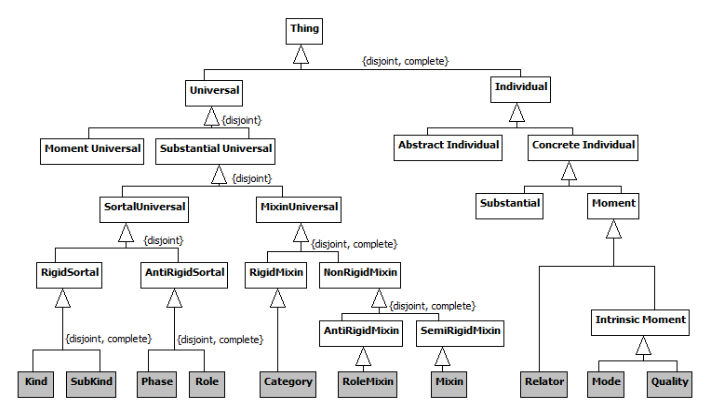

Fonte: GUIZZARDI, 2005

Um dos conceitos centrais da UFO-A é a distinção entre tipos que fornecem identidade e tipos que apenas classificam uma entidade em determinado contexto. Essa distinção é essencial para a modelagem conceitual, pois permite compreender que nem todo conceito atribuído a uma entidade define aquilo que ela é. Alguns conceitos indicam apenas papéis temporários ou classificações contextuais. No domínio jurídico, essa diferença pode ser observada na distinção entre “Pessoa” e “Autor”. Uma pessoa é uma entidade que possui identidade própria, independentemente de participar ou não de um processo judicial. Já “Autor” é um papel exercido por uma pessoa ou organização quando ocupa o polo ativo de uma demanda judicial. Assim, a pessoa não deixa de ser pessoa quando o processo termina, mas deixa de exercer o papel de autora naquele contexto específico. O mesmo raciocínio pode ser aplicado aos papéis de réu, advogado, testemunha ou perito.

### 2.2.2 UFO-B

A UFO-B é a parte da Unified Foundational Ontology voltada à representação de eventos, isto é, entidades que ocorrem no tempo. Diferentemente dos objetos, que permanecem ao longo do tempo mantendo sua identidade, os eventos possuem natureza temporal, pois acontecem, desenvolvem-se e se encerram em determinado intervalo. Assim, enquanto uma pessoa, uma organização ou um documento podem ser analisados como entidades que persistem, uma audiência, uma perícia, uma citação ou a prolação de uma sentença devem ser compreendidas como acontecimentos processuais.

No contexto da modelagem conceitual, a distinção entre objetos e eventos é relevante porque permite representar adequadamente a dinâmica dos domínios analisados. Em muitos modelos, atos, atividades e acontecimentos são tratados como simples objetos ou registros, o que pode gerar perda de significado. A UFO-B contribui para evitar esse problema ao permitir que ocorrências temporais sejam modeladas como eventos, evidenciando sua relação com o tempo, com os participantes envolvidos e com os efeitos que produzem no domínio (GUIZZARDI et al., 2013; GUIZZARDI et al., 2015).

Figura 2 – Taxonomia de UFO-B.

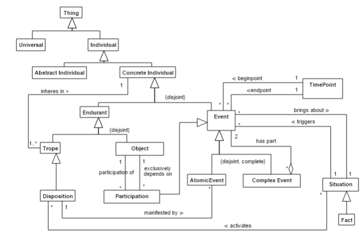

Fonte: GUIZZARDI et al., 2013

A representação de eventos também é relevante porque os atos processuais possuem relação direta com prazos, fases e consequências jurídicas. O ajuizamento, a apresentação de contestação, a tentativa de conciliação ou o cumprimento de uma decisão são acontecimentos que podem alterar o andamento do processo. Desse modo, a UFO-B fornece suporte para modelar não apenas quais elementos existem no domínio, mas também como eles se desenvolvem ao longo do tempo.

### 2.2.3 UFO-C

A UFO-C estende as categorias das camadas anteriores para representar aspectos sociais, intencionais e institucionais, incluindo agentes, momentos intencionais, papéis sociais, compromissos e ações comunicativas (GUIZZARDI et al., 2011, 2015). Um estado intencional, como uma intenção, pertence a um agente e tem um conteúdo; não se confunde com a condição jurídica de exercício de um direito. Essa distinção será retomada na análise de Interesse de Agir.

Figura 3 – Fragmento de UFO-C.

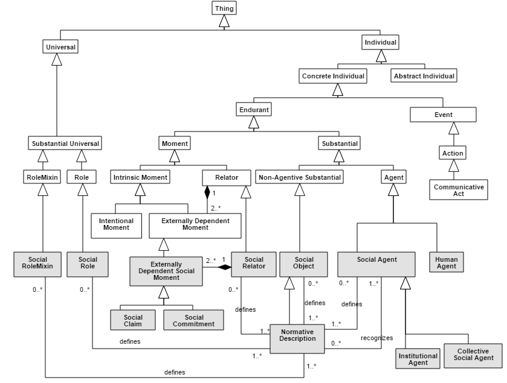

Fonte: Almeida e Guizzardi (2012 apud BECCALLI, 2018, p. 77, Figura 17). A fonte consultada foi a tese de Beccalli.

A noção de agente é central para as relações sociais e institucionais. Pessoas e organizações podem desempenhar papéis juridicamente relevantes sem que esses papéis forneçam novas identidades aos seus portadores (GUIZZARDI et al., 2015; BECCALLI, 2018). Uma pessoa que atua como juíza, por exemplo, não se transforma em uma organização: é preciso distinguir o magistrado, o órgão jurisdicional e o exercício da função de julgar.

A UFO-C também auxilia na compreensão das relações jurídicas e processuais como relações socialmente reconhecidas e normativamente estruturadas. A relação entre autor e réu, por exemplo, não é uma simples associação entre duas entidades, mas uma relação processual gerada a partir de uma demanda judicial. Essa relação envolve direitos, deveres, poderes, faculdades e ônus processuais que decorrem do ordenamento jurídico e dos atos praticados no processo.

## 2.3 Ontologia núcleo UFO-L

A UFO-L é uma ontologia núcleo de aspectos jurídicos, desenvolvida por Beccalli (2018) com base na UFO. Sua construção parte da perspectiva das relações jurídicas, articulando agentes, papéis, posições jurídicas e relações reificadas. Esse nível intermediário permite reutilizar estruturas jurídicas gerais na construção de ontologias de domínio sem pretender que todos os conceitos do Direito tenham sido esgotados.

Figura 4 – Padrão de modelagem para Legal Relator.

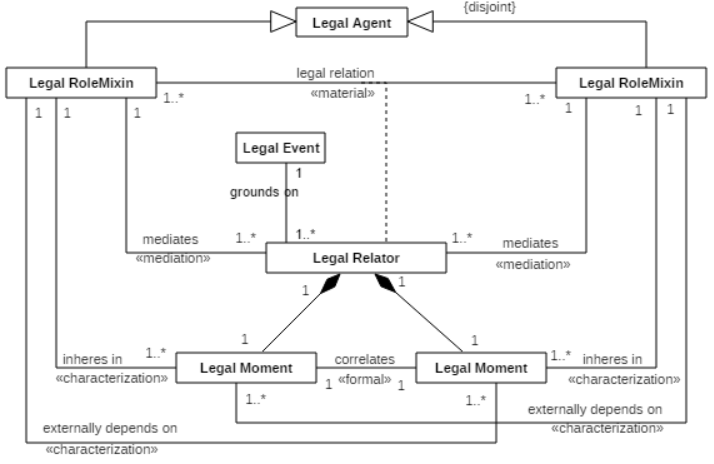

Fonte: Beccalli (2018, p. 135, Figura 33).

A ontologia introduz categorias próprias do domínio jurídico, entre elas Legal Agent, Legal Role, Legal RoleMixin, Legal Moment, Legal Relator e Legal Event. Na UFO-L, os Legal Agents são agentes que podem ocupar posições em relações jurídicas e carregar Legal Moments. Esses momentos representam posições jurídicas, como direitos, deveres, permissões, poderes e sujeições. As relações entre os agentes podem ser reificadas por meio de Legal Relators, que são compostos por momentos jurídicos externamente dependentes.

As posições jurídicas não são tratadas isoladamente. Na acepção específica de Right adotada pela UFO-L, o direito de exigir uma ação ou omissão corresponde a um Duty de outro agente. Essa correlação não deve ser generalizada indistintamente a todas as posições chamadas de “direitos” na linguagem comum: poder e sujeição, por exemplo, formam outro par. As posições correlatas são partes de um Legal Relator e dependem tanto de seus portadores quanto, externamente, dos agentes correlatos (BECCALLI, 2018, p. 112–118).

A UFO-L também distingue Legal Norm, o significado normativo, de Legal Normative Description, o enunciado ou texto que o expressa. Rule e Principle são espécies de norma, e não tipos de arquivo ou de documento legislativo. Essa separação evita confundir a regra aplicada a um caso com a página ou o documento em que sua formulação é encontrada (BECCALLI, 2018, p. 105–108).

No contexto deste trabalho, a UFO-L fornece conceitos jurídicos de nível intermediário que podem ser reutilizados na construção da ontologia do Juizado Especial Federal. Dessa forma, conceitos específicos do domínio processual podem ser modelados a partir de categorias mais gerais da ontologia núcleo, permitindo representar agentes, papéis jurídicos, relações, posições jurídicas e eventos processuais de maneira fundamentada e semanticamente consistente.

## 2.4 Engenharia de Ontologias

A Engenharia de Ontologias compreende o conjunto de métodos, técnicas e atividades utilizados para apoiar a construção sistemática de ontologias. Seu processo envolve não apenas a identificação e a representação dos conceitos de um domínio, mas também a definição do propósito e do escopo da ontologia, a aquisição do conhecimento, a especificação de requisitos, a modelagem conceitual, a documentação e a avaliação do modelo produzido. Dessa forma, busca-se reduzir ambiguidades e favorecer a construção de representações mais claras, consistentes e reutilizáveis do conhecimento (FALBO, 2014). O desenvolvimento de uma ontologia também pode envolver diferentes recursos metodológicos e tecnológicos, cada um desempenhando uma função específica durante o processo de construção.

### 2.4.1 SABiO

A construção de ontologias exige o uso de metodologias para orientar o processo de desenvolvimento, desde a identificação do domínio até a avaliação do modelo produzido. Nesse contexto, destaca-se a SABiO, sigla para _Systematic Approach for Building Ontologies_ , proposta por Falbo (2014), que consiste em uma abordagem sistemática para a construção de ontologias de domínio. A SABiO foi desenvolvida com o objetivo de apoiar o processo de engenharia de ontologias, fornecendo atividades, papéis, artefatos e processos de apoio para a elaboração de modelos ontológicos mais consistentes e reutilizáveis.

Segundo Falbo (2014), as ontologias podem ser distinguidas em ontologias de referência e ontologias operacionais. As ontologias de referência são voltadas à representação conceitual do domínio, tendo como principal objetivo descrever, com clareza e precisão, os conceitos e relações existentes em determinada área de conhecimento. Já as ontologias operacionais são voltadas ao uso computacional, sendo implementadas em linguagens computacionais, como OWL. Essa distinção é relevante porque permite separar a fase de compreensão e modelagem conceitual do domínio da fase de implementação da ontologia.

Figura 5 – Metodologia SABiO.

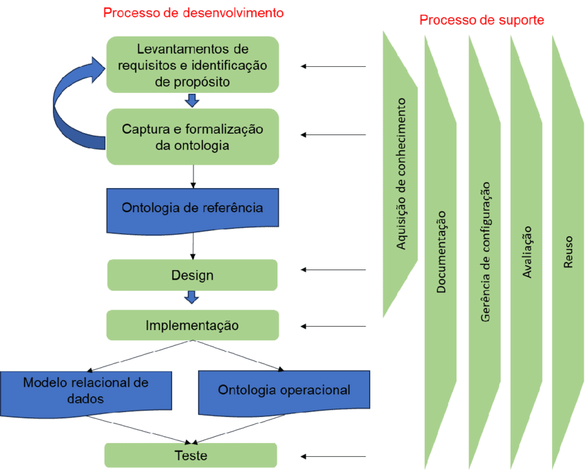

Fonte: FALBO, 2014

A primeira etapa proposta pela SABiO consiste na identificação do propósito da ontologia e no levantamento de requisitos. Nessa fase, são definidos o objetivo da ontologia, seus possíveis usos e as questões que ela deverá ser capaz de responder. Essas questões são denominadas perguntas de competência e funcionam como requisitos funcionais da ontologia, pois delimitam quais conhecimentos devem ser representados no modelo (FALBO, 2014). No caso deste trabalho, exemplos de perguntas de competência seriam: Qual é o tipo da ação proposta? Existe requerimento de tutela provisória? O réu apresentou contestação? Qual foi o resultado da sentença? Em que fase está meu processo?

Após a definição dos requisitos, a SABiO propõe a captura e a formalização da ontologia. Essa etapa envolve a identificação dos conceitos relevantes do domínio, suas propriedades, relações e restrições. Para isso, o conhecimento pode ser obtido a partir de especialistas do domínio, materiais bibliográficos, normas, documentos técnicos, modelos de referência e demais fontes consolidadas de conhecimento.

A SABiO também recomenda que a modelagem conceitual seja orientada por uma ontologia de fundamentação. Nesse sentido, Falbo (2014) destaca a possibilidade de utilização da OntoUML como linguagem de modelagem para ontologias de referência, uma vez que ela incorpora representações ontológicas da Unified Foundational Ontology (UFO). Essa orientação é compatível com a proposta deste trabalho, que utiliza conceitos da UFO-L e da OntoUML para representar o domínio jurídico.

Outro ponto relevante da SABiO é a possibilidade de modularização da ontologia. Em domínios complexos, como o jurídico, a repartição em módulos ou subontologias pode facilitar o desenvolvimento, a manutenção e a reutilização do modelo. No caso do Juizado Especial Federal Cível, a ontologia pode ser organizada em módulos relacionados, por exemplo, aos sujeitos processuais, à demanda judicial, às competências e aos procedimentos. Essa divisão contribui para reduzir a complexidade da modelagem e permite que cada parte do domínio seja analisada de maneira mais clara.

Além das atividades principais de desenvolvimento, a SABiO também recomenda processos de apoio, como aquisição de conhecimento, documentação, gerenciamento de configuração,  avaliação e reuso. A documentação é especialmente importante para registrar as decisões tomadas durante a modelagem, os conceitos definidos e as relações. Já a avaliação busca verificar se a ontologia atende ao propósito para o qual foi construída, se responde às perguntas de competência e se apresenta clareza, coerência e consistência conceitual.

Dessa forma, a SABiO contribui diretamente para o desenvolvimento deste trabalho, pois oferece um caminho metodológico adequado para a construção da ontologia proposta. Neste trabalho, são contempladas as atividades relacionadas à construção de uma ontologia de referência: identificação de requisitos, definição de perguntas de competência, captura do conhecimento, modelagem conceitual, modularização e avaliação da ontologia. Essa abordagem permite que o modelo seja desenvolvido de forma mais sistemática e alinhada aos objetivos da pesquisa.

### 2.4.2 OntoUML

A OntoUML é uma linguagem de modelagem conceitual fundamentada na Unified Foundational Ontology (UFO), desenvolvida a partir dos estudos de Guizzardi (2005). Ela permite explicitar distinções ontológicas entre tipos essenciais, papéis, fases, propriedades e relações, em vez de representar todas as classes e associações como elementos de mesma natureza.

A principal diferença entre a UML tradicional e a OntoUML está no uso de estereótipos ontológicos. Enquanto a UML permite representar classes, atributos, associações e generalizações, a OntoUML permite indicar se determinado conceito corresponde, por exemplo, a um tipo que fornece identidade, a um papel contextual, a uma fase, a uma propriedade, a uma categoria ou a uma entidade relacional. Desse modo, a linguagem não apenas representa os conceitos de um domínio, mas também explicita o tipo de entidade que cada conceito representa.

Quadro 1 – Estereótipos de classes da linguagem OntoUML.

| Estereótipo   | Interpretação                                                                                                                                                               |
| -------------- | ----------------------------------------------------------------------------------------------------------------------------------------------------------------------------- |
| `kind`       | Tipo rígido que fornece princípio de identidade aos indivíduos classificados.                                                                                              |
| `subkind`    | Especialização rígida que herda o princípio de identidade fornecido por seu tipo de identidade, em vez de fornecer um novo princípio.                                    |
| `role`       | Tipo sortal antirrígido e relacionalmente dependente; classifica o indivíduo no contexto de uma relação.                                                                  |
| `phase`      | Tipo sortal antirrígido cuja classificação depende de condições intrínsecas do indivíduo. Não equivale, por si só, a uma etapa de um fluxo.                          |
| `mode`       | Propriedade particularizada intrínseca, dependente de um portador; pode apresentar dependência externa adicional.                                                           |
| `quality`    | Propriedade particularizada cujo valor pode ser associado a um espaço de qualidades, como uma dimensão monetária. A propriedade não é o próprio número que a expressa. |
| `category`   | Tipo não sortal rígido que reúne indivíduos com diferentes princípios de identidade.                                                                                     |
| `mixin`      | Tipo não sortal semirrígido, essencial para algumas instâncias e contingente para outras.                                                                                  |
| `roleMixin`  | Tipo não sortal antirrígido e relacionalmente dependente que reúne papéis de indivíduos com diferentes princípios de identidade.                                        |
| `collective` | Tipo de identidade para coletivos, considerados segundo um critério de unidade de seus membros.                                                                              |
| `quantity`   | Tipo de identidade para porções de matéria ou quantidades, como água ou areia.                                                                                            |
| `relator`    | Entidade relacional particularizada que fundamenta uma relação material entre os indivíduos mediados.                                                                      |
| `event`      | Ocorrência que se desenvolve no tempo, podendo envolver participantes e produzir situações.                                                                                |
| `situation`  | Configuração de entidades e propriedades que pode resultar de eventos ou constituir condição para sua ocorrência.                                                        |
| `intention`  | Momento intencional de um agente, dirigido a um conteúdo ou objetivo; não representa automaticamente um direito ou requisito processual.                                    |

Fonte: síntese com base em Guizzardi (2005), Guizzardi et al. (2013, 2015) e Beccalli (2018). As categorias de eventos, situações e intenções complementam o fragmento estrutural original da OntoUML.

O Quadro 1 sintetiza as distinções empregadas na leitura do modelo. A escolha de um estereótipo exige justificativa conceitual e respeito às restrições da linguagem; utilizar seus rótulos não demonstra, por si só, a correção da modelagem. Os padrões jurídicos da UFO-L também não são intercambiáveis com estereótipos básicos como `role` e `relator`.

Quadro 2 – Estereótipos de Relacionamentos da linguagem OntoUML.

| Relação                     | Interpretação                                                                                                                                         |
| ----------------------------- | ------------------------------------------------------------------------------------------------------------------------------------------------------- |
| `mediation`                 | Vincula um relator aos indivíduos mediados. As mediações devem explicitar o contexto que fundamenta os papéis.                                      |
| `material`                  | Relação material fundamentada por um relator.                                                                                                         |
| `derivation`                | Indica o relator do qual uma relação material é derivada.                                                                                            |
| `characterization`          | Relaciona uma propriedade intrínseca particularizada ao seu portador.                                                                                  |
| `formal`                    | Relação que não exige um relator como fundamento, como determinadas comparações entre propriedades.                                                |
| `componentOf`               | Relação todo-parte de composição funcional.                                                                                                         |
| `memberOf`                  | Relaciona um membro a um coletivo.                                                                                                                      |
| `subCollectionOf`           | Relaciona um subcoletivo ao coletivo mais abrangente.                                                                                                   |
| `participation`             | Relaciona um endurante à ocorrência de um evento do qual participa.                                                                                   |
| `creation`                  | Indica a criação de uma entidade pela ocorrência de um evento.                                                                                       |
| `brings about` / “leva a” | Relaciona um evento à situação resultante.                                                                                                           |
| `triggers`                  | Relaciona uma situação ao evento que ela desencadeia. Não deve ser utilizada como simples ligação genérica entre dois eventos.                    |
| `historicalDependence`      | Registra a dependência histórica entre uma ocorrência e uma ocorrência antecedente; não especifica sozinha todas as regras de um fluxo processual. |

Fonte: síntese com base em Guizzardi (2005) e Guizzardi et al. (2013, 2015). Os rótulos “possui”, “regula” e “impõe”, usados nos diagramas, são associações do domínio e não adquirem automaticamente a semântica de um desses estereótipos.

Essa distinção entre tipos, papéis e relações é relevante para a modelagem jurídica. Beccalli (2018) destaca a representação das relações jurídicas e das posições de seus agentes. A fundamentação permite distinguir uma pessoa ou organização dos papéis exercidos em uma relação, bem como o vínculo jurídico das posições de direito, dever, poder ou sujeição que o compõem. Para aproveitar essa contribuição, é preciso documentar quais padrões foram efetivamente utilizados e quais dependências ainda não aparecem no modelo.

A utilização da OntoUML também se relaciona ao método de desenvolvimento de ontologias adotado neste trabalho. Falbo (2014), ao propor a SABiO, diferencia ontologias de referência e ontologias operacionais, indicando que as ontologias de referência possuem foco na representação conceitual do domínio. Nesse sentido, a OntoUML é adequada para a construção da ontologia proposta, pois permite elaborar um modelo conceitual independente de uma implementação computacional específica, servindo como base para posteriores transformações em ontologias operacionais ou sistemas de apoio jurídico.

### 2.4.3 Visual Paradigm e o plugin OntoUML

Para a construção gráfica de modelos conceituais em OntoUML, podem ser utilizadas ferramentas de modelagem que ofereçam suporte aos elementos específicos da linguagem. Entre elas está o Visual Paradigm, ambiente voltado à criação de modelos e diagramas, que pode ser estendido por meio do plugin OntoUML, possibilitando a elaboração de modelos conceituais ontologicamente fundamentados.

O plugin OntoUML acrescenta ao Visual Paradigm recursos próprios da linguagem, permitindo aplicar às classes e relações os estereótipos apresentados nos Quadros 1 e 2, como kind, role, relator e mode. Além disso, oferece mecanismos de apoio à modelagem, como sugestões de estereótipos e verificação do modelo segundo as regras da OntoUML. A Figura 6 exemplifica a representação desses elementos e de suas relações no ambiente de modelagem.

Figura 6 – Exemplo de modelagem OntoUML no Visual Paradigm.

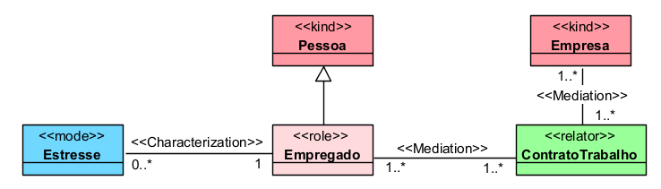

Fonte: Elaborado pelo autor (2026).

A utilização do ambiente e do plugin como apoio à edição não demonstra que a ontologia tenha sido formalmente verificada. O uso do plugin em ontologias jurídicas é relatado, por exemplo, em Zorzanelli Costa et al. (2023), mas os resultados de verificação daquele trabalho não são transferidos para esta proposta. A versão do Visual Paradigm, a versão do plugin e eventuais relatórios de análise do projeto precisam ser registrados para reprodução do procedimento.

## 2.5 Juizado Especial Federal Cível

O Juizado Especial Federal Cível integra a Justiça Federal e tem competência definida pela Lei nº 10.259/2001. Essa disciplina não se confunde com a dos Juizados Especiais Cíveis estaduais: a Lei nº 9.099/1995 é aplicável ao JEF apenas no que não conflitar com a lei específica. A motivação de simplificação do acesso deve ser compreendida junto aos critérios legais de competência, de admissão das partes e de procedimento, sem restringir o acesso aos Juizados exclusivamente às pessoas economicamente vulneráveis (BRASIL, 2001, arts. 1º, 3º e 6º; RIBEIRO; SANZOVO, 2011).

### 2.5.1 Competência, partes e representação

O art. 3º da Lei nº 10.259/2001 atribui ao JEF Cível o processamento, a conciliação, o julgamento e a execução de suas sentenças em causas de competência da Justiça Federal de até sessenta salários mínimos. O valor, isoladamente, não decide o cabimento. O § 1º contém exclusões materiais, entre elas o mandado de segurança; o § 2º disciplina as obrigações vincendas; e o § 3º estabelece competência absoluta no foro em que estiver instalada Vara do Juizado Especial. A análise deve, portanto, considerar matéria, partes, dimensão econômica e demais condições aplicáveis ao caso (BRASIL, 2001).

Conforme o art. 6º, podem ser autores pessoas físicas, microempresas e empresas de pequeno porte; no polo passivo, a lei indica União, autarquias, fundações e empresas públicas federais. Um órgão integrante de uma entidade não se confunde com essa pessoa jurídica. Por exemplo, identificar o órgão administrativo que praticou um ato não basta para concluir qual entidade tem legitimidade para figurar como ré. Essa distinção é importante para as QCs sobre participantes, cabimento e polo passivo.

O art. 10 permite a designação, por escrito, de representante para a causa, advogado ou não, no contexto cível e nas hipóteses admitidas. Essa previsão deve ser distinguida da representação técnica obrigatória em grau recursal, prevista no art. 41, § 2º, da Lei nº 9.099/1995. Tampouco se deve transpor automaticamente para o JEF o limite de vinte salários mínimos do art. 9º da lei dos Juizados estaduais. A ontologia precisa separar a existência de um representante, sua habilitação e as condições normativas que tornam sua atuação necessária (BRASIL, 2001; BRASIL, 1995).

### 2.5.2 Demanda, defesa e prova

O pedido apresentado ao Juizado deve identificar as partes, os fatos e fundamentos, o objeto e seu valor, admitida apresentação oral reduzida a escrito pela Secretaria (BRASIL, 1995, art. 14). No modelo, Demanda designa o conteúdo articulado a partir de causa de pedir e pedidos, enquanto Documento de Petição Inicial designa seu registro documental. O ato de peticionar é distinto de ambos. A representação de uma petição escrita elaborada por representante é um recorte possível, não a única via juridicamente admissível de acesso ao JEF.

A defesa pode ser oral ou escrita, conforme o art. 30 da Lei nº 9.099/1995. A entidade pública ré deve fornecer a documentação de que disponha para esclarecimento da causa, e a Lei nº 10.259/2001 prevê exame técnico quando necessário à conciliação ou ao julgamento (arts. 11 e 12). Não se extrai dessas regras uma obrigação de produzir todas as modalidades de prova em todos os processos. A escolha dos meios e a avaliação de sua necessidade dependem das questões controvertidas e da apreciação judicial.

É necessário, ainda, distinguir interesse de agir de vontade subjetiva de ajuizar uma ação. O art. 17 do CPC exige interesse e legitimidade para postular em juízo. Um requerimento administrativo e sua resposta podem ser relevantes para demonstrar a necessidade da tutela em determinadas hipóteses, mas não autorizam afirmar que toda causa exige prévio requerimento ou esgotamento da via administrativa. A aplicação dessa exigência a matérias específicas demanda exame normativo e jurisprudencial próprio, não desenvolvido integralmente neste trabalho (BRASIL, 1988, art. 5º, XXXV; BRASIL, 2015, art. 17).

### 2.5.3 Conciliação, decisão, recursos e cumprimento

A conciliação é incentivada pelo rito, e os representantes indicados no art. 10 da Lei nº 10.259/2001 têm autorização legal para conciliar, transigir ou desistir, nos termos desse dispositivo. O consenso das partes, sua formalização e a homologação judicial são elementos distintos; a obtenção de conciliação é reduzida a escrito e homologada por sentença com eficácia executiva (BRASIL, 1995, art. 22, § 1º). Registrar um acordo ocorrido não equivale a formalizar todas as condições de validade de qualquer acordo.

O recurso inominado permite a impugnação de sentenças nas hipóteses legais. O art. 41 da Lei nº 9.099/1995 excepciona a sentença homologatória de conciliação ou de laudo arbitral. Seu art. 42 prevê prazo de dez dias a partir da ciência da sentença; o art. 12-A determina contagem em dias úteis, e o art. 50 estabelece a interrupção do prazo pela oposição de embargos de declaração. Esses elementos não se reduzem ao armazenamento de um número: um cálculo concreto exige ciência válida, calendário e análise de causas de interrupção ou suspensão. O modelo representa principalmente o recurso inominado, não o sistema completo de impugnações, uniformização e recurso extraordinário (BRASIL, 1995; BRASIL, 2001, arts. 5º, 14 e 15).

O cumprimento também depende da natureza da prestação. O art. 16 da Lei nº 10.259/2001 trata das obrigações de fazer, não fazer e entregar coisa certa após o trânsito em julgado, mediante ofício. O art. 17 disciplina o pagamento de quantia certa e suas condições, incluindo a requisição e as hipóteses de precatório. Não se deve confundir o limite de competência com o valor final do crédito ou supor que toda condenação será paga por RPV. Neste trabalho, essas regras fundamentam o recorte conceitual, mas o procedimento de requisição e pagamento não foi modelado integralmente (BRASIL, 2001).

## 2.6 Trabalhos relacionados e posição da proposta

Beccalli (2018) oferece, com a UFO-L, estruturas gerais para analisar relações e posições jurídicas. Trata-se de contribuição de núcleo: sua finalidade não é descrever, por si só, o procedimento completo do JEF Cível. Neste trabalho, ela fundamenta a análise de agentes, papéis, relações, normas e posições correlatas, cujo modo de adaptação é documentado na Seção 3.5.

Zorzanelli Costa, Guizzardi e Almeida (2022) estudam o Pedido de Uniformização de Interpretação de Lei Federal combinando uma perspectiva estrutural em OntoUML e uma perspectiva comportamental em BPMN. O trabalho também relaciona elementos dos modelos a fragmentos normativos identificados com LexML. A contribuição mostra que modelar entidades e representar o encadeamento de atividades são tarefas complementares, e que a rastreabilidade normativa não deve depender apenas da semelhança entre os nomes de classes e os termos da lei.

Zorzanelli Costa et al. (2023) utilizam e estendem a OntoRS, implementam uma versão operacional em OWL com base em gUFO e a empregam na representação de dados extraídos de decisões da TNU. São relatadas consultas SPARQL e avaliação com raciocinador na implementação daquele trabalho. Esses resultados não podem ser atribuídos à ontologia aqui proposta, que permanece no nível de referência e emprega dados fictícios na avaliação.

A proposta desta monografia diferencia-se pelo recorte do percurso de uma demanda no JEF Cível, incluindo análise pré-processual, sujeitos, defesa, instrução, sentença, recurso inominado e cumprimento. Esse escopo é mais amplo quanto às etapas do primeiro grau, mas menos detalhado quanto ao Pedido de Uniformização e à operação computacional. Não se afirma ter estendido integralmente a OntoRS nem realizado uma comparação exaustiva de todas as ontologias jurídicas existentes. O resultado é uma adaptação conceitual documentada, cuja avaliação evidencia tanto o suporte aos requisitos quanto os pontos a refinar.

# 3 Aspectos Metodológicos

## 3.1 Abordagem para desenvolvimento da ontologia

O desenvolvimento da ontologia proposta neste trabalho foi conduzido com base na Systematic Approach for Building Ontologies (SABiO), apresentada por Falbo (2014). A abordagem organiza a construção de ontologias por meio de um processo sistemático, envolvendo atividades de desenvolvimento e processos de apoio que acompanham a construção do artefato ontológico. Conforme apresentado no referencial teórico, o processo de desenvolvimento parte do levantamento dos requisitos e da identificação do propósito da ontologia, avança para a captura e formalização do conhecimento e resulta, inicialmente, na construção de uma ontologia de referência.

A SABiO prevê ainda etapas posteriores relacionadas ao design e à implementação, nas quais a ontologia de referência pode ser transformada em uma representação voltada ao uso computacional, resultando, por exemplo, em uma ontologia operacional. Apoiando as atividades de desenvolvimento, a abordagem oferece processos de apoio, como aquisição de conhecimento, documentação, gerenciamento de configuração, avaliação e reúso. Esses processos não necessariamente ocorrem de maneira isolada ou estritamente sequencial, podendo acompanhar diferentes momentos do desenvolvimento da ontologia. No próprio referencial deste trabalho, esses processos são apresentados como mecanismos de suporte à construção e à avaliação do modelo.

Considerando que o objetivo deste trabalho é desenvolver uma ontologia de referência para o domínio do Juizado Especial Federal Cível, foram adotadas principalmente as atividades da SABiO relacionadas à identificação do propósito e levantamento dos requisitos, aquisição do conhecimento, captura e formalização do domínio, reúso, modelagem conceitual e avaliação. As etapas destinadas ao design e à implementação de uma ontologia operacional não integram o escopo deste trabalho. Nas seções seguintes, são descritas as atividades realizadas durante esse processo, iniciando-se pela definição do propósito e pela delimitação do domínio da ontologia, seguida da aquisição do conhecimento, do levantamento das Questões de Competência e da captura e modelagem dos conceitos identificados.

## 3.2 Propósito e delimitação do domínio

Esta seção corresponde à etapa de levantamento de requisitos e identificação do propósito da ontologia prevista pela SABiO. Nessa etapa são estabelecidos o objetivo do artefato a ser desenvolvido, o domínio que será representado e os limites de seu escopo, de modo a orientar as atividades posteriores de aquisição de conhecimento e modelagem.

A ontologia desenvolvida neste trabalho tem como propósito representar, de forma conceitual e estruturada, o domínio do Juizado Especial Federal Cível, organizando os principais elementos envolvidos no funcionamento e na tramitação de uma demanda judicial nesse contexto. Busca-se explicitar os conceitos e relações existentes entre os participantes do processo, seus papéis, as demandas apresentadas, os atos praticados, as provas produzidas, as decisões proferidas e os mecanismos de impugnação e cumprimento.

A definição do escopo partiu da necessidade de estabelecer um recorte do domínio jurídico que fosse suficientemente abrangente para representar o funcionamento do Juizado Especial Federal Cível, sem pretender modelar todo o Direito Processual Civil ou toda a estrutura da Justiça Federal. Dessa forma, o trabalho concentrou-se no percurso de uma demanda no JEF Cível, desde sua propositura até os possíveis desdobramentos decorrentes da decisão judicial.

Foram considerados no escopo conceitos relacionados aos sujeitos e papéis processuais, ação judicial, competência do Juizado, pedidos, tutela provisória, atos processuais, fases e estados do processo, produção de provas, conciliação, sentença, obrigações decorrentes da decisão, recursos e cumprimento da decisão. Também foram contemplados os órgãos e agentes que participam desses procedimentos, sempre na medida necessária para representar as relações relevantes ao domínio estudado.

Essa delimitação orientou tanto a formulação das Questões de Competência quanto a identificação inicial dos conceitos e relações posteriormente refinados durante a modelagem ontológica. Assim, elementos que não contribuíam diretamente para responder às questões definidas ou que pertenciam a outros ramos e procedimentos da Justiça Federal permaneceram fora do escopo da ontologia.

Não foram modelados integralmente os requisitos materiais dos benefícios, a análise jurisprudencial por espécie de causa, o sistema completo de impugnações, o Pedido de Uniformização, a requisição de pagamento ou as hipóteses de sucessão e incidentes processuais. A identificação desses limites não exclui sua relevância jurídica; delimita o alcance do artefato e das respostas avaliadas.

## 3.3 Aquisição do conhecimento do domínio

Na SABiO, a aquisição de conhecimento é caracterizada como um processo de apoio ao desenvolvimento da ontologia, podendo ocorrer ao longo das diferentes atividades de construção do modelo. Neste trabalho, esse processo teve papel especialmente relevante nas etapas de definição dos requisitos e de captura da ontologia, uma vez que forneceu o conhecimento necessário para a identificação dos conceitos, relações e restrições existentes no domínio do Juizado Especial Federal Cível.

A aquisição do conhecimento foi realizada por pesquisa bibliográfica e análise documental. As fontes centrais do domínio foram a Lei nº 10.259/2001 e a Lei nº 9.099/1995, aplicada no que não conflitar com a lei específica (BRASIL, 2001, art. 1º). A Constituição Federal e o CPC fornecem fundamentos complementares para os conceitos explicitados nesta revisão, especialmente interesse de agir, prova, pronunciamentos judiciais e trânsito em julgado, sempre observada a compatibilidade com o rito especial (BRASIL, 1988, 2015). A data de consulta às fontes eletrônicas é indicada nas referências; a futura operacionalização requer controle de vigência e atualização normativa.

Também foram utilizados trabalhos da literatura jurídica voltados ao funcionamento e às características dos Juizados Especiais Federais, especialmente quanto à competência, aos sujeitos processuais, ao procedimento, aos atos praticados e aos mecanismos de acesso à justiça. Entre esses trabalhos, destaca-se o estudo de Ribeiro e Sanzovo (2011), utilizado como apoio para a compreensão da estrutura e das particularidades do Juizado Especial Federal Cível.

O relato de desenvolvimento informa acompanhamento de especialista do domínio jurídico no refinamento dos conceitos e das relações. Entretanto, os materiais que acompanham esta versão não incluem identificação e perfil do participante, datas, roteiro de revisão, conceitos examinados ou decisões registradas. Por isso, esse acompanhamento não é apresentado como validação integral e reprodutível da ontologia. A documentação da participação deve ser complementada antes de atribuir a qualquer definição a condição de “validada com especialista”.

No âmbito da modelagem, foram utilizadas a UFO e a OntoUML, bem como a UFO-L, apresentada por Beccalli (2018), e a OntoRS, descrita nos trabalhos de Zorzanelli Costa, Guizzardi e Almeida (2022) e Zorzanelli Costa et al. (2023). Essas fontes oferecem categorias e estruturas para a análise conceitual, não substituindo a fundamentação normativa dos termos jurídicos. O Apêndice A distingue fontes de apoio, adaptações do autor e pontos cuja validação com especialista permanece sem registro. Não foi identificado, entre os materiais disponibilizados, um dicionário jurídico com autoria, edição e páginas que permita atribuir-lhe a origem das definições.

## 3.4 Levantamento dos requisitos

O levantamento dos requisitos integra a etapa de identificação do propósito e dos requisitos da ontologia prevista pela SABiO. Enquanto a delimitação apresentada na Seção 3.2 estabeleceu o domínio e os limites da ontologia, nesta etapa buscou-se determinar quais conhecimentos deveriam ser contemplados pelo modelo para que ele atendesse ao propósito definido.

Os requisitos funcionais da ontologia foram expressos por meio de Questões de Competência (QCs), formuladas em linguagem natural. Essas questões especificam o conhecimento que a ontologia deve ser capaz de representar e servem como orientação para a identificação dos conceitos, relações e módulos necessários ao modelo. Além de orientar a captura e a modelagem do domínio, as QCs também fornecem uma referência para a posterior avaliação da ontologia, permitindo verificar se o modelo construído contempla os elementos necessários para responder às questões inicialmente estabelecidas.

As Questões de Competência foram organizadas em sete grupos: sujeitos processuais; ação judicial; procedimento; provas; sentença e cumprimento; recursos; e questões voltadas ao cidadão. A lista completa, com identificadores QC1 a QC38, é apresentada na Seção 4.1. Algumas questões combinam um aspecto descritivo e um aspecto normativo, como identificar se há representante e determinar se ele é obrigatório. A avaliação conserva a formulação original e examina essas partes separadamente, evitando considerar uma questão integralmente atendida quando apenas um de seus componentes está representado.

Além das questões destinadas à representação conceitual do processo, foram formuladas questões sob a perspectiva do cidadão que utiliza o Juizado Especial Federal, considerando que um dos objetivos do trabalho é contribuir para uma representação do domínio que também possa apoiar, futuramente, sistemas voltados ao acesso e à compreensão da informação jurídica.

As QCs orientaram a identificação e o refinamento dos conceitos e foram retomadas na avaliação para localizar o suporte às respostas esperadas. Como diretrizes de qualidade, adotaram-se clareza das definições, rastreabilidade das fontes, preservação de identidade, legibilidade dos módulos e distinção entre descrição de fatos e condições normativas. Essas diretrizes orientam a revisão, mas sua menção não demonstra que tenham sido integralmente satisfeitas. Compreensibilidade para cidadãos e desempenho computacional não foram medidos.

## 3.5 Reúso de ontologias

O reúso é um processo de apoio da SABiO e pode envolver especialização, adaptação e analogia com estruturas de ontologias existentes (FALBO, 2014). Nesta proposta, é necessário distinguir três níveis: a fundamentação nas categorias da UFO; a adaptação dos padrões jurídicos da UFO-L; e o aproveitamento seletivo de conceitos da OntoRS. O reúso realizado é conceitual: não se documenta uma importação automática de módulos, IRIs ou axiomas de uma ontologia operacional.

A distinção entre Legal Role e Legal RoleMixin orientou a análise dos participantes. Participante Processual, Parte Processual e Demandante foram representados como `roleMixin` por reunirem papéis de pessoas e organizações, enquanto Representante Processual, Testemunha, Perito e Conciliador foram representados como `role` de Pessoa. Demandado foi representado como `role` de Organização Federal. Essa correspondência expressa uma intenção de alinhamento com a UFO-L; o simples uso dos estereótipos da OntoUML não comprova todas as dependências e posições jurídicas exigidas pelo núcleo (BECCALLI, 2018, Seções 5.5 e 5.6).

A concepção de Legal Relator orientou a reificação de vínculos como Relação Jurídico-Processual, Representação Processual, Obrigação Judicial e Acordo Processual. No padrão da UFO-L, não basta um vínculo receber o estereótipo `relator`: devem ser identificados agentes mediados, momentos jurídicos correlatos, suas dependências externas e o evento ou fundamento jurídico da relação. O diagrama de Sentença explicita Direito à Prestação e Dever de Prestação como partes de Obrigação Judicial, aproximando-se desse padrão. Nos demais vínculos, o detalhamento dessas posições não está completo; Competência Jurisdicional e Relação Recursal, em particular, exigem revisão de sua interpretação e de seus participantes antes de serem tratadas como especializações integrais de Legal Relator.

Right e Duty fundamentam conceitualmente Direito à Prestação e Dever de Prestação. Legal Power é referência para Poder Jurisdicional, mas a posição correlata de sujeição não está explicitada no diagrama. Legal Norm e Rule orientam Norma Jurídica, Regra Jurídica, Regra de Competência e Regra de Prazo Recursal. A distinção entre norma e descrição normativa discutida no Capítulo 2 ainda precisa ser detalhada no modelo, assim como o conteúdo das regras aplicadas. Assim, essas correspondências são adaptações parciais, não equivalências formalmente demonstradas (BECCALLI, 2018, Seções 5.3, 5.7 e 5.9).

A OntoRS foi selecionada pela proximidade com o domínio dos Juizados Especiais Federais e do Pedido de Uniformização. Judicial Process foi referência para Processo Judicial Federal, entendido aqui como relação reificada e não como sequência de eventos. Petition foi referência para Petição, também tratada como relação e distinguida do Documento de Petição Inicial. Party foi referência para Parte Processual, adaptada aos polos e sujeitos previstos no recorte do JEF Cível. A fonte imediata é Zorzanelli Costa et al. (2023, Seção 3, Figura 1), em continuidade ao estudo de 2022. A figura de origem representa decisões como eventos; aqui, Julgamento e Julgamento do Recurso são eventos, enquanto Sentença e Acórdão designam documentos. Essa opção é uma adaptação explícita, não uma transposição de todos os conceitos ou de suas naturezas ontológicas. Não se presume equivalência formal entre os pares mapeados.

O reúso não foi integral. A OntoRS detalha o Pedido de Uniformização e a atuação da TNU; esta proposta representa principalmente outros momentos do percurso processual. Foram construídas estruturas próprias para análise de cabimento, estados do procedimento, produção e avaliação de provas e cumprimento. “Próprias” significa desenvolvidas para o recorte deste trabalho, não demonstração de que tais estruturas sejam inéditas em toda a literatura. A verificação do reúso deve considerar as fontes, a interpretação preservada, as adaptações e as lacunas indicadas no Quadro 3.

Quadro 3 – Mapeamento do reúso conceitual.

| Fonte e localização                                          | Conceito ou padrão de origem                        | Correspondência na proposta                                                                         | Modalidade e limite                                                                                                    |
| -------------------------------------------------------------- | ---------------------------------------------------- | ---------------------------------------------------------------------------------------------------- | ---------------------------------------------------------------------------------------------------------------------- |
| UFO / OntoUML: Guizzardi (2005); Guizzardi et al. (2013, 2015) | Identidade, papéis, relators, eventos e situações | Pessoa, Organização, participantes, vínculos, atos e situações processuais                      | Fundamentação conceitual; não equivale a aprovação automática das restrições da linguagem.                     |
| UFO-L: Beccalli (2018), Seção 5.5                            | Legal Role                                           | Demandado, Representante Processual, Testemunha, Perito, Conciliador e papéis específicos de autor | Adaptação dos papéis jurídicos; faltam explicitações uniformes de seus vínculos e posições.                   |
| UFO-L: Beccalli (2018), Seção 5.6                            | Legal RoleMixin                                      | Participante Processual, Parte Processual e Demandante                                               | Adaptação de categorias de papéis de diferentes tipos de agentes.                                                   |
| UFO-L: Beccalli (2018), Seções 5.7–5.9 e Figura 33          | Legal Relator e posições correlatas                | Obrigação Judicial, Direito à Prestação e Dever de Prestação                                  | Reúso parcial do padrão direito–dever; explicitar correlação e dependência externa.                              |
| UFO-L: Beccalli (2018), Capítulos 5 e 6                       | Legal Relator                                        | Relação Jurídico-Processual, Representação Processual e Acordo Processual                       | Analogia com o padrão; os momentos jurídicos não estão detalhados em todos os vínculos.                           |
| UFO-L: Beccalli (2018), Seção 5.7.4                          | Legal Power / Legal Subjection                       | Poder Jurisdicional e sua relação com a competência                                               | Alinhamento parcial; a sujeição correlata e a distinção entre poder e competência precisam ser explicitadas.      |
| UFO-L: Beccalli (2018), Seção 5.3                            | Legal Norm / Rule                                    | Norma Jurídica, Regra Jurídica, Regra de Competência e Regra de Prazo Recursal                    | Adaptação; a descrição normativa e as condições de aplicação não estão integralmente representadas.          |
| OntoRS: Zorzanelli Costa et al. (2023), Seção 3, Figura 1    | Judicial Process                                     | Processo Judicial Federal                                                                            | Adaptação ao processo no JEF Cível, mantendo a interpretação relacional e separando a tramitação como eventos.  |
| OntoRS: Zorzanelli Costa et al. (2023), Seção 3, Figura 1    | Petition                                             | Petição                                                                                            | Adaptação do relator; o documento é representado separadamente. Não impõe representante a toda petição inicial. |
| OntoRS: Zorzanelli Costa et al. (2023), Seções 3 e 5         | Party                                                | Parte Processual                                                                                     | Adaptação às partes do JEF; não se afirma equivalência formal com toda a categoria da OntoRS.                     |

Fonte: Elaborado pelo autor (2026).

## 3.6 Captura e modelagem da ontologia

Esta etapa corresponde à captura e formalização da ontologia prevista pela SABiO. A partir das Questões de Competência e do conhecimento adquirido nas fontes do domínio, foram identificados os principais conceitos e relações necessários à representação do Juizado Especial Federal Cível. O levantamento inicial serviu como ponto de partida para a construção do modelo, sendo posteriormente refinado à medida que os conceitos eram analisados sob uma perspectiva ontológica.

Durante esse processo, buscou-se não apenas identificar os elementos presentes no domínio jurídico, mas também compreender a natureza ontológica de cada um deles. Assim, foi necessário distinguir, por exemplo, entidades que possuem identidade própria, papéis assumidos pelos participantes do processo, relações que vinculam esses participantes, eventos que ocorrem durante a tramitação e situações resultantes desses eventos. A UFO forneceu a fundamentação para essas distinções, enquanto a UFO-L auxiliou na representação dos aspectos especificamente jurídicos e a OntoUML foi utilizada como linguagem para expressar graficamente o modelo conceitual.

A modelagem foi realizada de forma iterativa e incremental. Os conceitos inicialmente identificados foram progressivamente revistos, especializados ou reorganizados conforme novas relações eram identificadas e as Questões de Competência eram avaliadas com o modelo. Dessa forma, a construção dos diagramas não consistiu apenas na transcrição dos termos encontrados na legislação ou na literatura; foi um processo de análise e refinamento conceitual focado no aprofundamento da compreensão das entidades e relações relevantes para o domínio.

Esse refinamento é importante, por exemplo, para diferenciar os participantes e papéis processuais na representação de relações jurídico-processuais por meio de relators e na distinção entre atos processuais, modelados como eventos, e as situações produzidas por esses atos. Também foram representados elementos como documentos, normas, pedidos, posições jurídicas, obrigações e poderes, conforme sua natureza e sua função dentro do processo judicial.

À medida que a modelagem avançou, o número de conceitos e relações tornou inadequada sua representação em um único diagrama. Para preservar a legibilidade e facilitar a compreensão do modelo, a ontologia foi organizada em módulos conceituais inter-relacionados, cada um concentrado em determinado aspecto do domínio. Essa modularização também permitiu relacionar os diferentes grupos de Questões de Competência às partes correspondentes da ontologia e é apresentada na seção seguinte.

## 3.7 Modularização da ontologia

Durante o processo de modelagem, verificou-se que a representação de todos os conceitos e relações do Juizado Especial Federal Cível em um único diagrama comprometeria a legibilidade e dificultaria a compreensão do modelo. Por esse motivo, a ontologia foi organizada de forma modular, distribuindo os conceitos em diferentes diagramas de acordo com os aspectos do domínio que representam.

A modularização não corresponde à construção de ontologias independentes. Os diagramas são perspectivas de uma mesma proposta e compartilham conceitos como Processo Judicial Federal, Ato Processual, Situação Processual, Participante Processual, Parte Processual e Documento. Na consolidação do projeto, classes com o mesmo significado devem referenciar um único elemento, e não cópias locais semanticamente desconectadas. O diagrama de pacotes explicita dependências de apresentação; não prova, por si só, que todas as ligações entre indivíduos dos diferentes módulos estejam completas.

A organização dos diagramas acompanhou os principais grupos conceituais identificados durante o levantamento das Questões de Competência e o refinamento do domínio. Foram desenvolvidos modelos relacionados aos Representantes; Serventuários; Organizações; Sujeitos e papéis; Demanda, causa e pedidos; Competência do JEF; Instauração e desenvolvimento do procedimento; Contestação; Conciliação; Produção de provas; Análise e Julgamento; Sentença e obrigações decorrentes da decisão; Recursos; e Cumprimento da sentença.

Essa divisão permitiu representar com maior clareza tanto os aspectos estruturais quanto os aspectos dinâmicos do domínio. Enquanto alguns diagramas concentram-se na identificação das entidades, papéis e relações existentes no processo, outros evidenciam eventos processuais e as situações produzidas por esses eventos. Os módulos permanecem semanticamente relacionados e devem ser compreendidos de forma integrada. A separação em diagramas teve, portanto, finalidade principalmente organizacional e de apresentação, permitindo reduzir a complexidade visual sem perder as relações existentes entre os diferentes elementos da ontologia. A organização global desses módulos foi representada por meio de um Diagrama de Pacotes, utilizado para explicitar a divisão da ontologia e as dependências existentes entre suas diferentes partes. Esse diagrama oferece uma visão geral da arquitetura conceitual adotada, enquanto os diagramas de classes apresentam detalhadamente os conceitos e relações pertencentes a cada módulo.

## 3.8 Verificação por rastreabilidade e instanciação simulada

Como parte da verificação da ontologia de referência, foram construídos uma matriz de rastreabilidade das Questões de Competência e um conjunto de instanciações com dados inteiramente fictícios. A matriz relaciona cada questão aos conceitos, às relações e aos diagramas que oferecem suporte à sua resposta. As instanciações, por sua vez, exemplificam a aplicação desses elementos em situações hipotéticas, permitindo examinar a distinção entre entidades, papéis, documentos, eventos e situações processuais. Essa atividade segue a orientação da SABiO de verificar a competência da ontologia por correspondência com os requisitos e de utilizar instanciações como instrumento de avaliação conceitual (FALBO, 2014).

O procedimento compreendeu quatro atividades: identificação dos elementos necessários a cada resposta; localização desses elementos nos diagramas; construção de fragmentos de instâncias e relações para seis cenários; e registro das respostas esperadas, das premissas externas e das lacunas observadas. Foram utilizados identificadores estáveis para permitir o acompanhamento de uma mesma entidade em diferentes relações e recortes do cenário. Uma pessoa e o papel por ela exercido não foram representados como dois indivíduos distintos.

A análise distinguiu o suporte direto à descrição de fatos já informados, o suporte parcial e a ausência de suporte suficiente para a decisão solicitada. Essa distinção é relevante porque algumas questões solicitam a identificação de informações, enquanto outras exigem decidir sobre necessidade, possibilidade ou obrigatoriedade jurídica. A existência de uma classe que registra um acontecimento não é suficiente para representar a regra que determina se ele deve ocorrer.

Os resultados são apresentados na Seção 4.4. As instanciações são fragmentos conceituais, e não populações completas dos diagramas. Não foi executada verificação formal de todas as cardinalidades, da satisfatibilidade ou dos axiomas da OntoUML. As regras jurídicas utilizadas nos exemplos foram registradas separadamente como premissas externas. Portanto, a atividade não substitui validação documentada com especialistas nem testes de uma ontologia operacional. A SABiO recomenda instanciação a partir de situações reais; a adoção de cenários fictícios neste trabalho é uma avaliação exploratória de menor alcance, sem comprovação de representatividade da prática forense (FALBO, 2014).

Os artefatos complementares encontram-se em [avaliacao/dados-simulados.json](avaliacao/dados-simulados.json), [avaliacao/instanciacoes-simuladas.md](avaliacao/instanciacoes-simuladas.md) e [avaliacao/verificar-dados.py](avaliacao/verificar-dados.py). O JSON distingue classificações e relações do modelo de anotações contextuais, marcos temporais e premissas normativas. O script confere a integridade desses registros; as respostas esperadas foram redigidas por inspeção, não obtidas por inferência automática.

# 4 Resultados

## 4.1 Visão geral da ontologia

A ontologia desenvolvida tem como propósito representar conceitualmente o percurso de uma demanda no Juizado Especial Federal Cível, desde os elementos necessários à sua propositura até os possíveis desdobramentos decorrentes do julgamento, da interposição de recursos e do cumprimento da decisão. O escopo adotado não pretende representar todo o Direito Processual Civil ou toda a estrutura da Justiça Federal, mas os elementos considerados relevantes para a compreensão do funcionamento do JEF Cível e para o atendimento das Questões de Competência estabelecidas durante o desenvolvimento.

As Questões de Competência que foram elaboradas para o desenvolvimento dos artefatos foram as seguintes:

**1. Sujeitos Processuais:**

QC1. Quem são os participantes do processo e qual papel processual cada um exerce?

QC2. O autor é pessoa física, microempresa ou empresa de pequeno porte?

QC3. O réu é a União, uma autarquia, uma fundação pública federal ou uma empresa pública federal?

QC4. Quem representa juridicamente as partes?

QC5. Há advogado constituído ou é necessária representação por advogado na fase atual?

QC6. Há perito, conciliador, testemunha ou outro auxiliar da justiça vinculado ao processo?

**2. Ação Judicial**

QC7. Qual é o tipo da ação proposta?

QC8. Qual é o pedido principal formulado pelo autor?

QC9. A ação busca obrigação de fazer, não fazer, pagar valores ou outra providência?

QC10. Existe requerimento de tutela provisória?

**3. Procedimento:**

QC11. Em qual status ou fase o processo se encontra?

QC12. O réu apresentou contestação?

QC13. Pode haver proposta ou realização de acordo entre as partes?

QC14. É necessária audiência de conciliação?

QC15. Há necessidade de produção de provas?

**4. Provas:**

QC16. Quais provas foram apresentadas pelas partes?

QC17. Há testemunhas indicadas ou necessidade de produção de prova testemunhal?

QC18. As provas disponíveis são suficientes para julgamento antecipado?

QC19. A ausência de alguma prova impede o julgamento do pedido?

**5. Sentença e Cumprimento:**

QC20. Qual foi o resultado da sentença?

QC21. Qual obrigação foi imposta ao réu: pagar, fazer, não fazer ou entregar algo?

QC22. A sentença transitou em julgado?

QC23. A obrigação reconhecida na sentença foi cumprida?

QC24. O cumprimento da sentença foi concluído?

QC25. O processo pode ser arquivado por satisfação da obrigação?

**6. Recursos:**

QC26. Foi interposto recurso contra a sentença?

QC27. Qual é o prazo para apresentação do recurso?

QC28. O recurso exige representação por advogado?

QC29. O processo foi encaminhado à Turma Recursal?

QC30. Qual foi o resultado do julgamento do recurso?

**7. Questões voltadas ao cidadão:**

QC31. Meu caso pode ser levado ao Juizado Especial Federal?

QC32. Preciso contratar advogado para iniciar a ação?

QC33. Contra qual órgão ou entidade federal devo propor minha ação?

QC34. Quais documentos preciso reunir para apresentar meu pedido?

QC35. O que acontece depois que eu entro com a ação?

QC36. Em que fase está meu processo?

QC37. Preciso comparecer a alguma audiência ou perícia?

QC38. O que acontece depois que a sentença reconhece meu direito?

Como resultado da captura e do refinamento, foram produzidos 16 diagramas de classes, além de um diagrama de pacotes. São seis diagramas no pacote Estrutural — Sujeitos e Papéis, Organizações, Representantes, Serventuários, Cabimento no JEF e Competência — e dez no pacote Procedimental — Demanda, Causa e Pedido; Procedimentos; Instauração; Contestação; Conciliação; Produção de Prova; Análise Probatória e Julgamento; Sentença; Recursos; e Cumprimento e Encerramento. “Demanda, Causa e Pedido” é o nome de um único diagrama. As figuras reproduzem os PNGs disponibilizados; as correções que ainda exigem alteração dos modelos são distinguidas da descrição da versão existente.

A Figura 7 apresenta o Diagrama de Pacotes da ontologia, oferecendo uma visão em nível mais abstrato de sua organização. Por meio dele, é possível visualizar a distribuição dos modelos e as dependências existentes entre os diferentes módulos, enquanto os diagramas de classes apresentados posteriormente detalham os conceitos e relações que compõem cada parte da ontologia.

Figura 7 – Diagrama de pacotes.

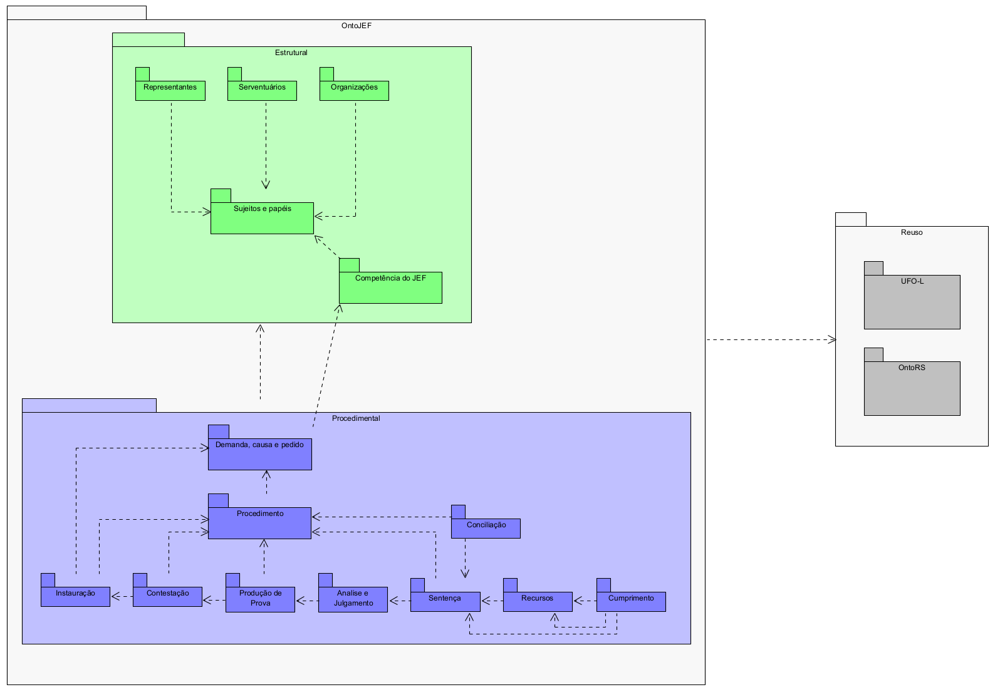

Fonte: elaborado pelo autor (2026)

A organização apresentada no Diagrama de Pacotes é detalhada pelos diagramas de classes que compõem a ontologia. O Quadro 4 sintetiza esses diagramas e o principal aspecto do domínio representado em cada um deles.

Quadro 4 – Visão geral dos diagramas da ontologia.

| **Diagrama**                          | **Foco da representação**                                                   |
| ------------------------------------------- | ----------------------------------------------------------------------------------- |
| **Sujeitos e Papéis**                | Participantes do processo e papéis processuais desempenhados                       |
| **Organizações**                    | Organizações e estruturas institucionais presentes no domínio                    |
| **Representantes**                    | Relações de representação jurídica das partes                                  |
| **Serventuários**                    | Agentes e auxiliares envolvidos no funcionamento do Juizado                         |
| **Demanda, Causa e Pedido**           | Elementos constitutivos da demanda e tipos de pedido                                |
| **Cabimento no JEF**                  | Análise de uma pretensão antes do ajuizamento, sem pressupor processo instaurado. |
| **Competência**                      | Cabimento no JEF, competência jurisdicional e interesse de agir                    |
| **Procedimentos**                     | Estrutura geral dos atos e situações processuais                                  |
| **Instauração**                     | Peticionamento, protocolização e formação da demanda                            |
| **Contestação**                     | Citação, prazo e apresentação ou ausência de contestação.                    |
| **Conciliação**                     | Tentativa de composição, propostas e celebração de acordo                       |
| **Produção de Prova**               | Produção documental, testemunhal e pericial                                       |
| **Análise Probatória e Julgamento** | Análise da suficiência das provas e aptidão para julgamento                      |
| **Sentença**                         | Resultado do julgamento, obrigação judicial e trânsito em julgado                |
| **Recursos**                          | Interposição, tramitação e julgamento do recurso                                |
| **Cumprimento e Encerramento**        | Cumprimento da obrigação e encerramento do processo                               |

Fonte: Elaborado pelo autor (2026).

## 4.2 Pacote Estrutural

O pacote Estrutural reúne os modelos responsáveis pela representação dos principais elementos que constituem a estrutura do domínio do Juizado Especial Federal Cível. Nele são representadas as organizações envolvidas, os sujeitos que participam do processo, os papéis processuais assumidos por esses sujeitos, as relações de representação e os elementos relacionados à competência jurisdicional.

O pacote é composto pelos diagramas Organizações, Sujeitos e Papéis, Representantes, Serventuários, Cabimento no JEF e Competência. O modelo de Sujeitos e Papéis utiliza conceitos de organizações, representação e auxiliares para caracterizar os participantes. Cabimento no JEF trata de uma análise que pode anteceder a propositura da ação, enquanto Competência relaciona elementos de um processo já instaurado.

### 4.2.1 Sujeitos e Papéis

O diagrama Sujeitos e Papéis representa os principais participantes envolvidos na relação processual e os papéis que podem ser desempenhados no contexto do Juizado Especial Federal Cível. A estrutura parte dos `kinds` Pessoa e Organização, que representam entidades com identidade própria, enquanto os diferentes papéis assumidos durante o processo são representados por roles e `roleMixins` .

O Participante Processual é modelado como `roleMixin` e constitui o conceito mais abrangente para os sujeitos que participam do processo. A partir dele são especializados Parte Processual, também representada como `roleMixin` , além dos `roles` Representante Processual, Auxiliar da Justiça e Testemunha. Essa estrutura permite reunir em uma mesma categoria participantes de naturezas distintas, sem atribuir a esses papéis um princípio de identidade próprio.

A Parte Processual especializa-se em Demandante e Demandado. O Demandante é representado como `roleMixin` , pois essa posição pode ser ocupada por diferentes tipos de entidades. No modelo, são representados os roles Pessoa Física Autora, Microempresa Autora e Empresa de Pequeno Porte Autora. Já o Demandado é modelado como `role` desempenhado por uma Organização Federal, representando a entidade contra a qual a demanda é proposta no recorte considerado pela ontologia.

Além dos papéis, o diagrama representa Relação Jurídico-Processual e Representação Processual como `relator`. A segunda formaliza o vínculo entre a parte e o representante. A opção por representação precisa ser compatível com as cardinalidades dos demais diagramas: a ausência de representante em uma etapa inicial admitida não pode ser impedida por uma obrigatoriedade introduzida no diagrama de Instauração. Também é necessário explicitar como Relação Jurídico-Processual se articula com Processo Judicial Federal, distinguindo eventual parte ou perspectiva do mesmo vínculo de uma relação independente.

Os conceitos apresentados constituem uma base compartilhada pelos demais módulos. O enquadramento como microempresa ou empresa de pequeno porte, porém, não fornece por si só um princípio de identidade: o porte deve ser distinguido da natureza do agente e de seu papel no processo. A representação atual desses autores apenas como organizações precisa ser conferida quanto às hipóteses de empresário individual, sem duplicar a identidade da pessoa natural.

Figura 8 – Diagrama de Sujeitos e Papéis.

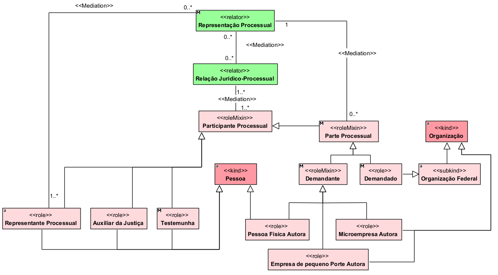

Fonte: elaborado pelo autor (2026)

### 4.2.2 Organizações

O diagrama Organizações apresenta a classificação institucional utilizada na versão atual. Organização é representada como `kind` e Organização Federal como `subkind`. Seu objetivo é fornecer os tipos das entidades que participam do domínio e dos órgãos envolvidos no julgamento. Entretanto, entidade com personalidade jurídica, órgão e pessoa que exerce função jurisdicional precisam ser distinguidos; a hierarquia da Figura 9 ainda mistura esses níveis.

A Organização Federal é especializada, no desenho, em Empresa Pública Federal, União Federal, Autarquia Federal, Fundação Pública Federal e Órgão Julgador. As quatro primeiras denominações se relacionam às categorias admitidas no polo passivo pelo art. 6º, II, da Lei nº 10.259/2001. Órgão Julgador representa outra dimensão: uma unidade de exercício da função jurisdicional, que não deve ser confundida com a pessoa jurídica União ou com uma entidade ré.

O conjunto `{disjoint, complete}` expressa uma restrição de exclusividade e cobertura, não uma indicação meramente visual. Sua pertinência precisa ser revista: as categorias de réus admitidos no JEF não esgotam todas as organizações federais, e a inclusão de órgãos na mesma partição introduz ambiguidade. O recorte do estudo, isoladamente, não justifica declarar completa uma taxonomia cujo tipo geral permanece abrangente.

O desenho especializa Órgão Julgador em Juiz e Turma Recursal. Esse ponto requer correção: Juiz, no sentido de magistrado, é um papel desempenhado por uma Pessoa, não uma espécie de Organização. Deve-se representar separadamente o magistrado, o órgão judicial e o colegiado. Também é preciso compatibilizar Órgão Julgador com Órgão Judicial, utilizado no diagrama de Competência, explicitando se são conceitos distintos ou denominações do mesmo conceito. A revisão textual registra essa inconsistência, mas não altera a imagem existente.

Figura 9 – Diagrama de Organização.

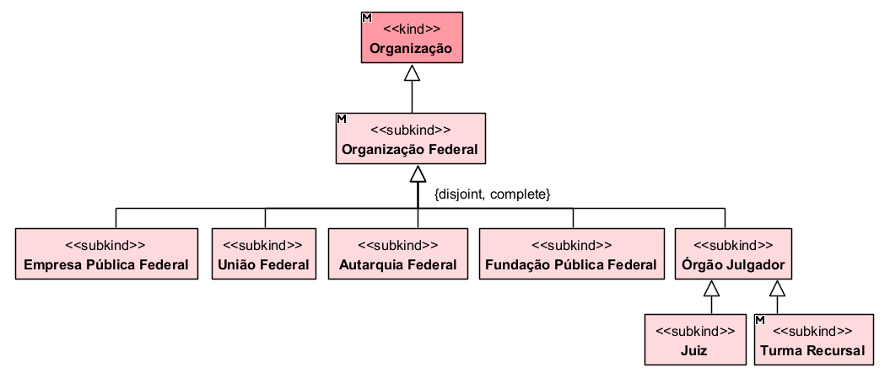

Fonte: elaborado pelo autor (2026)

### 4.2.3 Representantes

O diagrama Representantes apresenta os diferentes papéis de representação processual considerados na ontologia. A estrutura parte do `kind` Pessoa, do qual se especializa o `role` Representante Processual. Essa modelagem evidencia que a representação processual não constitui uma característica essencial da pessoa, mas um papel assumido por ela quando atua na representação de uma das partes em determinado processo.

O Representante Processual é especializado nos roles Representante Designado, Advogado Constituído, Defensor Público Federal e Representante Jurídico Federal. O Representante Designado contempla a pessoa que exerce a representação em razão de designação específica, enquanto o Advogado Constituído representa o profissional escolhido pela parte para atuar em sua defesa. O Defensor Público Federal representa a atuação da Defensoria Pública da União no processo, e o Representante Jurídico Federal agrupa os diferentes papéis de representação jurídica das entidades federais contempladas pelo modelo.

O `role` Representante Jurídico Federal é posteriormente especializado em Procurador Federal, Advogado da União, Procurador da Fazenda Nacional e Advogado de Empresa Pública Federal. Essa distinção permite representar, de maneira mais específica, os diferentes papéis que podem ser exercidos na representação jurídica da parte federal, mantendo todos eles subordinados a uma categoria processual comum.

Os dois níveis apresentam conjuntos `{disjoint, complete}`. A restrição exige revisão: o art. 10 da Lei nº 10.259/2001 admite representante designado advogado ou não, de modo que designação e habilitação profissional não constituem necessariamente categorias excludentes. Além disso, uma pessoa pode exercer papéis diferentes em processos ou momentos distintos. Convém separar habilitação, vínculo institucional e papel exercido na representação concreta, delimitando a exclusividade apenas quando houver fundamento para ela. A completude dessas classificações também não foi formalmente verificada.

Esse diagrama complementa o modelo de Sujeitos e Papéis, no qual o Representante Processual participa da Representação Processual juntamente com a Parte Processual. Enquanto aquele diagrama evidencia a relação existente entre representante e parte, o diagrama Representantes detalha os diferentes tipos de papéis que podem ocupar a posição de representação no processo.

Figura 10 – Diagrama de Representantes.

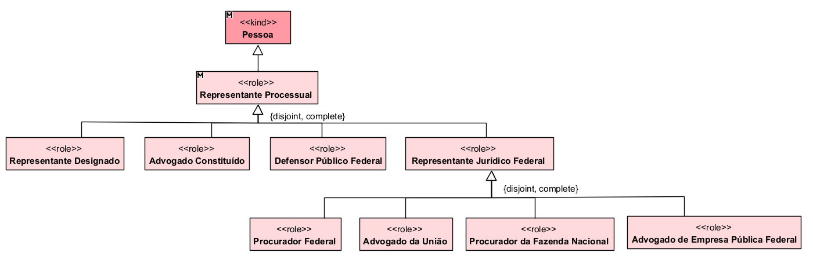

Fonte: elaborado pelo autor (2026)

### 4.2.4 Serventuários

O diagrama denominado Serventuários reúne papéis de apoio à atividade jurisdicional. A estrutura parte de Pessoa e a especializa em Serventuário da Justiça. Para evitar ambiguidade jurídica, é necessário distinguir servidores do Judiciário de auxiliares que não integram seus quadros. O conceito mais abrangente para a articulação com Sujeitos e Papéis é Auxiliar da Justiça, e a denominação do diagrama não deve implicar que todo participante nele representado seja servidor público.

No desenho, Serventuário da Justiça possui as especializações Servidor Judicial, Oficial de Justiça, Perito e Conciliador. Servidor Judicial exerce atividades institucionais de apoio; Oficial de Justiça cumpre ordens e diligências; Perito fornece conhecimento técnico ou científico; e Conciliador auxilia a composição. O CPC inclui esses últimos entre os auxiliares da Justiça, sem equipará-los indistintamente a servidores (BRASIL, 2015, art. 149). A Lei nº 10.259/2001 disciplina o exame técnico e a designação de conciliadores (arts. 12 e 18).

A partição `{disjoint, complete}` também requer revisão. Oficial de Justiça pode integrar a categoria de servidores judiciais; Perito e Conciliador não precisam possuir esse vínculo. A modelagem deve distinguir vínculo funcional e participação como auxiliar no processo, estabelecendo as generalizações adequadas e evitando que a disjunção impeça classificações juridicamente compatíveis.

Esses conceitos são reutilizados em diferentes partes da ontologia. O Perito participa dos eventos relacionados à produção de prova pericial, enquanto o Conciliador aparece no modelo de conciliação. Já Servidor Judicial e Oficial de Justiça representam agentes de apoio ao funcionamento e à prática dos atos necessários à tramitação processual. Dessa forma, o diagrama complementa o modelo de Sujeitos e Papéis ao detalhar os papéis institucionais desempenhados por pessoas vinculadas à atividade judiciária.

Figura 11 – Diagrama de Serventuários.

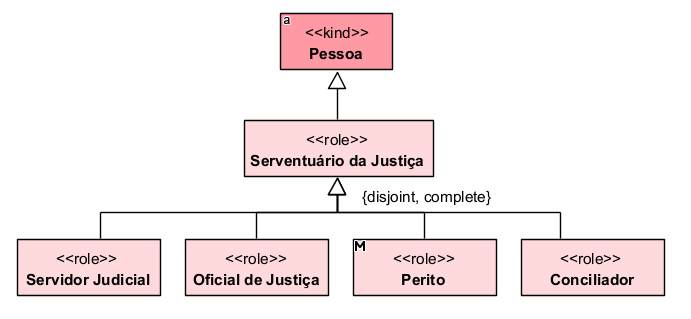

Fonte: elaborado pelo autor (2026)

### 4.2.5 Cabimento no JEF

O diagrama Cabimento no JEF representa a verificação pré-processual da possibilidade de uma pretensão ser submetida ao Juizado Especial Federal Cível. Diferentemente do diagrama Competência, que trata de um processo judicial já instaurado, este modelo busca representar a análise realizada antes do ajuizamento, permitindo avaliar se determinado caso reúne condições para tramitar no JEF sem pressupor a existência de Demandante, Demandado ou Processo Judicial Federal.

O elemento central do diagrama é a Pretensão Jurídica, modelada como `intention` e associada à Pessoa que pretende buscar determinada tutela jurisdicional. Essa pretensão reúne os principais elementos necessários à análise de cabimento, incluindo um ou mais Pedidos Processuais, a Causa de Pedir e o Valor da Causa. Também é indicada a Organização Federal em face da qual se pretende formular a demanda.

A Pretensão Jurídica possui um ou mais Pedidos Processuais, representados como `kind` , e uma Causa de Pedir, também modelada como `kind` . O Valor da Causa é representado como `quality` e caracteriza a pretensão, permitindo que sua dimensão econômica seja considerada na análise. A Organização Federal, por sua vez, é representada como `subkind` e corresponde à entidade contra a qual a pretensão poderá futuramente ser dirigida.

A verificação propriamente dita é representada pelo `event` Análise de Cabimento no JEF. Esse evento considera os elementos da pretensão, incluindo a entidade envolvida, o pedido, a causa de pedir e o valor da causa, além da Regra de Competência aplicável. A participação desses elementos evidencia que o cabimento não é determinado por um único critério isolado, mas pela análise conjunta das características da pretensão à luz das regras jurídicas pertinentes.

A Regra de Competência é representada como `subkind` e regula a Análise de Cabimento no JEF. Essa relação permite explicitar que a conclusão quanto ao enquadramento da pretensão depende da aplicação das normas que estabelecem os critérios de competência do Juizado Especial Federal Cível, inclusive as hipóteses de inclusão e exclusão previstas no ordenamento jurídico.

Como resultado da análise, o evento produz a `situation` Resultado da Análise de Cabimento. Essa situação é especializada em Cabível no JEF e Não Cabível no JEF, formando um conjunto `{disjoint, complete}` . Dessa forma, no recorte adotado pela ontologia, o resultado da análise é classificado em uma dessas duas possibilidades, consideradas mutuamente exclusivas.

O diagrama distingue a análise de uma pretensão ainda não ajuizada da competência relacionada a um processo já existente. O resultado pode ser registrado, mas as condições das regras de competência ainda não são executadas pelo modelo. Há também um limite de cobertura: a Pretensão Jurídica caracteriza apenas Pessoa no desenho, embora o escopo inclua microempresas e empresas de pequeno porte. É necessário avaliar um agente mais abrangente ou outra representação que contemple esses interessados sem criar antecipadamente seus papéis de partes. A intenção aqui representada não deve ser confundida com uma pretensão material já reconhecida como direito.

Figura 12 – Diagrama de Cabimento no JEF.

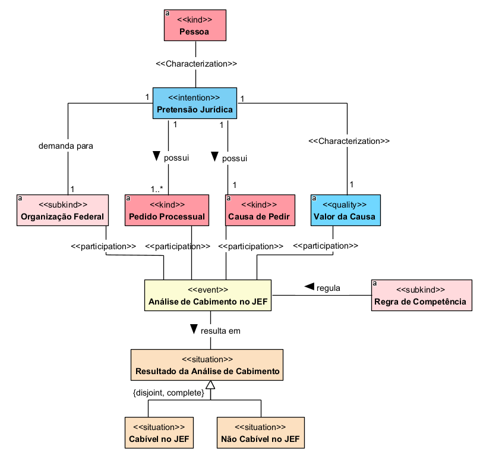

Fonte: elaborado pelo autor (2026)

### 4.2.6 Competência

O diagrama Competência representa os elementos utilizados para determinar o cabimento de uma demanda no Juizado Especial Federal Cível e a existência de competência jurisdicional para sua apreciação. O modelo articula aspectos relacionados ao processo, às partes, ao valor da causa, à instrução documental, ao eventual requerimento administrativo prévio e às regras jurídicas que fundamentam a competência do órgão julgador.

O Processo Judicial Federal é modelado como `relator` e constitui um dos elementos centrais do diagrama. Ele se relaciona à Demanda, representada como `kind` , que é caracterizada pela `quality` Valor da Causa. Essa propriedade permite representar um dos elementos considerados na verificação do cabimento da demanda perante o Juizado Especial Federal. O processo também se relaciona às partes envolvidas, representadas pelos papéis Demandante e Demandado, sendo este último desempenhado por uma Organização Federal.

A representação jurídica das partes é formalizada pelo `relator` Representação

Processual, que media a Parte Processual e o Representante Processual. Essa estrutura permite que a existência ou ausência de representação seja tratada de maneira independente da identidade da parte, mantendo a distinção entre o participante do processo e o papel eventualmente desempenhado por seu representante.

A instrução do processo é representada pelo `relator` Instrução Documental do Processo, que relaciona o Processo Judicial Federal aos Documentos Necessários ao Processo. Estes são modelados como `role` de Documento, indicando que um documento assume essa função quando é relevante para a instrução de determinada demanda. Entre os documentos representados encontra-se o Documento de Requerimento Administrativo, modelado como `subkind` de Documento e relacionado ao `event` Requerimento Administrativo.

Requerimento Administrativo representa a provocação da Administração quando pertinente. Indeferimento Administrativo, Resistência Administrativa e Demora Excessiva são situações que podem ser relevantes à análise da necessidade da tutela, mas não constituem condições universais e suficientes do interesse de agir. A classificação de Interesse de Agir como `intention` é inadequada ao significado jurídico adotado: desejar ajuizar uma ação não equivale a satisfazer esse requisito. O conceito deve ser reformulado como condição jurídica apreciada no contexto da pretensão e do provimento necessário, distinguindo o resultado dessa análise da intenção do interessado (BRASIL, 2015, art. 17). Não se presume prévio requerimento obrigatório para toda demanda.

A competência propriamente dita é representada pelo `relator` Competência Jurisdicional. Esse relator conecta o Processo Cabível no JEF ao JEF Competente, explicitando a relação pela qual determinado processo pode ser submetido a um Juizado Especial Federal específico. O Processo Cabível no JEF é modelado como `role` de Processo Judicial Federal, evidenciando que o cabimento perante o Juizado depende das condições presentes no contexto da demanda.

O JEF Competente, por sua vez, é representado como `role` de Juizado Especial Federal, `subkind` de Órgão Judicial. O papel de JEF Competente é caracterizado pelo `mode` Poder Jurisdicional, representando o poder atribuído ao órgão para apreciar e decidir a demanda dentro de sua esfera de competência.

Por fim, a determinação dessa competência é vinculada à estrutura normativa. O `kind` Norma Jurídica é especializado em Regra Jurídica e, posteriormente, em Regra de Competência. No modelo, a Regra de Competência define a Competência Jurisdicional, tornando explícita a dependência entre a atribuição de competência ao órgão judicial e as normas jurídicas aplicáveis ao caso.

O diagrama aproxima informações sobre cabimento, partes, documentos e competência, mas essas dimensões não são equivalentes. Competência é a atribuição do órgão para apreciar uma causa; interesse de agir e legitimidade são condições distintas. A classe Documento Necessário ao Processo permite classificar um documento já identificado como necessário, mas não fornece uma lista exaustiva dos documentos exigíveis em cada tipo de caso. Essas limitações impedem tratar as QCs sobre cabimento, polo passivo e documentação como decisões integralmente respondidas pela estrutura atual.

Figura 13 – Diagrama de Competência.

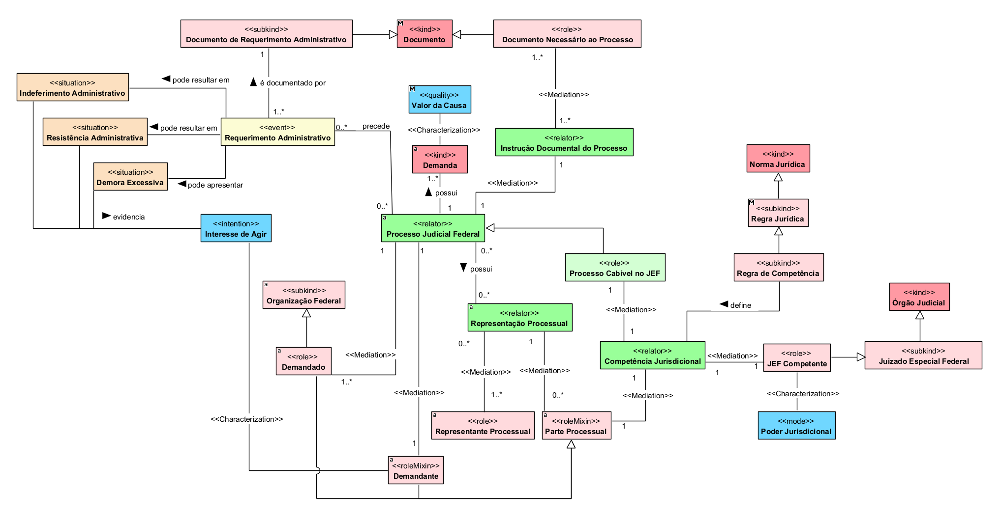

Fonte: elaborado pelo autor (2026)

## 4.3 Pacote Procedimental

O pacote Procedimental reúne os modelos responsáveis pela representação da dinâmica do processo no Juizado Especial Federal Cível. Diferentemente do pacote Estrutural, que concentra os sujeitos, papéis, organizações e relações mais estáveis do domínio, este pacote representa os principais acontecimentos, documentos, relações e situações que surgem ao longo da tramitação da demanda.

O pacote é composto pelos diagramas Demanda, Causa e Pedido, Procedimentos, Instauração, Contestação, Conciliação, Produção de Prova, Análise Probatória e Julgamento, Sentença, Recursos e Cumprimento e Encerramento. Em conjunto, esses modelos representam o percurso processual contemplado pela ontologia, desde a formulação e o ajuizamento da demanda até os possíveis desdobramentos decorrentes da decisão judicial, incluindo a interposição de recurso e o cumprimento da obrigação reconhecida.

### 4.3.1 Demanda, Causa e Pedido

O diagrama Demanda, Causa e Pedido representa os elementos utilizados para caracterizar a pretensão submetida ao Juizado Especial Federal Cível. O modelo distingue a própria Demanda, os fundamentos que a sustentam e aquilo que é solicitado ao órgão judicial, permitindo representar separadamente conceitos que, embora relacionados, possuem funções distintas no processo.

A Demanda é modelada como `kind` e se fundamenta em uma Causa de Pedir. Possui um ou mais Pedidos Processuais, permitindo explicitar as providências requeridas. São conteúdos articulados na pretensão apresentada, distintos do ato de ajuizar e do documento que os registra. O diagrama não possui uma relação específica que identifique qual dos pedidos é principal; essa informação é anotação externa nos cenários de avaliação.

Pedido Processual é especializado em Pedido de Fazer, Pedido de Não Fazer, Pedido de Pagar, Pedido de Tutela Provisória e Pedido de Outra Providência. A partição disjunta e completa do desenho precisa ser revista: a natureza da prestação e a modalidade provisória ou definitiva da tutela são critérios distintos, pois uma tutela provisória pode determinar fazer ou pagar. Convém representar essas dimensões separadamente e avaliar a inclusão explícita de pedido de entrega de coisa. A presença de um pedido de tutela não significa seu deferimento.

A Demanda é ainda caracterizada pela `quality` Valor da Causa. A inclusão desse elemento permite representar uma propriedade relevante da demanda e que também é utilizada em outras partes da ontologia, especialmente no modelo de Competência, no qual o valor da causa participa da análise do cabimento do processo perante o Juizado Especial Federal.

O diagrama relaciona a Demanda ao `relator` Processo Judicial Federal e apresenta classificações por matéria: Processo Previdenciário, Processo Assistencial e Processo Indenizatório. Na imagem, Processo FGTS e Processo Habitacional aparecem subordinados a Processo Indenizatório. Essa generalização não é adequada como regra geral: demandas sobre FGTS ou habitação não são necessariamente indenizatórias. É preciso separar matéria discutida e natureza da tutela, sem tratar a enumeração como taxonomia exaustiva de ações. Os rótulos gráficos “Processo Previdenciária” e “Processo Indenizatória” são normalizados no texto, mas ainda precisam de correção na figura.

Dessa forma, o diagrama explicita que a caracterização de uma demanda não depende apenas da identificação de um tipo de processo, mas também da combinação entre sua Causa de Pedir, seu Pedido Processual e seu Valor da Causa. Esses elementos fornecem a base para a representação das Questões de Competência relacionadas ao tipo da ação proposta, ao pedido formulado pelo autor, à natureza da obrigação pretendida e à existência de pedido de tutela provisória.

Figura 14 – Diagrama de Demanda, Causa e Pedido.

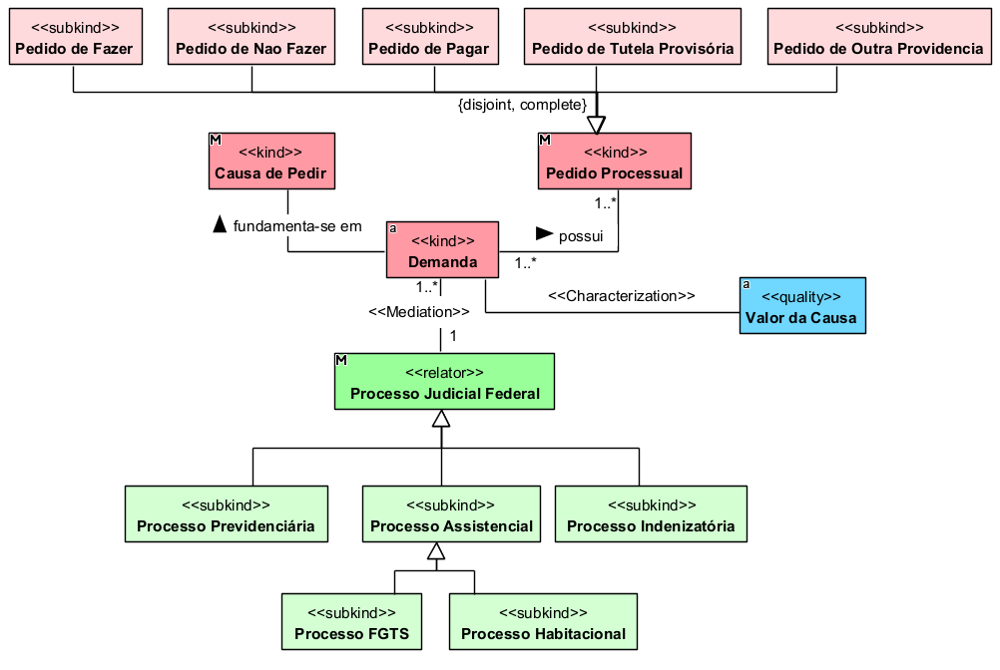

Fonte: elaborado pelo autor (2026)

### 4.3.2 Procedimentos

O diagrama Procedimento representa, de forma geral, a sequência de atos e situações que marcam o desenvolvimento de uma demanda no Juizado Especial Federal Cível. Seu objetivo é fornecer uma visão sintética da dinâmica processual, evidenciando os principais eventos que ocorrem ao longo da tramitação e as situações produzidas por esses acontecimentos.

O elemento mais abrangente do diagrama é o `event` Ato Processual, que representa os acontecimentos processuais praticados no curso da demanda. Esse evento geral está relacionado, por meio da relação `participation` , ao Participante Processual, indicando que os atos processuais envolvem a participação de sujeitos já representados no pacote estrutural. Além disso, Ato Processual se relaciona à Situação Processual, modelada como `situation` , permitindo representar os estados ou condições produzidas ao longo do processo.

A partir de Ato Processual, o diagrama especializa alguns eventos considerados centrais para a estrutura procedimental do modelo: Ajuizamento, Citação, Apresentação de Contestação e Julgamento, todos representados como `event` . O Ajuizamento representa o ato inicial de instauração da demanda judicial. No modelo, esse evento leva a situação Processo Instaurado e, adicionalmente, por meio da relação `creation` , dá origem ao Processo Judicial Federal, modelado como `relator` .

O evento Citação mantém uma relação de `historicalDependence` com o Ajuizamento, indicando que sua ocorrência depende da instauração prévia do processo. A citação leva a situação Demandado Citado, representando o estado processual decorrente da ciência formal do réu acerca da demanda proposta.

Apresentação de Contestação aparece como historicamente dependente da Citação no percurso desenhado. Não se trata de requisito universal: o comparecimento espontâneo pode suprir a falta ou nulidade da citação (BRASIL, 1995, art. 18, § 3º; BRASIL, 2015, art. 239, § 1º). A ligação desenhada de Apresentação de Contestação para Apto a Julgamento com `triggers` também precisa ser corrigida, pois esse estereótipo relaciona situação a evento, e não evento a situação. O resultado da apresentação da defesa é Contestação Apresentada; a aptidão para julgamento depende de avaliação própria.

A situação Apto a Julgamento é relacionada ao evento Julgamento por `triggers`. Já a dependência obrigatória de Julgamento em relação à Apresentação de Contestação, sugerida no desenho, não cobre o julgamento em processos sem contestação. A estrutura oferece uma visão de um percurso, mas precisa contemplar alternativas e exceções. Um diagrama de classes com eventos não equivale, por si só, a um fluxo de execução completo ou a uma especificação de todas as condições legais de tramitação.

O diagrama Procedimento exerce, portanto, uma função de síntese dentro do pacote Procedimental. Ele apresenta o encadeamento básico entre eventos e situações do processo e serve como referência geral para os modelos mais específicos desenvolvidos nas seções seguintes, como Contestação, Conciliação, Produção de Prova, Análise Probatória e Julgamento e Sentença.

Figura 15 – Diagrama de Procedimentos.

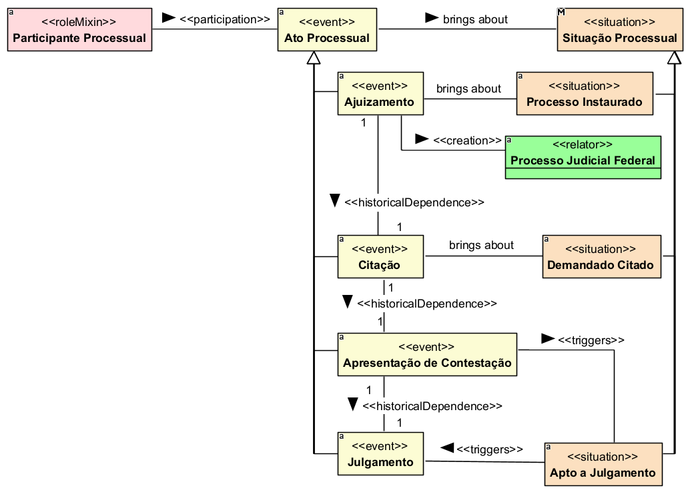

Fonte: elaborado pelo autor (2026)

### 4.3.3 Instauração

O diagrama Instauração representa os principais eventos e elementos envolvidos na formação da demanda judicial, desde a elaboração da petição até o ajuizamento e a constituição do processo. A estrutura evidencia a sequência entre Peticionamento, Protocolização e Ajuizamento, bem como os documentos, participantes e situações relacionados a esses acontecimentos.

O Peticionamento é modelado como `event` e especializa Ato Processual. Esse evento envolve a participação do Representante Processual e, por meio da relação `creation` , dá origem ao Documento de Petição Inicial, representado como `subkind` de Documento. A petição inicial formaliza a Demanda, formula o Pedido Processual e expõe a Causa de Pedir, reunindo, em um único documento, os principais elementos necessários à apresentação da pretensão ao Judiciário.

A relação entre o Demandante e a apresentação da petição é representada pelo `relator` Petição. Esse relator media o Demandante e se relaciona ao Documento de Petição Inicial, permitindo distinguir o documento produzido da própria relação estabelecida em torno da apresentação da pretensão. O Representante Processual também participa dessa estrutura, especialmente nos casos em que atua na elaboração e apresentação da petição. Após o Peticionamento ocorre a Protocolização, também modelada como `event` . Esse evento apresenta `historicalDependence` em relação ao Peticionamento, indicando que a protocolização depende da existência prévia da petição elaborada. A Protocolização leva à `situation` Demanda Protocolizada e, por meio da relação `creation` , produz o Comprovante de Protocolo, representado como `subkind` de Documento.

Ajuizamento é representado como `event`, relacionado à Protocolização e à situação Processo Instaurado. A distinção é analítica, não a afirmação de um ato jurídico adicional sempre posterior ao protocolo: o CPC considera proposta a ação quando a petição inicial é protocolada (BRASIL, 2015, art. 312). A separação entre preparação, registro e efeitos da propositura deve ser compatibilizada com essa regra e com a apresentação oral admitida no rito especial.

O diagrama distingue conteúdo, documento, registro e relação processual, mas representa a via de petição escrita com participação de representante. A mediação com mínimo de um Representante Processual no relator Petição impede, nessa estrutura, a petição sem representante. Para atender à QC32 e ao art. 10 da Lei nº 10.259/2001, é necessário modelar explicitamente a atuação pessoal e revisar a obrigatoriedade de representante. A apresentação oral reduzida a escrito também precisa de tratamento próprio (BRASIL, 1995, art. 14, § 3º).

Figura 16 – Diagrama de Instauração.

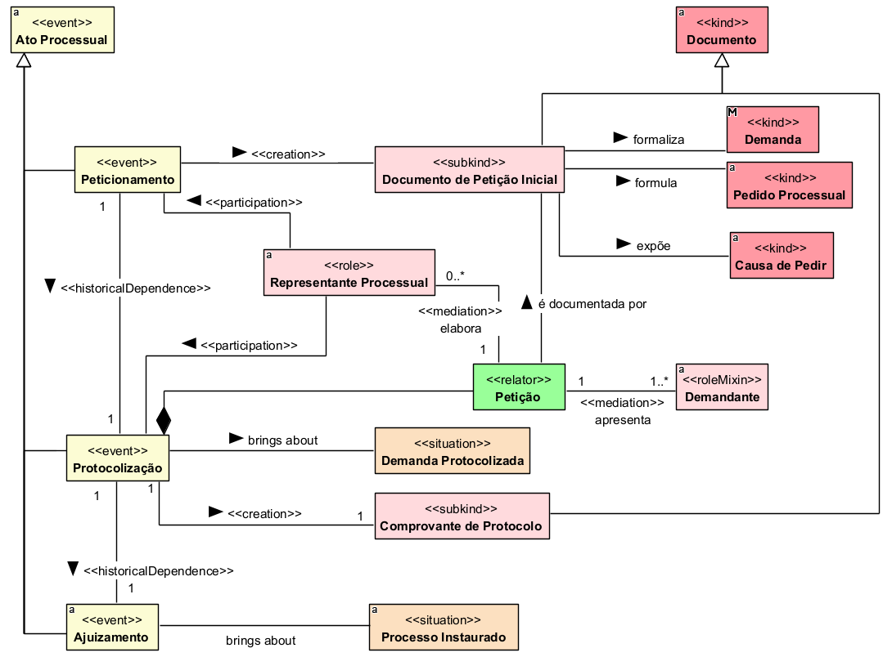

Fonte: elaborado pelo autor (2026)

### 4.3.4 Contestação

O diagrama Contestação representa os eventos, documentos e situações relacionados à apresentação da defesa pelo demandado após a citação. O modelo evidencia tanto a hipótese de apresentação da contestação quanto a possibilidade de transcurso do prazo sem manifestação, permitindo representar diferentes estados processuais decorrentes dessa etapa.

A Citação é modelada como `event` e especializa Ato Processual. Sua ocorrência leva às `situations` Demandado Citado e Prazo de Contestação em Curso, representando, respectivamente, a ciência formal do demandado acerca da demanda e o período em que pode ser apresentada a defesa.

Prazo de Contestação em Curso relaciona-se ao Decurso do Prazo de Contestação. Ausência de Contestação deve resultar da combinação entre término do prazo aplicável e falta de defesa, não do mero transcurso do tempo. O desenho ainda não explicita essa condição negativa nem o conteúdo da regra de prazo. Não se presume prazo uniforme de contestação para todas as hipóteses; a antecedência mínima de trinta dias da citação para conciliação, prevista no art. 9º da Lei nº 10.259/2001, não é automaticamente um prazo de defesa.

Apresentação de Contestação é modelada como `event` com participação do Demandado e de Contestação, esta como `subkind` de Documento. O evento produz Contestação Apresentada. O modelo registra a ocorrência, não demonstra automaticamente tempestividade ou regularidade da defesa. A dependência de citação deve considerar comparecimento espontâneo, e a representação documental precisa contemplar a defesa oral admitida no art. 30 da Lei nº 9.099/1995. Ausência de contestação não implica, por si só, procedência do pedido nem todos os efeitos materiais de revelia.

As situações Demandado Citado, Prazo de Contestação em Curso, Ausência de Contestação e Contestação Apresentada são especializações de Situação Processual. Assim, o diagrama evidencia como diferentes eventos modificam o estado do processo ao longo dessa etapa e permite representar tanto o desenvolvimento regular da defesa quanto a ausência de contestação.

Dessa forma, o modelo de Contestação complementa o diagrama Procedimento ao detalhar a sequência iniciada pela Citação e os possíveis resultados relacionados à resposta do demandado. Ele fornece suporte, especialmente, às Questões de Competência relacionadas à verificação da apresentação da contestação e à identificação da situação processual em que a demanda se encontra.

Figura 17 – Diagrama de Contestação.

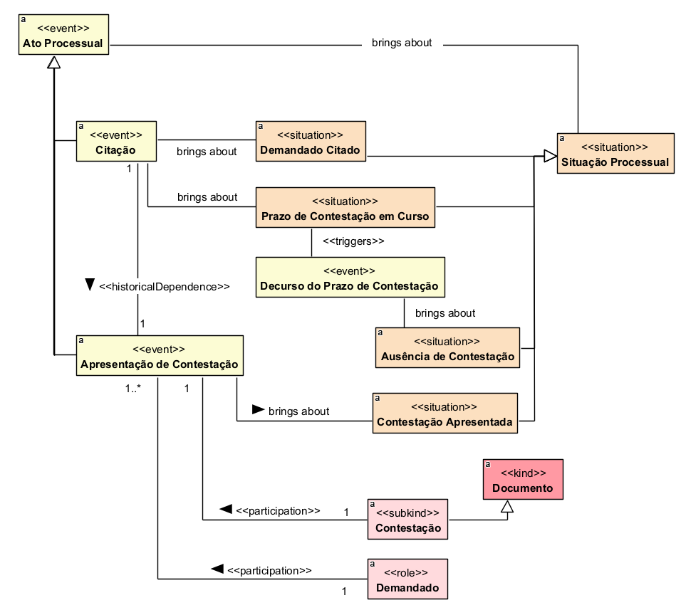

Fonte: elaborado pelo autor (2026)

### 4.3.5 Conciliação

O diagrama Conciliação representa a determinação da audiência, sua ocorrência e a tentativa de composição. Determinação de Audiência é um evento que pode produzir Resultado da Determinação de Audiência, especializado em Audiência Designada e Audiência Dispensada. A partição desses resultados é disjunta e completa, mas a associação com multiplicidade `0..1` ainda permite uma determinação sem resultado registrado. Os critérios jurídicos para designar ou dispensar a audiência não estão explicitados; registrar a dispensa não exige criar uma audiência que tenha efetivamente ocorrido.

A Audiência de Conciliação é modelada como `event` e especializa Ato Processual. Durante sua realização pode ocorrer a Apresentação de Propostas de Acordo, também representada como `event` . Esse evento envolve a participação de uma ou mais Propostas de Acordo, modeladas como `subkind` de Documento, permitindo representar formalmente as propostas apresentadas pelas partes durante a tentativa de composição.

A Tentativa de Conciliação, igualmente modelada como `event` , ocorre no contexto da Audiência de Conciliação e envolve a participação do Conciliador, do Demandante e do Demandado. O Conciliador é representado como `role` , enquanto Demandante e Demandado correspondem aos papéis processuais já definidos no pacote Estrutural. Dessa forma, o modelo integra os sujeitos envolvidos à dinâmica própria da conciliação.

Quando a tentativa resulta em consenso entre as partes, ocorre o `event` Celebração de Acordo, que apresenta `historicalDependence` em relação à Tentativa de Conciliação. A celebração cria o `relator` Acordo Processual, responsável por formalizar a relação estabelecida entre Demandante e Demandado. O Acordo Processual media as partes, explicitando que o acordo não é representado apenas como um documento ou resultado abstrato, mas como uma relação constituída entre os participantes.

Celebração de Acordo produz Conciliação Realizada, utilizada no modelo no sentido de conciliação bem-sucedida; Conciliação Frustrada corresponde à tentativa sem acordo. O rótulo “Conciliação Frustada” da figura é normalizado no texto. A partição completa dessas duas situações está desenhada diretamente sob Situação Processual. Se esse supertipo é compartilhado com os outros módulos, a restrição pode forçar indevidamente toda situação processual a ser um desses resultados. O refinamento indicado é introduzir um resultado específico da tentativa de conciliação, preservando a categoria geral para os demais estados.

A figura também inclui Dever de Comparecimento à Audiência e Dever de Comparecimento à Perícia como `mode`, ambos caracterizando Audiência de Conciliação. Essa ligação requer correção: o dever jurídico deve ter como portador o agente obrigado e ser relacionado ao ato a que se refere, ao seu fundamento, à intimação e à vigência. A própria qualificação como dever, e não ônus processual, precisa ser conferida conforme o destinatário e a consequência jurídica. O dever relativo à perícia não deve caracterizar uma audiência de conciliação. A estrutura, portanto, não responde integralmente à QC37. Também falta ligação explícita entre Acordo Processual e a sentença que o homologa; a narrativa dos cenários não supre esse vínculo.

Figura 18 – Diagrama de Conciliação.


Fonte: elaborado pelo autor (2026)

### 4.3.6 Produção de Prova

O diagrama Produção de Prova representa os principais eventos relacionados à formação do conjunto probatório no processo. A estrutura parte do `event` Produção de Prova, especializado a partir de Ato Processual, e contempla diferentes formas de produção probatória, incluindo a oitiva de testemunha, a realização de perícia e a juntada de documentos.

A Oitiva de Testemunha é modelada como `event` e envolve a participação da Testemunha, representada como `role` . A realização desse evento leva à `situation` Testemunho Colhido, permitindo representar o estado processual decorrente da produção da prova testemunhal.

A Realização de Perícia também é representada como `event` e envolve a participação do Perito, modelado como `role` . Como resultado dessa atividade, o modelo representa a `situation` Perícia Realizada. Além disso, a realização da perícia cria o Laudo Pericial, representado como `subkind` de Documento, que registra formalmente o resultado da análise técnica produzida no processo.

A produção documental é representada pelo `event` Juntada de Documento. Esse evento envolve a participação da Parte Processual e de documentos utilizados com finalidade probatória. O conceito Documento Probatório é modelado como role de Documento, indicando que determinado documento assume função probatória quando utilizado no contexto do processo. O Laudo Pericial também pode participar da Juntada de Documento, permitindo que o resultado da perícia seja formalmente incorporado aos autos.

A ocorrência da Juntada de Documento leva à `situation` Documento Juntado. Assim como Testemunho Colhido e Perícia Realizada, essa situação especializa Situação Processual, permitindo representar os diferentes estados produzidos pelos atos de instrução probatória.

O diagrama permite registrar provas produzidas e seus participantes, mas não decide sozinho quais provas são necessárias. A vinculação de uma testemunha à oitiva não representa seu arrolamento prévio pela parte, e Testemunho Colhido não especifica o conteúdo do depoimento. As composições e cardinalidades entre Produção de Prova, Oitiva de Testemunha e Realização de Perícia precisam permitir que cada processo utilize apenas as modalidades necessárias, sem impor cumulativamente todas elas. A ligação “pode levar a” entre Realização de Perícia e Juntada de Documento também deve ser distinguida da relação técnica entre evento e situação resultante.

Figura 19 – Diagrama de Produção de Prova.

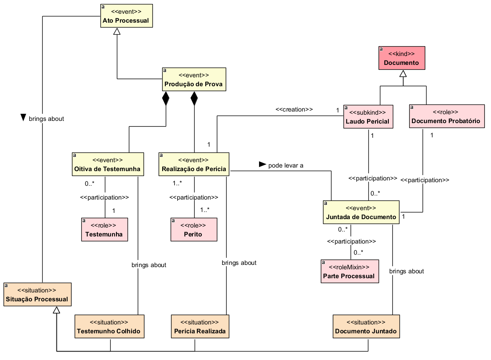

Fonte: elaborado pelo autor (2026)

### 4.3.7 Análise Probatória e Julgamento

O diagrama Análise Probatória e Julgamento representa a avaliação das provas produzidas no processo e os possíveis desdobramentos decorrentes de sua suficiência ou insuficiência. O modelo busca explicitar a relação entre a produção probatória, sua análise e a formação da condição necessária para que o processo possa ser submetido a julgamento.

A Produção de Prova é modelada como `event` e especializa Ato Processual. Após a produção dos elementos probatórios, ocorre a Análise das Provas, também representada como `event` e relacionada à produção probatória por `historicalDependence` . Essa relação evidencia que a análise pressupõe a existência de provas previamente produzidas no processo. O evento Análise das Provas leva à `situation` Resultado da Análise Probatória, que representa a condição resultante da avaliação do conjunto de provas disponível.

O Resultado da Análise Probatória é especializado nas `situations` Provas Suficientes e Provas Insuficientes. Essas especializações formam um conjunto `{disjoint, complete}` , indicando que, no recorte adotado pelo modelo, o resultado da análise é classificado em uma dessas duas situações, consideradas mutuamente exclusivas.

Quando as provas são consideradas suficientes, a situação Provas Suficientes possibilita a `situation` Apto a Julgamento. Esta representa a condição em que o conjunto probatório existente permite o prosseguimento do processo para decisão. A situação Apto a Julgamento, por sua vez, `triggers` o `event` Julgamento, também especializado a partir de Ato Processual.

Quando a análise identifica necessidade de complementação, Provas Insuficientes relaciona-se a Não Apto a Julgamento e desencadeia Produção de Prova Complementar. O evento produz Prova Complementar Produzida, situação que pode desencadear nova Análise das Provas. A figura não explicita uma generalização de Produção de Prova Complementar para Produção de Prova; essa classificação pretendida precisa ser consolidada no projeto. A associação com Não Apto a Julgamento não possui rótulo e não deve ser interpretada como regra jurídica universal de impedimento.

Apto a Julgamento é especialização de Situação Processual; a generalização correspondente de Não Apto a Julgamento deve ser explicitada no modelo. A avaliação registra resultados em momentos distintos, sem tomar suficiência e insuficiência históricas como estados atuais simultâneos. Não se admite um ciclo obrigatório e ilimitado de complementação: o julgamento pode ocorrer segundo as regras de distribuição do ônus da prova e a apreciação judicial. A insuficiência para demonstrar um fato não impede necessariamente a decisão, e aptidão não equivale a julgamento antecipado, favorável ou já realizado (BRASIL, 2015, arts. 355, 370, 371 e 373).

O modelo complementa o diagrama Produção de Prova ao representar o que ocorre após a obtenção dos elementos probatórios. Enquanto aquele diagrama descreve as formas pelas quais as provas são produzidas e incorporadas ao processo, este evidencia sua avaliação e as consequências decorrentes de sua suficiência ou insuficiência, fornecendo suporte especialmente às Questões de Competência relacionadas à necessidade de produção de provas, à suficiência do conjunto probatório e à possibilidade de julgamento.

Figura 20 – Diagrama de Análise Probatória e Julgamento.


Fonte: elaborado pelo autor (2026)

### 4.3.8 Sentença

O diagrama Sentença representa o resultado do julgamento e os efeitos jurídicos decorrentes da decisão proferida no processo. O modelo articula o evento de julgamento, o documento de sentença, os diferentes tipos de resultado, as obrigações impostas e a formação das posições jurídicas entre Demandante e Demandado.

O Julgamento é modelado como `event` e, por meio da relação `creation` , dá origem à Sentença, representada como `subkind` de Documento. Dessa forma, o modelo distingue o acontecimento processual de julgar do documento que registra formalmente a decisão produzida.

A figura apresenta Sentença Homologatória, Procedência, Improcedência, Extinção sem Resolução do Mérito e Procedência Parcial como especializações de Sentença. No recorte, esses nomes classificam o documento pelo resultado registrado, não representam o evento de julgar. A partição precisa de avaliação quanto a decisões com capítulos distintos e quanto ao alcance de “homologatória”, pois nem todas as hipóteses de homologação e de extinção estão explicitadas. Não se afirma cobertura de todo o regime dos pronunciamentos judiciais (BRASIL, 2015, arts. 203, 485 e 487).

Quando a decisão reconhece uma prestação devida, a Sentença impõe uma Obrigação Judicial, modelada como `relator` . Essa relação vincula Demandante e Demandado e permite representar as posições jurídicas decorrentes da decisão. O Demandante é caracterizado pelo `mode` Direito à Prestação, enquanto o Demandado é caracterizado pelo `mode Dever de Prestação` , evidenciando a correlação entre o direito reconhecido a uma parte e o dever correspondente atribuído à outra.

Obrigação Judicial é especializada em Obrigação de Entregar Coisa, de Fazer, de Pagar e de Não Fazer. A classificação deve incidir sobre cada prestação individualizada: uma sentença pode reconhecer mais de uma obrigação, inclusive de naturezas diferentes. A figura admite de zero a várias obrigações por sentença, o que permite representar também decisões sem prestação a cumprir. Direito à Prestação e Dever de Prestação são posições correlatas, não duplicações das pessoas que as portam; suas dependências externas e a relação de correlação devem ser explicitadas para completar o alinhamento com a UFO-L.

O diagrama também representa o Trânsito em Julgado como `event` , tendo a Sentença como objeto. A ocorrência desse evento leva à `situation` Sentença Transitada em Julgado, indicando a consolidação da decisão no estado processual representado pela ontologia.

Dessa forma, o diagrama Sentença integra em uma mesma estrutura a decisão judicial, sua materialização documental, seus possíveis resultados e os efeitos jurídicos produzidos entre as partes. O modelo fornece suporte especialmente às Questões de Competência relacionadas ao resultado da sentença, à obrigação imposta ao demandado e à verificação da ocorrência do trânsito em julgado.

Figura 21 – Diagrama de Sentença.

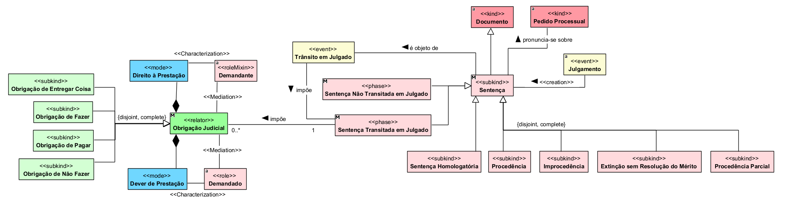

Fonte: elaborado pelo autor (2026)

### 4.3.9 Recursos

O diagrama Recursos representa os principais elementos envolvidos na impugnação da sentença, desde a abertura do prazo recursal até o julgamento do recurso pela Turma Recursal. O modelo contempla tanto a hipótese de interposição do recurso quanto a ausência de manifestação recursal, além dos participantes, documentos, prazos e situações decorrentes dessa etapa do processo.

A Sentença, representada como `subkind` de Documento, é produzida pelo `event` Julgamento e pode assumir o role Sentença Recorrida quando se torna objeto de impugnação. Essa posição é mediada pelo relator `Relação Recursal` , que também envolve a Parte Processual, permitindo representar a relação constituída em torno da impugnação da decisão.

O Recurso Inominado é modelado como `subkind` de Documento e impugna a Sentença Recorrida. Sua apresentação ocorre por meio do `event` Interposição de Recurso, regulado pela Regra de Prazo Recursal, especialização de Regra Jurídica. A regra é caracterizada pela `quality` Prazo Recursal, permitindo representar o intervalo temporal aplicável à apresentação do recurso.

A Interposição de Recurso cria o Recurso Inominado e leva a `situation` Recurso Interposto. Essa situação, por sua vez, `triggers` o `event` Remessa à Turma Recursal, representando o encaminhamento do processo para apreciação do recurso. A remessa destina o recurso à Turma Recursal e leva à `situation` Processo Encaminhado à Turma Recursal.

A representação processual em grau recursal é detalhada por meio de Representação Recursal, modelada como `subkind` de Representação Processual. Esse `relator` media a Parte Processual e o Representante Processual, permitindo distinguir a representação exercida especificamente durante a fase recursal daquela existente nas etapas anteriores do processo. O Julgamento do Recurso é modelado como `event` e possui `historicalDependence` em relação à Remessa à Turma Recursal. A situação Processo Encaminhado à Turma Recursal `triggers` esse julgamento, que produz o Acórdão, representado como `subkind` de Documento, e leva a `situation` Resultado do Julgamento Recursal.

O Resultado do Julgamento Recursal é especializado nas `situations` Recurso Provido, Recurso Parcialmente Provido, Recurso Desprovido e Recurso Não Conhecido. Essas especializações formam um conjunto `{disjoint, complete}` , permitindo representar, dentro do escopo da ontologia, os diferentes resultados possíveis da apreciação do recurso.

O modelo contempla Decurso do Prazo Recursal, Ausência de Recurso e Trânsito em Julgado. A ligação `triggers` que parte diretamente de Sentença, um documento, é inadequada segundo a semântica adotada: é necessário representar uma situação decorrente de ciência ou intimação válida e as condições do prazo. O decurso, por si só, não produz ausência de recurso se houve interposição, e essa ausência só autoriza concluir trânsito quando não houver outra possibilidade de impugnação aplicável. O modelo não calcula essas condições. O prazo de dez dias úteis é premissa normativa externa dos cenários, fundamentada nos arts. 12-A, 42 e 50 da Lei nº 9.099/1995.

Dessa forma, o diagrama Recursos organiza os principais conceitos relacionados à fase recursal, integrando a decisão impugnada, o recurso, o prazo, a representação processual, a remessa à Turma Recursal, o julgamento e seus possíveis resultados. O modelo fornece suporte especialmente às Questões de Competência relacionadas à existência de recurso contra a sentença, ao prazo recursal, à necessidade de representação, ao encaminhamento à Turma Recursal e ao resultado do julgamento do recurso.

O suporte normativo é parcial: Representação Recursal ligada ao genérico Representante Processual não exclui, por si só, representante sem habilitação. A obrigatoriedade de advogado exige restrição própria (BRASIL, 1995, art. 41, § 2º), assim como a exceção à recorribilidade da sentença homologatória de conciliação. O rótulo “Não Conhecido” da figura corresponde ao resultado mencionado como Recurso Não Conhecido no texto. A interpretação de Relação Recursal, mediando parte e documento, também exige revisão antes de sua equiparação ao padrão de Legal Relator entre agentes jurídicos.

Figura 22 – Diagrama de Recursos.

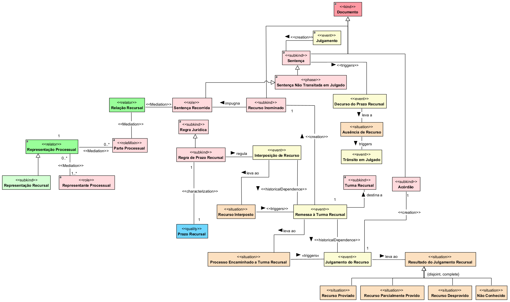

Fonte: elaborado pelo autor (2026)

### 4.3.10 Cumprimento e Encerramento

O diagrama Cumprimento e Encerramento representa os eventos e situações relacionados à fase posterior ao trânsito em julgado da sentença, abrangendo o cumprimento da obrigação judicial e os possíveis desdobramentos até o encerramento do processo.

A `situation` Sentença Transitada em Julgado `triggers` o `event` Cumprimento da Sentença, indicando que, no recorte representado pelo modelo, o início dessa etapa decorre da estabilização da decisão judicial. O Cumprimento da Sentença está relacionado ao `relator` Obrigação Judicial pela relação satisfaz, evidenciando que essa fase tem como finalidade efetivar a prestação estabelecida na decisão.

A ocorrência do Cumprimento da Sentença leva a `situation` Resultado do Cumprimento. Esse resultado é especializado nas situações Obrigação Cumprida, Obrigação Parcialmente Cumprida e Obrigação Não Cumprida. As três especializações integram um conjunto `{disjoint, complete}` , permitindo representar, no escopo da ontologia, os possíveis resultados da verificação do cumprimento da obrigação judicial.

Quando a obrigação é integralmente satisfeita, a `situation` Obrigação Cumprida `triggers` o `event` Conclusão do Cumprimento. Esse evento leva a situação Cumprimento Concluído, indicando que não há necessidade de continuidade dos atos voltados à satisfação da obrigação.

Nos casos de satisfação parcial ou inexistente, as situações correspondentes relacionam-se ao evento Prosseguimento do Cumprimento. Seu resultado deve ser uma nova situação de cumprimento avaliado. A ligação direta “brings about” entre esse evento e Conclusão do Cumprimento, também evento, precisa ser substituída por uma situação intermediária ou por relação apropriada entre ocorrências. Além disso, “satisfaz” não pode caracterizar indistintamente toda ocorrência da fase de cumprimento quando o próprio modelo admite ausência de satisfação.

A `situation` Cumprimento Concluído, por sua vez, `triggers` o `event` Arquivamento do Processo. O arquivamento leva a situação Processo Arquivado por Satisfação da Obrigação, representando o encerramento do percurso processual contemplado pela ontologia após o cumprimento da prestação reconhecida judicialmente.

Dessa forma, o diagrama permite acompanhar a evolução da fase de cumprimento desde o trânsito em julgado até o arquivamento do processo, distinguindo as hipóteses de cumprimento integral, parcial ou inexistente da obrigação. O modelo fornece suporte especialmente às Questões de Competência relacionadas ao cumprimento da sentença, à conclusão dessa fase e à possibilidade de arquivamento do processo em razão da satisfação da obrigação.

O suporte à decisão sobre arquivamento permanece parcial. É preciso associar cada resultado à obrigação, ao processo e ao intervalo de vigência, verificar todas as prestações e eventuais pendências e distinguir conclusão, declaração de extinção da execução e arquivamento. A disciplina de ofício, RPV ou precatório permanece parcialmente fora da representação. O percurso é um caso de encerramento por satisfação, não a descrição de todas as formas de extinção processual.

Figura 23 – Diagrama de Cumprimento e Encerramento.

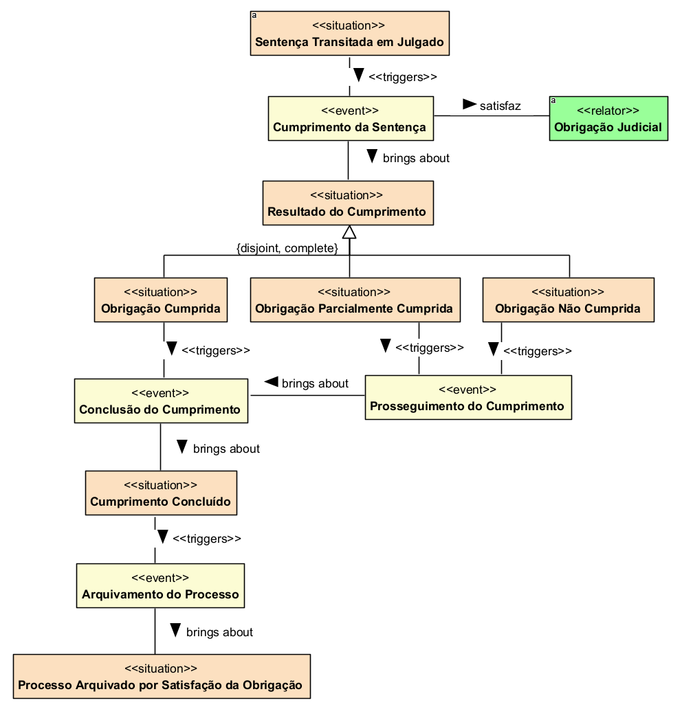

Fonte: elaborado pelo autor (2026)

## 4.4 Avaliação da Ontologia

Esta seção apresenta a verificação documental das 38 QCs e sua aplicação a seis cenários com dados simulados. Todos os participantes fictícios, documentos, identificadores de processos, valores e acontecimentos específicos foram construídos para o ensaio. A referência à União em C3 utiliza uma entidade real apenas como participante de uma hipótese inventada, sem lhe atribuir um fato ocorrido. Não foram utilizados números CNJ, documentos pessoais ou registros profissionais reais.

### 4.4.1 Matriz de rastreabilidade das 38 QCs

A matriz preserva a numeração e a formulação das questões da Seção 4.1. O símbolo `>` indica um percurso de leitura, `/` separa alternativas e `;` separa percursos. A leitura inversa de uma associação é indicada quando necessário. Esses percursos não acrescentam relações ao modelo nem constituem consultas executadas. A presença de elementos rastreáveis não demonstra, por si só, atendimento integral à questão.

Quadro 5 – Matriz de rastreabilidade das 38 QCs.

| QC | Pergunta                                                                                            | Elementos e relações rastreados                                                                                                                                                                                                                                                                                                      | Localização                |
| -- | --------------------------------------------------------------------------------------------------- | -------------------------------------------------------------------------------------------------------------------------------------------------------------------------------------------------------------------------------------------------------------------------------------------------------------------------------------- | ---------------------------- |
| 1  | Quem são os participantes do processo e qual papel processual cada um exerce?                      | Relação Jurídico-Processual > mediação > Participante Processual > especializações > Parte Processual / Representante Processual / Auxiliar da Justiça / Testemunha; Parte Processual > especializações > Demandante / Demandado.                                                                                            | Figura 8.                    |
| 2  | O autor é pessoa física, microempresa ou empresa de pequeno porte?                                | Processo Judicial Federal > mediação > Demandante > especializações > Pessoa Física Autora / Microempresa Autora / Empresa de Pequeno Porte Autora.                                                                                                                                                                               | Figuras 8 e 13.              |
| 3  | O réu é a União, uma autarquia, uma fundação pública federal ou uma empresa pública federal? | Processo Judicial Federal > mediação > Demandado > supertipo > Organização Federal > especializações > União Federal / Autarquia Federal / Fundação Pública Federal / Empresa Pública Federal.                                                                                                                              | Figuras 8, 9 e 13.           |
| 4  | Quem representa juridicamente as partes?                                                            | Parte Processual > mediada por > Representação Processual > mediação > Representante Processual > especializações > Representante Designado / Advogado Constituído / Defensor Público Federal / Representante Jurídico Federal.                                                                                               | Figuras 8 e 10.              |
| 5  | Há advogado constituído ou é necessária representação por advogado na fase atual?             | Representação Processual > mediação > Representante Processual > especialização > Advogado Constituído; Representação Recursal > especialização de > Representação Processual. A obrigatoriedade jurídica não decorre apenas desses vínculos.                                                                          | Figuras 10 e 22.             |
| 6  | Há perito, conciliador, testemunha ou outro auxiliar da justiça vinculado ao processo?            | Perito > participação > Realização de Perícia; Conciliador > participação > Tentativa de Conciliação; Testemunha > participação > Oitiva de Testemunha; Serventuário da Justiça > especializações do desenho > Servidor Judicial / Oficial de Justiça / Perito / Conciliador.                                          | Figuras 11, 18 e 19.         |
| 7  | Qual é o tipo da ação proposta?                                                                  | Processo Judicial Federal > especializações por matéria > Processo Previdenciário / Processo Assistencial / Processo Indenizatório. A hierarquia de FGTS e habitação permanece sujeita à revisão.                                                                                                                             | Figura 14.                   |
| 8  | Qual é o pedido principal formulado pelo autor?                                                    | Processo Judicial Federal > possui > Demanda > possui > Pedido Processual; Documento de Petição Inicial > formula > Pedido Processual. A prioridade do pedido não está explicitada por associação própria.                                                                                                                      | Figuras 14 e 16.             |
| 9  | A ação busca obrigação de fazer, não fazer, pagar valores ou outra providência?               | Demanda / Pretensão Jurídica > possui > Pedido Processual > especializações > Pedido de Fazer / Pedido de Não Fazer / Pedido de Pagar / Pedido de Outra Providência.                                                                                                                                                             | Figuras 12 e 14.             |
| 10 | Existe requerimento de tutela provisória?                                                          | Demanda / Pretensão Jurídica > possui > Pedido Processual > especialização > Pedido de Tutela Provisória; Documento de Petição Inicial > formula > pedido.                                                                                                                                                                      | Figuras 12, 14 e 16.         |
| 11 | Em qual status ou fase o processo se encontra?                                                      | Ato Processual > produz > Situação Processual > especializações > Processo Instaurado / Contestação Apresentada / Apto a Julgamento / Cumprimento Concluído; Determinação de Audiência > leva a > Resultado da Determinação de Audiência. A vigência atual dos estados depende do recorte.                               | Figuras 15, 17, 18, 20 e 23. |
| 12 | O réu apresentou contestação?                                                                    | Demandado / Contestação > participação > Apresentação de Contestação > produz > Contestação Apresentada; Prazo de Contestação em Curso > triggers > Decurso do Prazo de Contestação > produz > Ausência de Contestação, sob a condição de falta de defesa.                                                          | Figura 17.                   |
| 13 | Pode haver proposta ou realização de acordo entre as partes?                                      | Proposta de Acordo > participação > Apresentação de Propostas de Acordo; Celebração de Acordo > creation > Acordo Processual > mediação > Demandante / Demandado. A ocorrência não representa todas as condições de permissão.                                                                                            | Figura 18.                   |
| 14 | É necessária audiência de conciliação?                                                         | Determinação de Audiência > leva a > Resultado da Determinação de Audiência > especializações > Audiência Designada / Audiência Dispensada; Audiência Designada > promove > Audiência de Conciliação. Os critérios da determinação são externos.                                                                     | Figura 18.                   |
| 15 | Há necessidade de produção de provas?                                                            | Análise das Provas > leva ao > Resultado da Análise Probatória > especialização > Provas Insuficientes > triggers > Produção de Prova Complementar > leva a > Prova Complementar Produzida > triggers > Análise das Provas.                                                                                                    | Figura 20.                   |
| 16 | Quais provas foram apresentadas pelas partes?                                                       | Parte Processual / Documento Probatório > participação > Juntada de Documento > produz > Documento Juntado; Realização de Perícia > creation > Laudo Pericial; Oitiva de Testemunha > produz > Testemunho Colhido.                                                                                                               | Figura 19.                   |
| 17 | Há testemunhas indicadas ou necessidade de produção de prova testemunhal?                        | Testemunha > participação > Oitiva de Testemunha > produz > Testemunho Colhido. A indicação prévia pela parte e a necessidade da prova não estão integralmente representadas.                                                                                                                                                   | Figuras 8 e 19.              |
| 18 | As provas disponíveis são suficientes para julgamento antecipado?                                 | Análise das Provas > leva ao > Resultado da Análise Probatória > especialização > Provas Suficientes > possibilita > Apto a Julgamento > triggers > Julgamento. Aptidão não equivale à hipótese jurídica de julgamento antecipado.                                                                                           | Figura 20.                   |
| 19 | A ausência de alguma prova impede o julgamento do pedido?                                          | Análise das Provas > leva ao > Provas Insuficientes > associação sem rótulo > Não Apto a Julgamento; Provas Insuficientes > triggers > Produção de Prova Complementar. Não há regra de impedimento universal.                                                                                                                 | Figura 20.                   |
| 20 | Qual foi o resultado da sentença?                                                                  | Julgamento > creation > Sentença > especializações por resultado > Procedência / Procedência Parcial / Improcedência / Sentença Homologatória / Extinção sem Resolução do Mérito.                                                                                                                                         | Figura 21.                   |
| 21 | Qual obrigação foi imposta ao réu: pagar, fazer, não fazer ou entregar algo?                    | Sentença > impõe > Obrigação Judicial > especializações > Obrigação de Pagar / Obrigação de Fazer / Obrigação de Não Fazer / Obrigação de Entregar Coisa; Obrigação Judicial > composição > Direito à Prestação / Dever de Prestação.                                                                          | Figura 21.                   |
| 22 | A sentença transitou em julgado?                                                                   | Sentença > é objeto de > Trânsito em Julgado > produz > Sentença Transitada em Julgado. O trânsito é registrado, não calculado a partir de todas as condições legais.                                                                                                                                                         | Figuras 21 e 22.             |
| 23 | A obrigação reconhecida na sentença foi cumprida?                                                | Cumprimento da Sentença > produz > Resultado do Cumprimento > especializações > Obrigação Cumprida / Obrigação Parcialmente Cumprida / Obrigação Não Cumprida.                                                                                                                                                               | Figura 23.                   |
| 24 | O cumprimento da sentença foi concluído?                                                          | Obrigação Cumprida > triggers > Conclusão do Cumprimento > produz > Cumprimento Concluído.                                                                                                                                                                                                                                         | Figura 23.                   |
| 25 | O processo pode ser arquivado por satisfação da obrigação?                                      | Cumprimento Concluído > triggers > Arquivamento do Processo > produz > Processo Arquivado por Satisfação da Obrigação. As condições de autorização e ausência de outras pendências não estão completas.                                                                                                                   | Figura 23.                   |
| 26 | Foi interposto recurso contra a sentença?                                                          | Interposição de Recurso > creation > Recurso Inominado > impugna > Sentença Recorrida; Interposição de Recurso > produz > Recurso Interposto.                                                                                                                                                                                     | Figura 22.                   |
| 27 | Qual é o prazo para apresentação do recurso?                                                     | Prazo Recursal > caracterização > Regra de Prazo Recursal > regula > Interposição de Recurso. Duração, ciência válida e condições de contagem precisam de conteúdo normativo e dados adicionais.                                                                                                                            | Figura 22.                   |
| 28 | O recurso exige representação por advogado?                                                       | Representação Recursal > especialização de > Representação Processual > mediação > Parte Processual / Representante Processual; Representante Processual > especializações profissionais. Falta restrição que exclua representante não habilitado no recurso.                                                             | Figuras 10 e 22.             |
| 29 | O processo foi encaminhado à Turma Recursal?                                                       | Recurso Interposto > triggers > Remessa à Turma Recursal > destina a > Turma Recursal; Remessa à Turma Recursal > produz > Processo Encaminhado à Turma Recursal.                                                                                                                                                                   | Figura 22.                   |
| 30 | Qual foi o resultado do julgamento do recurso?                                                      | Julgamento do Recurso > creation > Acórdão; Julgamento do Recurso > produz > Resultado do Julgamento Recursal > especializações > Recurso Provido / Recurso Parcialmente Provido / Recurso Desprovido / Não Conhecido.                                                                                                            | Figura 22.                   |
| 31 | Meu caso pode ser levado ao Juizado Especial Federal?                                               | Pretensão Jurídica > possui > Pedido Processual / Causa de Pedir; Organização Federal / Pedido Processual / Causa de Pedir / Valor da Causa > participação > Análise de Cabimento no JEF; Regra de Competência > regula > análise > resulta em > Resultado da Análise de Cabimento > Cabível no JEF / Não Cabível no JEF. | Figura 12.                   |
| 32 | Preciso contratar advogado para iniciar a ação?                                                   | Parte Processual > mediada por > Representação Processual > mediação > Representante Processual > especializações > Representante Designado / Advogado Constituído; Petição > mediação obrigatória no desenho > Representante Processual. Há conflito entre a opção inicial e a estrutura da petição.                 | Figuras 8, 10 e 16.          |
| 33 | Contra qual órgão ou entidade federal devo propor minha ação?                                   | Pretensão Jurídica > demanda para > Organização Federal; Processo Judicial Federal > mediação > Demandado > supertipo > Organização Federal. A indicação de uma organização não determina automaticamente a legitimidade passiva.                                                                                         | Figuras 8, 9, 12 e 13.       |
| 34 | Quais documentos preciso reunir para apresentar meu pedido?                                         | Processo Judicial Federal > mediado por > Instrução Documental do Processo > mediação > Documento Necessário ao Processo; Documento de Petição Inicial > formaliza > Demanda. Não existe catálogo exaustivo de exigências por matéria.                                                                                      | Figuras 13 e 16.             |
| 35 | O que acontece depois que eu entro com a ação?                                                    | Ajuizamento > produz > Processo Instaurado; Determinação de Audiência > leva a > Audiência Designada / Audiência Dispensada; Provas Insuficientes > triggers > Produção de Prova Complementar > produz > Prova Complementar Produzida > triggers > Análise das Provas.                                                         | Figuras 15, 18 e 20.         |
| 36 | Em que fase está meu processo?                                                                     | Análise das Provas > leva ao > Resultado da Análise Probatória > especializações > Provas Suficientes / Provas Insuficientes; Provas Suficientes > possibilita > Apto a Julgamento; Determinação de Audiência > leva a > Resultado da Determinação de Audiência. A seleção da situação atual é contextual.             | Figuras 18 e 20.             |
| 37 | Preciso comparecer a alguma audiência ou perícia?                                                 | Determinação de Audiência > leva a > Audiência Designada > promove > Audiência de Conciliação; Dever de Comparecimento à Audiência / Dever de Comparecimento à Perícia > caracterização desenhada > Audiência de Conciliação. O portador do dever é inadequado e não se representa a intimação do indivíduo.      | Figuras 18 e 19.             |
| 38 | O que acontece depois que a sentença reconhece meu direito?                                        | Sentença > impõe > Obrigação Judicial; Trânsito em Julgado > produz > Sentença Transitada em Julgado > triggers > Cumprimento da Sentença; Obrigação Cumprida > triggers > Conclusão do Cumprimento > produz > Cumprimento Concluído > triggers > Arquivamento do Processo.                                                 | Figuras 21 e 23.             |

Fonte: elaborado pelo autor, por inspeção dos diagramas e dos artefatos de avaliação (2026).

### 4.4.2 Instanciação e identidade dos indivíduos

Os seis cenários empregam identificadores locais, sem correspondência com processos reais. Os marcos são ordinais de cada cenário e não representam dias ou datas judiciais. Os fragmentos exemplificam relações selecionadas, sem preencher todas as mediações, cardinalidades ou classificações exigíveis de uma população completa.

Quadro 6 – Cenários de instanciação.

| Cenário | Dados simulados                                                                                                                                                                                                                                                               | Aspectos exemplificados                                                                                                                                                  |
| -------- | ----------------------------------------------------------------------------------------------------------------------------------------------------------------------------------------------------------------------------------------------------------------------------- | ------------------------------------------------------------------------------------------------------------------------------------------------------------------------ |
| C1       | Pessoa Alfa demanda a Autarquia Previdenciária Simulada Alfa para implantação de benefício. O cabimento positivo é informado. Há pedido separado de tutela provisória, contestação, conciliação frustrada, perícia, oitiva, procedência e satisfação integral. | Pessoa física autora, representação, pretensão e demanda distintas, provas e obrigação de fazer. Não se simula deferimento da tutela.                             |
| C2       | Microempresa Beta demanda a Empresa Pública Federal Simulada Beta. Pede R$ 8.000,00, obtém R$ 6.000,00 e recebe inicialmente R$ 2.000,00, com satisfação posterior do saldo.                                                                                            | Microempresa autora, pedido de pagar, procedência parcial e resultados de cumprimento em recortes distintos.                                                            |
| C3       | Empresa Gama, de pequeno porte, demanda a União em hipótese indenizatória inventada. Após improcedência, interpõe recurso inominado, posteriormente desprovido.                                                                                                         | Empresa de pequeno porte autora, representação recursal, remessa à Turma Recursal e acórdão. Não se afirma trânsito automático após o acórdão.                |
| C4       | Pessoa Delta atua inicialmente por representante designado não advogado, na hipótese de admissibilidade estipulada, e celebra acordo com a Fundação Pública Federal Simulada Delta para entrega de documento.                                                            | Designação da audiência, acordo, homologação e obrigação não cumprida. O dever de comparecimento é reproduzido conforme o desenho, sem certificar seu portador. |
| C5       | Pessoa Épsilon demanda a Autarquia Simulada Épsilon. Há audiência dispensada e ausência de contestação. A análise inicial indica necessidade de complementação; após sua produção, uma nova análise registra suficiência e aptidão.                           | Dispensa sem ocorrência de audiência; Prova Complementar Produzida; resultados históricos e atuais distintos. Não se estipula julgamento ou perícia realizada.      |
| C6       | Pessoa Zeta consulta sobre mandado de segurança em caso federal de dez salários mínimos, antes de qualquer ajuizamento. A análise tem resultado negativo informado.                                                                                                       | Pretensão sem processo ou papéis processuais; Não Cabível no JEF por exclusão legal, apesar do valor inferior ao limite.                                            |

Fonte: elaborado pelo autor com base em `avaliacao/dados-simulados.json` (2026).

**Identidade e classificação.** Um mesmo indivíduo pode ser classificado como Pessoa e Pessoa Física Autora no contexto de um processo. Isso não cria duas pessoas. Já a relação de representação, o documento e o ato de apresentá-lo são indivíduos distintos. O Quadro 7 explicita parte do inventário de C1; os identificadores restantes podem ser consultados no JSON.

Quadro 7 – Identidade e classificação dos indivíduos.

| Identificador         | Classificação no fragmento                                                  | Interpretação                                                                  |
| --------------------- | ----------------------------------------------------------------------------- | -------------------------------------------------------------------------------- |
| C1-AUT                | Pessoa; Pessoa Física Autora; Demandante                                     | Uma única pessoa, no polo ativo do cenário.                                    |
| C1-REU                | Organização; Organização Federal; Autarquia Federal; Demandado            | Entidade simulada no polo passivo.                                               |
| C1-ADV                | Pessoa; Representante Processual; Advogado Constituído                       | Advogada da autora.                                                              |
| C1-REP-A              | Representação Processual                                                    | Vínculo entre C1-AUT e C1-ADV.                                                  |
| C1-PF                 | Pessoa; Representante Processual; Procurador Federal                          | Representante da autarquia ré.                                                  |
| C1-REP-R              | Representação Processual                                                    | Vínculo entre C1-REU e C1-PF.                                                   |
| C1-PROC               | Processo Judicial Federal; Processo Previdenciário; Processo Cabível no JEF | Relação processual SIM-P01, com cabimento estipulado.                          |
| C1-DEM                | Demanda                                                                       | Conteúdo da demanda de implantação do benefício.                             |
| C1-PRET               | Pretensão Jurídica                                                          | Estado intencional atribuído à Pessoa Alfa; distinto da demanda e do processo. |
| C1-VAL-PRET           | Valor da Causa                                                                | Propriedade da pretensão, com valor de trinta salários mínimos informado.     |
| C1-ANALISAR-CAB       | Análise de Cabimento no JEF                                                  | Evento regulado por C1-REG-COMP.                                                 |
| C1-CABIVEL            | Resultado da Análise de Cabimento; Cabível no JEF                           | Um resultado positivo informado, distinto do papel Processo Cabível no JEF.     |
| C1-PED                | Pedido de Fazer                                                               | Pedido de implantação, considerado principal por anotação externa.           |
| C1-TUT                | Pedido de Tutela Provisória                                                  | Requerimento provisório sem decisão de deferimento simulada.                   |
| C1-INI                | Documento; Documento de Petição Inicial                                     | Registro documental, distinto do relator Petição.                              |
| C1-PET                | Petição                                                                     | Relação associada à apresentação da pretensão.                             |
| C1-DETERMINAR-AUD     | Determinação de Audiência                                                  | Evento da determinação da audiência.                                          |
| C1-AUD-DESIGNADA      | Resultado da Determinação de Audiência; Audiência Designada               | Um resultado classificado pelo tipo geral e por um de seus subtipos.             |
| C1-AUD                | Audiência de Conciliação                                                   | Ocorrência efetiva da audiência.                                               |
| C1-PERICIA            | Realização de Perícia                                                      | Evento efetivamente ocorrido no cenário.                                        |
| C1-LAUDO              | Documento; Laudo Pericial; Documento Probatório                              | Artefato criado pela perícia e utilizado como prova.                            |
| C1-SENT               | Sentença; Procedência                                                       | Documento que registra a decisão.                                               |
| C1-OBR                | Obrigação Judicial; Obrigação de Fazer                                    | Vínculo entre o direito da autora e o dever da ré.                             |
| C1-DIREITO / C1-DEVER | Direito à Prestação / Dever de Prestação                                 | Duas posições distintas e correlatas, partes de C1-OBR.                        |

Fonte: elaborado pelo autor (2026).

Quadro 8 – Relações entre instâncias.

| Fragmento                                                                                                      | Interpretação                                                                                     |
| -------------------------------------------------------------------------------------------------------------- | --------------------------------------------------------------------------------------------------- |
| C1-REP-A > mediação > C1-AUT / C1-ADV                                                                        | Representação vincula a autora e a advogada.                                                      |
| C1-PROC > possui > C1-DEM > possui > C1-PED / C1-TUT                                                           | Processo, conteúdo da demanda e pedidos são distinguidos. A prioridade é anotação do cenário. |
| C1-PRET > caracterização > C1-AUT; C1-PRET > demanda para > C1-REU                                           | A pessoa porta a intenção, relacionada à organização considerada no caso.                      |
| C1-REU / C1-PED / C1-TUT / C1-CAUSA / C1-VAL-PRET > participação > C1-ANALISAR-CAB > resulta em > C1-CABIVEL | Entradas e resultado da análise são indivíduos distintos; a regra regula o evento.               |
| C1-DETERMINAR-AUD > leva a > C1-AUD-DESIGNADA > promove > C1-AUD                                               | Determinação, designação e ocorrência da audiência não se confundem.                         |
| C1-PERICIA > creation > C1-LAUDO                                                                               | Um evento cria um documento.                                                                        |
| C1-ANALISE > leva ao > C1-SUF > possibilita > C1-APTO                                                          | O resultado suficiente é informado no cenário, não inferido do conteúdo das provas.             |
| C1-APTO > triggers > C1-JULGAR > creation > C1-SENT                                                            | Uma situação desencadeia o julgamento, que produz o documento da decisão.                        |
| C1-SENT > impõe > C1-OBR; C1-OBR > mediação > C1-AUT / C1-REU                                               | A obrigação reconhecida vincula as partes.                                                        |
| C1-CUMPRIR > leva a > C1-CUMPRIDA > triggers > C1-CONCLUIR                                                     | Ocorrência do cumprimento, satisfação e conclusão são distinguidas.                            |

Fonte: elaborado pelo autor (2026).

**Recortes temporais.** Situações históricas não são automaticamente estados atuais. Em C2, o pagamento parcial não deve ser confundido com o valor pedido nem com o total reconhecido na sentença. Os valores são anotações da simulação, não um esquema monetário já implementado na ontologia.

Quadro 9 – Recortes temporais do cumprimento.

| Recorte | Obrigação reconhecida     | Pagamento acumulado | Saldo                                               | Situação |
| ------- | --------------------------- | ------------------- | --------------------------------------------------- | ---------- |
| C2-TP   | R$ 6.000,00 | R$ 2.000,00 | R$ 4.000,00         | Obrigação Parcialmente Cumprida e prosseguimento. |            |
| C2-TF   | R$ 6.000,00 | R$ 6.000,00 | R$ 0,00             | Obrigação Cumprida e Cumprimento Concluído.      |            |

Fonte: elaborado pelo autor (2026).

O total pago no recorte final é acumulado, não uma parcela a somar novamente ao valor anterior. O cenário não informa arquivamento de C2, nem simula integralmente requisições de pagamento. Uma resposta sobre C2-TP não pode usar a satisfação ocorrida somente em C2-TF.

Quadro 10 – Instanciação de recurso, acordo e comparecimento.

| Fragmento                                                                | Interpretação e limite                                                                                                     |
| ------------------------------------------------------------------------ | ---------------------------------------------------------------------------------------------------------------------------- |
| C3-REL-REC > mediação > C3-AUT / C3-SENT                               | Relação recursal conforme o desenho, sem certificar sua adequação ao padrão de Legal Relator.                           |
| C3-INTERPOR > creation > C3-RECURSO > impugna > C3-SENT                  | O evento, o documento recursal e a sentença impugnada são distintos.                                                       |
| C3-REMETER > destina a > C3-TURMA; C3-JULGAR-REC > creation > C3-ACORDAO | Remessa e decisão colegiada são registradas. O resultado desprovido não implica trânsito automático.                    |
| C4-DETERMINAR-AUD > leva a > C4-AUD-DESIGNADA > promove > C4-AUD         | A audiência foi designada e ocorreu.                                                                                        |
| C4-DEVER-COMP > caracterização desenhada > C4-AUD                      | Reproduz a ligação atual do dever com a audiência, sem atribuí-lo silenciosamente à autora e sem validar esse portador. |
| C4-CELEBRAR > creation > C4-ACORDO > mediação > C4-AUT / C4-REU        | A celebração constitui uma relação entre as partes.                                                                      |
| C4-JULGAR > creation > C4-SENT > impõe > C4-OBR                         | A decisão homologatória registra uma obrigação de entrega de documento no exemplo.                                       |

Fonte: elaborado pelo autor (2026).

Quadro 11 – Insuficiência probatória e reanálise.

| Recorte        | Resultado da análise                          | Aptidão e produção complementar                                                       |
| -------------- | ---------------------------------------------- | ---------------------------------------------------------------------------------------- |
| C5-TI, marco 4 | C5-INSUF: Provas Insuficientes                 | C5-NAO-APTO: Não Apto a Julgamento. A produção complementar ainda não ocorreu.       |
| C5-TC, marco 6 | C5-SUF: Provas Suficientes, após C5-REANALISE | C5-COMPLEMENTO-PRODUZIDO ocorreu no marco 5; a nova análise informa C5-APTO no marco 6. |

Fonte: elaborado pelo autor (2026).

Em C6, o valor de dez salários mínimos não afasta a exclusão do mandado de segurança da competência do JEF Cível (BRASIL, 2001, art. 3º, § 1º, I). O cenário não cria Processo Judicial Federal, Demanda, Demandante ou Demandado para representar a consulta pré-processual. O resultado negativo é informado com essa premissa normativa, não inferido por execução de Regra de Competência. Em C1 ocorre o mesmo cuidado com o resultado positivo informado.

### 4.4.3 Síntese do suporte e alcance da conferência

A classificação documental distingue **D**, suporte descritivo direto a fatos informados no fragmento; **P**, suporte parcial, com necessidade de regras, relações, dados ou anotações adicionais; e **N**, ausência de suporte suficiente no recorte considerado. A versão dos artefatos analisada registra 16 QCs em D, 22 em P e nenhuma em N. Esses números não correspondem a porcentagem de acerto, certificação jurídica ou aprovação do modelo.

Quadro 12 – Síntese do suporte às questões de competência.

| Classificação   | Questões                                                                                                                        | Interpretação                                                                                                                                                    |
| ----------------- | -------------------------------------------------------------------------------------------------------------------------------- | ------------------------------------------------------------------------------------------------------------------------------------------------------------------ |
| D — 16 questões | QC2, QC3, QC4, QC6, QC7, QC9, QC10, QC12, QC20, QC21, QC22, QC23, QC24, QC26, QC29 e QC30                                        | Os fragmentos contêm classificações e fatos que permitem a descrição esperada. Não se demonstra que esses fatos seriam obtidos ou validados automaticamente. |
| P — 22 questões | QC1, QC5, QC8, QC11, QC13, QC14, QC15, QC16, QC17, QC18, QC19, QC25, QC27, QC28, QC31, QC32, QC33, QC34, QC35, QC36, QC37 e QC38 | Parte da resposta depende de conteúdo normativo externo, contextualização, integração entre módulos ou refinamento conceitual.                               |

Fonte: síntese de `avaliacao/dados-simulados.json` e `avaliacao/instanciacoes-simuladas.md` (2026).

O conjunto contém 169 indivíduos, 190 relações declaradas e 13 recortes distribuídos nos seis cenários. Esses números se referem ao ensaio, não ao número de classes da ontologia. A conferência de integridade pode ser reproduzida, na pasta desta monografia, com:

```powershell
python avaliacao/verificar-dados.py
```

O script verifica identificadores, referências, tipos básicos selecionados de relações, marcos temporais, conciliação de valores de C2 e preservação das 38 QCs e de suas localizações. Não consulta o grafo para produzir as respostas esperadas, não analisa integralmente os arquivos do Visual Paradigm e não verifica todas as cardinalidades, os axiomas ou a correção jurídica. Uma execução sem erro deve ser descrita como conferência de integridade dos artefatos, nunca como “38 QCs aprovadas por um raciocinador”.

As principais premissas jurídicas externas são: critérios de competência e partes admitidas (BRASIL, 2001, arts. 3º e 6º); representação inicial e recursal (BRASIL, 2001, art. 10; BRASIL, 1995, art. 41, § 2º); prazo, dias úteis e interrupção por embargos (BRASIL, 1995, arts. 12-A, 42 e 50); apreciação da prova (BRASIL, 2015, arts. 355, 370 e 373); exceção da sentença homologatória ao recurso previsto no art. 41 da Lei nº 9.099/1995; e cumprimento por modalidades de prestação (BRASIL, 2001, arts. 16 e 17). O armazenamento dessas referências não equivale a axiomatizar ou executar seus conteúdos.

### 4.4.4 Limitações e refinamentos necessários

O Quadro 13 reúne problemas detectados por inspeção conceitual e documental. As correções indicadas não foram incorporadas automaticamente aos PNGs ou aos arquivos do Visual Paradigm. Os estereótipos e cardinalidades precisam ser reavaliados no modelo integrado e, depois, novamente confrontados com as QCs e as instâncias. Problemas de classificação e de semântica das relações têm prioridade sobre a operacionalização.

Quadro 13 – Inconsistências e refinamentos necessários.

| Localização                                      | Problema observado                                                                                                                                | Refinamento necessário                                                                                                                                                    |
| -------------------------------------------------- | ------------------------------------------------------------------------------------------------------------------------------------------------- | -------------------------------------------------------------------------------------------------------------------------------------------------------------------------- |
| Organizações — Figura 9                         | Juiz aparece como espécie de organização; órgãos e pessoas jurídicas são reunidos na mesma partição.                                     | Representar o magistrado como papel de Pessoa, separar órgão e entidade e rever disjunção e completude. Compatibilizar Órgão Judicial e Órgão Julgador.            |
| Sujeitos e Competência — Figuras 8 e 13          | Relação Jurídico-Processual e Processo Judicial Federal são relators sem articulação suficientemente explícita.                            | Definir se são vínculos distintos, partes ou perspectivas do mesmo vínculo, e representar a conexão correspondente.                                                    |
| Representantes e Serventuários — Figuras 10 e 11 | Partições misturam designação, habilitação, vínculo funcional e atividade auxiliar.                                                        | Separar os critérios, rever exclusividade entre papéis e distinguir auxiliares de servidores; evitar disjunção que exclua classificações compatíveis.               |
| Cabimento — Figura 12                             | Pretensão Jurídica caracteriza somente Pessoa, embora o domínio inclua empresas autoras; regras permanecem genéricas.                         | Contemplar os interessados admitidos e explicitar critérios de inclusão e exclusão, sem criar antecipadamente papéis de parte.                                         |
| Competência — Figura 13                          | Interesse de Agir foi modelado como intenção subjetiva.                                                                                         | Representar a condição jurídica e sua análise, distinguindo-a da intenção e da competência do órgão. Tratar requerimento prévio conforme a hipótese aplicável. |
| Demanda — Figura 14                               | Tutela provisória e natureza da prestação compõem uma partição única; FGTS e habitação aparecem necessariamente indenizatórios.         | Separar os eixos de classificação, prever pedidos e obrigações múltiplos e explicitar pedido principal e acessório quando necessário.                               |
| Procedimentos — Figura 15                         | `triggers` liga contestação a situação; julgamento depende obrigatoriamente da contestação no percurso desenhado.                         | Corrigir os tipos e as direções das relações e contemplar julgamento sem contestação e comparecimento espontâneo.                                                   |
| Instauração — Figura 16                         | Petição exige representante; protocolo e ajuizamento aparecem como etapas necessariamente distintas.                                            | Admitir atuação pessoal e pedido oral reduzido a escrito, ajustando a representação aos efeitos jurídicos do protocolo.                                               |
| Contestação e Recursos — Figuras 17 e 22        | Decurso de prazo aparece ligado a ausência, sem explicitar a não apresentação da peça.                                                       | Representar ciência, prazo aplicável, eventual manifestação e condições negativas, sem inferir ausência da simples falta de registro.                               |
| Conciliação — Figura 18                         | Deveres caracterizam audiência, inclusive o de comparecimento à perícia; resultado da determinação é opcional.                              | Dar ao dever um portador agente, relacioná-lo ao ato correto e à intimação e avaliar o registro obrigatório de resultado quando a determinação estiver concluída.  |
| Conciliação — Figura 18                         | Partição completa de resultados diretamente sob Situação Processual; falta vínculo explícito com homologação.                             | Criar uma categoria específica de resultado conciliatório e explicitar a relação entre acordo, documento e sentença homologatória.                                   |
| Produção de Prova — Figura 19                   | Composições e mínimos podem impor modalidades probatórias cumulativas; indicação de testemunha não está explícita.                       | Rever a opcionalidade dos meios e representar arrolamento, conteúdo e proveniência da prova conforme os requisitos.                                                      |
| Análise Probatória — Figura 20                  | Complementação e não aptidão podem ser tomadas como consequências universais da insuficiência; generalizações precisam de consolidação. | Delimitar o resultado de avaliação ao momento e ao caso, contemplar julgamento segundo ônus da prova e explicitar as generalizações pretendidas.                      |
| Sentença — Figura 21                             | Partição por resultado pode não cobrir decisões com capítulos distintos; posições jurídicas estão apenas parcialmente detalhadas.        | Individualizar prestações e resultados relevantes e completar correlação e dependência externa das posições jurídicas.                                             |
| Recursos — Figura 22                              | Documento Sentença origina `triggers`; exigência de advogado e exceções de recorribilidade não estão completas.                           | Introduzir situação apropriada e conteúdo normativo, restringir representação recursal e verificar admissibilidade antes de remessa e julgamento.                     |
| Cumprimento — Figura 23                           | `brings about` liga dois eventos; “satisfaz” pode conflitar com não cumprimento; arquivamento está simplificado.                            | Introduzir resultado intermediário, distinguir atos de cumprimento de satisfação efetiva e verificar todas as obrigações e pendências antes do encerramento.         |
| Integração dos módulos                          | Atos e situações não possuem vínculo uniforme explícito com processo, participante e vigência.                                              | Definir identificadores compartilhados e ligações temporais, distinguindo estados históricos, atuais e concomitantes.                                                   |
| Reúso e validação                               | Uso de estereótipos não prova alinhamento integral à UFO-L; acompanhamento de especialista não possui registros suficientes.                  | Documentar padrões, fundamentos, participantes, datas, roteiro e decisões da revisão, vinculando cada resultado aos termos e às QCs afetadas.                          |

Fonte: análise documental do autor a partir dos diagramas, da literatura de fundamentação e das fontes normativas citadas (2026).

O conjunto de cenários é pequeno e construído pelo próprio trabalho, o que limita a generalização e favorece exemplos próximos ao modelo. Não foram avaliados processos reais, a compreensão de cidadãos, a interoperabilidade com sistemas judiciais ou o desempenho de uma implementação. Nenhum resultado autoriza usar a ontologia atual como mecanismo autônomo de aconselhamento ou decisão jurídica. A contribuição da avaliação é tornar verificáveis os pontos de cobertura e expor as lacunas, em vez de declarar a ontologia completa.

# 5 Conclusão

Este capítulo retoma os objetivos da pesquisa, sintetiza as contribuições da ontologia de referência e discute o alcance dos resultados. A avaliação permite identificar quais fragmentos estão representados e quais condições ainda precisam ser explicitadas antes de uma validação mais ampla ou de uma implementação operacional.

## 5.1 Considerações Finais

O objetivo geral foi desenvolver e avaliar documentalmente uma ontologia de referência do Juizado Especial Federal Cível. O trabalho produziu uma organização conceitual do domínio que distingue pessoas e organizações de seus papéis, documentos de seus conteúdos e relações, e eventos das situações que deles resultam. Essas distinções foram aplicadas à análise de cabimento, à demanda, aos participantes, à defesa, à conciliação, à instrução, ao julgamento, ao recurso inominado e ao cumprimento da decisão. O resultado é um artefato de referência em desenvolvimento, não uma representação completa de todo o Direito Processual Civil ou uma implementação pronta para orientar decisões jurídicas.

Em relação ao objetivo específico de identificar conceitos do domínio, foram descritos sujeitos, papéis, relações, documentos e acontecimentos relevantes ao recorte, acompanhados de dicionário de termos. A documentação evidencia, por exemplo, que a pessoa autora e a própria pessoa são o mesmo indivíduo sob classificações distintas; que o documento de petição não se confunde com a relação denominada Petição; e que a sentença, o evento de julgar, a obrigação reconhecida e o resultado de seu cumprimento possuem funções conceituais diferentes. O dicionário registra fontes normativas e ontológicas de apoio, adaptações do autor e pontos de conferência com especialista, evitando apresentar definições sem proveniência como transcrições de um dicionário jurídico.

O objetivo de levantar requisitos foi materializado nas 38 questões de competência, incluindo questões formuladas sob a perspectiva do cidadão. A manutenção de identificadores estáveis e de uma matriz de rastreabilidade permite localizar o suporte conceitual de cada questão e examinar o impacto de futuras alterações. A análise mostrou também que algumas perguntas combinam descrição e decisão normativa: saber se um advogado está constituído não basta para determinar se sua atuação é obrigatória, assim como registrar provas suficientes não demonstra, por si só, cabimento de julgamento antecipado. Essa distinção é parte relevante do resultado da pesquisa.

Quanto à aquisição do conhecimento, a base normativa central é formada pelas Leis nº 10.259/2001 e nº 9.099/1995, complementadas pelas disposições pertinentes da Constituição Federal e do CPC e pela literatura selecionada. A aplicação das fontes deve respeitar a especialidade do rito, a vigência e a hipótese jurídica considerada. O acompanhamento de especialista foi mencionado no relato de desenvolvimento, mas os registros disponíveis ainda não permitem caracterizá-lo como validação integral reproduzível. Essa limitação exige complementação documental, não a atribuição retroativa de aprovação a todos os conceitos.

O objetivo de modelar e documentar o domínio resultou em 16 diagramas de classes e um diagrama de pacotes, organizados em componentes estruturais e procedimentais. A fundamentação na UFO e a adaptação de estruturas da UFO-L e da OntoRS permitiram explicitar decisões que não seriam evidentes apenas a partir dos nomes jurídicos. O mapeamento de reúso identifica as correspondências e seus limites: foram aproveitadas interpretações e padrões conceituais, não demonstrada equivalência formal entre módulos ou importação completa de uma ontologia operacional. A existência de um relator ou role no desenho não substitui a documentação dos agentes, das posições jurídicas e das dependências requeridas pelo padrão de origem.

Quanto à avaliação, os seis cenários fictícios contêm 169 indivíduos, 190 relações declaradas e 13 recortes. A classificação documental registra 16 questões com suporte descritivo direto e 22 com suporte parcial. Os cenários positivos e negativos permitiram distinguir fatos informados, premissas externas e conclusões que o modelo ainda não pode produzir. O caso de mandado de segurança com valor inferior ao limite evidencia que o valor da causa não é critério suficiente de cabimento. O pagamento parcial seguido de satisfação evidencia a necessidade de separar o pedido, a prestação reconhecida, o valor pago e a situação atual. A conferência de integridade torna esses registros reprodutíveis, mas não demonstra satisfatibilidade, atendimento de todas as cardinalidades ou validade jurídica.

As principais contribuições são, portanto, a organização modular de um recorte do domínio, a explicitação de distinções ontológicas relevantes, a documentação do reúso, o dicionário com fontes e a avaliação rastreável por questões e cenários. Esses artefatos podem apoiar comunicação entre modeladores e especialistas e servir de base para extensões. A pretensão de contribuir futuramente para sistemas mais compreensíveis é coerente com a motivação social, mas depende de implementação e de avaliação com usuários. A presente pesquisa não mediu ampliação efetiva do acesso à justiça, redução de erros de peticionamento ou melhoria de desempenho de sistemas judiciais.

O desenvolvimento também evidencia cuidados metodológicos: modularizar um modelo não garante sua integração; registrar uma regra por seu nome não representa seu conteúdo; e construir instâncias compatíveis com fragmentos não prova a consistência do conjunto. A inspeção encontrou decisões que precisam ser revistas, como a classificação de Juiz sob Organização, o tratamento de Interesse de Agir como intenção, o portador dos deveres de comparecimento, as partições de classificação e algumas relações entre eventos e situações. Esses problemas foram expostos na Seção 4.4.4 para orientar o refinamento, em vez de serem ocultados pela redação.

Conclui-se que o objetivo de produzir uma base conceitual documentada e avaliá-la exploratoriamente foi atendido no recorte apresentado. Já a consistência formal, a validação jurídica integral, a cobertura de todas as alternativas procedimentais e a adequação a aplicações reais não foram demonstradas. A consolidação do artefato exige corrigir os problemas identificados, registrar a revisão com especialista e repetir a avaliação sobre os modelos efetivamente atualizados.

## 5.2 Trabalhos Futuros

O primeiro encaminhamento é revisar o modelo integrado no Visual Paradigm, priorizando as inconsistências de classificação e de semântica das relações. Devem ser separados magistrado, órgão e entidade; reformulados os papéis de apoio e de representação; revistos o interesse de agir, o portador dos deveres e os conjuntos de generalização; e corrigidas as ligações de `triggers` e `brings about`. A atualização precisa alcançar os elementos compartilhados entre módulos, as figuras, o dicionário e a matriz, não apenas as explicações textuais.

Uma segunda frente é formalizar os critérios jurídicos necessários às QCs parcialmente atendidas. Isso envolve explicitar condições de competência, legitimidade, representação, documentos por hipótese, prazos e recorribilidade, vinculando cada condição ao dispositivo e à interpretação pertinente. É importante distinguir duração normativa e prazo concreto, pedido e concessão de tutela, suficiência probatória e resultado do mérito. O registro de vigência e de versões das fontes permitirá analisar o impacto de mudanças legislativas ou jurisprudenciais sem tratar as regras como permanentes.

Também deve ser realizada uma validação documentada com especialistas e potenciais usuários. Recomenda-se registrar o perfil dos participantes, o conjunto de cenários e QCs examinados, o procedimento, as objeções e as decisões de revisão. Os casos podem incluir documentos ou situações reais devidamente autorizados, anonimizados e tratados segundo as exigências éticas e de proteção de dados. A revisão jurídica e a avaliação por cidadãos devem ter objetivos distintos: a primeira examina adequação ao domínio; a segunda investiga compreensão e utilidade informacional.

No âmbito da avaliação formal, o modelo corrigido poderá ser submetido a ferramentas apropriadas à versão da OntoUML utilizada, documentando ferramenta, versão, restrições examinadas, populações ou contraexemplos e resultados. Devem ser testadas cardinalidades, partições, dependências e identidade, inclusive em casos com múltiplas partes, pedidos e obrigações, ausência de contestação e estados concomitantes. O benefício é detectar problemas que cenários narrativos seletivos não expõem. A conferência de integridade dos artefatos deve continuar como verificação complementar, sem substituir essa análise.

Uma futura ontologia operacional poderá ser projetada a partir da referência consolidada, por exemplo em OWL com apoio de gUFO, tomando a experiência da OntoRS como referência de implementação. Essa transformação exigirá escolhas explícitas sobre temporalidade, regras, restrições e limites de inferência. As QCs então deverão originar consultas e casos de teste com entradas, resultados esperados e resultados obtidos, diferenciando consulta descritiva, validação de dados e decisão normativa. Essa etapa não deve automatizar silenciosamente lacunas conceituais da versão de referência.

Por fim, poderão ser estudadas aplicações de consulta explicativa, organização de documentos, elaboração assistida de petições e acompanhamento processual. Um protótipo deve informar as fontes e as limitações das respostas, tratar situações não contempladas e permitir encaminhamento para apoio jurídico. Seu benefício deverá ser avaliado com métricas de compreensão, identificação de informações e reconhecimento de limites, em vez de presumido a partir da existência da ontologia. A integração com dados judiciais e a ampliação do tratamento de homologação, RPV, precatório e meios de impugnação também constituem extensões possíveis, desde que acompanhadas de novos requisitos e avaliação.

# Referências

BECCALLI, Cristine Leonor Pereira Griffo. **UFO-L: uma ontologia núcleo de aspectos jurídicos construída sob a perspectiva das relações jurídicas**. 2018. Tese (Doutorado em Informática) — Universidade Federal do Espírito Santo, Vitória, 2018. Autora também identificada na literatura como Cristine Griffo.

BRASIL. **Decreto-Lei nº 200, de 25 de fevereiro de 1967**. Dispõe sobre a organização da Administração Federal, estabelece diretrizes para a Reforma Administrativa e dá outras providências. Brasília, DF: Presidência da República, 1967. Disponível em: https://www.planalto.gov.br/ccivil_03/decreto-lei/del0200.htm. Acesso em: 20 out. 2026.

BRASIL. **Constituição da República Federativa do Brasil de 1988**. Brasília, DF: Presidência da República, 1988. Disponível em: https://www.planalto.gov.br/ccivil_03/constituicao/constituicao.htm. Acesso em: 20 out. 2026.

BRASIL. **Lei nº 9.099, de 26 de setembro de 1995**. Dispõe sobre os Juizados Especiais Cíveis e Criminais e dá outras providências. Brasília, DF: Presidência da República, 1995. Disponível em: https://www.planalto.gov.br/ccivil_03/leis/l9099.htm. Acesso em: 20 out. 2026.

BRASIL. **Lei nº 10.259, de 12 de julho de 2001**. Dispõe sobre a instituição dos Juizados Especiais Cíveis e Criminais no âmbito da Justiça Federal. Brasília, DF: Presidência da República, 2001. Disponível em: https://www.planalto.gov.br/ccivil_03/leis/leis_2001/l10259.htm. Acesso em: 20 out. 2026.

BRASIL. **Lei nº 13.105, de 16 de março de 2015**. Código de Processo Civil. Brasília, DF: Presidência da República, 2015. Disponível em: https://www.planalto.gov.br/ccivil_03/_ato2015-2018/2015/lei/l13105.htm. Acesso em: 20 out. 2026.

FALBO, Ricardo de Almeida. SABiO: Systematic Approach for Building Ontologies. In: JOINT WORKSHOP ONTO.COM / ODISE ON ONTOLOGIES IN CONCEPTUAL MODELING AND INFORMATION SYSTEMS ENGINEERING, 1., 2014, Rio de Janeiro. **Proceedings [...]**. CEUR Workshop Proceedings, v. 1301, 2014. Disponível em: https://ceur-ws.org/Vol-1301/ontocomodise2014_2.pdf. Acesso em: 20 out. 2026.

GUIZZARDI, Giancarlo. **Ontological Foundations for Structural Conceptual Models**. 2005. Tese (Doutorado) — University of Twente, Enschede, 2005. Telematica Instituut Fundamental Research Series, n. 15.

GUIZZARDI, Giancarlo; ALMEIDA, João Paulo; GUIZZARDI, Renata S. S.; BARCELLOS, Monalessa Perini; FALBO, Ricardo. **Ontologias de fundamentação, modelagem conceitual e interoperabilidade semântica**. Documento complementar à apresentação no Ibero-American Meeting on Ontological Research, Gramado, 2011.

GUIZZARDI, Giancarlo; WAGNER, Gerd; FALBO, Ricardo de Almeida; GUIZZARDI, Renata S. S.; ALMEIDA, João Paulo A. Towards Ontological Foundations for the Conceptual Modeling of Events. In: **Conceptual Modeling — ER 2013**. Berlin; Heidelberg: Springer, 2013. p. 327–341. DOI: https://doi.org/10.1007/978-3-642-41924-9_27.

GUIZZARDI, Giancarlo; WAGNER, Gerd; ALMEIDA, João Paulo Andrade; GUIZZARDI, Renata S. S. Towards ontological foundations for conceptual modeling: the Unified Foundational Ontology (UFO) story. **Applied Ontology**, v. 10, n. 3–4, p. 259–271, 2015. DOI: https://doi.org/10.3233/AO-150157.

RIBEIRO, Luiz Alberto Pereira; SANZOVO, Mariana Resende. Juizado especial cível federal como instrumento facilitador do acesso à justiça. **Revista do Direito Público**, Londrina, v. 6, n. 2, p. 142–159, 2011. DOI: https://doi.org/10.5433/1980-511X.2011v6n2p142.

SCHERP, Ansgar; SAATHOFF, Carsten; FRANZ, Thomas; STAAB, Steffen. **Designing Core Ontologies**. Koblenz: Universität Koblenz-Landau, 2011. Arbeitsberichte aus dem Fachbereich Informatik, n. 5/2011. Relatório técnico, versão de 22 fev. 2011.

ZORZANELLI COSTA, Melissa; GUIZZARDI, Giancarlo; ALMEIDA, João Paulo A. On Capturing Legal Knowledge in Ontology and Process Models Combined: The Case of an Appeal Process. In: FRANCESCONI, E. et al. (ed.). **Legal Knowledge and Information Systems**. Amsterdam: IOS Press, 2022. p. 267–272. DOI: https://doi.org/10.3233/FAIA220478.

ZORZANELLI COSTA, Melissa; VIEIRA, Thiago Baiense Peçanha; BOURGUET, Jean-Rémi; GUIZZARDI, Giancarlo; ALMEIDA, João Paulo A. Enhancing Access to Legal Data through Ontology-based Representation: A Case Study with Brazilian Judicial Appeals. In: SEMINAR ON ONTOLOGY RESEARCH IN BRAZIL (ONTOBRAS), 16., 2023, Brasília. **Proceedings of the XVI Seminar on Ontology Research in Brazil and VII Doctoral and Masters Consortium on Ontologies**. CEUR Workshop Proceedings, 2023. p. 79–92.

<!-- Conferência editorial final: adequar a apresentação das referências e citações ao manual institucional vigente. As fontes primárias não consultadas diretamente não devem ser acrescentadas apenas para ocultar citações secundárias. -->

# Apêndice A — Dicionário de Termos

Este dicionário foi elaborado no âmbito do trabalho e, por isso, constitui apêndice, não anexo. Reúne 167 termos da proposta com definições de trabalho e fontes de apoio identificáveis. A indicação de uma lei fundamenta o conteúdo jurídico, mas não valida automaticamente o estereótipo ou a relação desenhada. As definições são sínteses ou adaptações, não transcrições literais das obras citadas. A proveniência indicada nesta revisão não deve ser confundida com prova da origem histórica de cada decisão de modelagem.

**Convenções da coluna de fontes:**

- **LJEF:** Brasil (2001), Lei nº 10.259/2001.
- **LJE:** Brasil (1995), Lei nº 9.099/1995, aplicada ao JEF no que não conflitar com a lei específica.
- **CPC:** Brasil (2015), Lei nº 13.105/2015, observada a compatibilidade com o rito especial.
- **CF:** Brasil (1988), Constituição Federal.
- **DL200:** Brasil (1967), Decreto-Lei nº 200/1967, especialmente art. 5º.
- **G05, G13 e G15:** Guizzardi (2005) e Guizzardi et al. (2013, 2015), respectivamente.
- **BL18:** Beccalli (2018), tese da UFO-L, especialmente Capítulos 5 e 6.
- **OR23:** Zorzanelli Costa et al. (2023), representação da OntoRS, especialmente Seção 3.
- **RS11:** Ribeiro e Sanzovo (2011), discussão jurídica do JEF e do acesso à justiça; considerada em seu contexto de publicação.
- **EA:** elaboração ou adaptação conceitual do autor para o recorte desta ontologia; a fonte normativa ou ontológica complementar é indicada quando identificada.
- **VE pendente:** necessária validação ou conferência com especialista, ainda sem registro individualizado nos materiais desta versão. Não significa validação já realizada.

Não se atribui “fonte: dicionário jurídico” sem identificar obra, autoria, edição e página. Também não se atribui “validado com especialista” sem registrar participante, data, procedimento e decisão. O acompanhamento mencionado na Seção 3.3 deve ser documentado para permitir atualizar esse estado. As demais definições igualmente não possuem, nesta versão, certificação individualizada de validação; a marca VE chama atenção para os casos que dependem especialmente dessa conferência.

Quadro 14 – Dicionário de termos e fontes.

| Termo                                              | Definição de trabalho                                                                                                                                                                                        | Fonte de apoio / proveniência                                                                                       |
| -------------------------------------------------- | -------------------------------------------------------------------------------------------------------------------------------------------------------------------------------------------------------------- | -------------------------------------------------------------------------------------------------------------------- |
| Acórdão                                          | No modelo, documento que registra a decisão colegiada da Turma Recursal; distingue-se do evento de julgamento do recurso.                                                                                     | CPC, art. 204; LJE, art. 46; EA para a representação documental.                                                   |
| Acordo Processual                                  | Relação constituída entre as partes por consenso sobre a composição da controvérsia, distinta da proposta, do documento e da homologação.                                                              | LJEF, art. 10, parágrafo único; LJE, art. 22; BL18; EA.                                                            |
| Advogado Constituído                              | Pessoa habilitada à advocacia que atua por constituição da parte na representação processual considerada.                                                                                                 | LJE, arts. 9º e 41, § 2º; LJEF, art. 10; EA; conferir habilitação e poderes no caso concreto.                   |
| Advogado da União                                 | Pessoa que exerce a representação judicial da União nas matérias de sua atribuição institucional, distinguida das atribuições específicas da Fazenda Nacional.                                        | CF, art. 131; EA; VE pendente quanto ao detalhamento das atribuições da carreira.                                  |
| Advogado de Empresa Pública Federal               | Pessoa habilitada à advocacia que exerce a representação judicial de empresa pública federal.                                                                                                              | LJEF, arts. 7º e 10, como contexto da representação; EA; VE pendente quanto ao vínculo e aos poderes.            |
| Ajuizamento                                        | Propositura da ação. No recorte, evento de instauração do processo, cujos efeitos devem ser compatibilizados com a apresentação do pedido e o protocolo, sem pressupor um ato adicional obrigatório.    | CPC, art. 312; LJE, art. 14; EA.                                                                                     |
| Análise das Provas                                | Evento de apreciação judicial da pertinência e suficiência dos elementos probatórios no contexto das questões controvertidas.                                                                            | LJE, arts. 5º e 32–35; CPC, arts. 370 e 371; EA.                                                                   |
| Análise de Cabimento no JEF                       | Evento de avaliação das características de uma pretensão à luz das regras aplicáveis ao JEF, sem pressupor processo já instaurado.                                                                      | LJEF, arts. 3º e 6º; EA; não corresponde a decisão jurídica automatizada.                                       |
| Apresentação de Contestação                    | Evento pelo qual o demandado apresenta defesa oral ou escrita; seu registro não comprova automaticamente regularidade ou tempestividade.                                                                      | LJE, art. 30; EA.                                                                                                    |
| Apresentação de Propostas de Acordo              | Evento no qual são apresentadas propostas de composição, distinto da aceitação e da celebração do acordo.                                                                                               | LJE, arts. 21 e 22; LJEF, art. 10; EA.                                                                               |
| Apto a Julgamento                                  | Situação em que se considera possível decidir a causa no contexto da avaliação realizada; não implica procedência, julgamento antecipado ou julgamento já ocorrido.                                    | CPC, arts. 355, 370 e 373; G13 para a categoria situação; EA.                                                      |
| Arquivamento do Processo                           | Evento de encaminhamento ao arquivo, representado no recorte após a conclusão por satisfação, sem abranger todas as hipóteses de arquivamento.                                                            | EA; CPC, arts. 924, II, e 925, como contexto da extinção da execução; VE pendente sobre os atos de encerramento. |
| Ato Processual                                     | No modelo, evento de atuação processual, inclusive na formação da demanda, capaz de produzir efeitos ou situações juridicamente relevantes.                                                              | LJE, arts. 12 e 13; G13; EA.                                                                                         |
| Audiência de Conciliação                        | Evento destinado à tentativa de composição entre as partes; sua ocorrência não significa que houve acordo.                                                                                                | LJE, arts. 21 e 22; LJEF, arts. 9º e 10; EA.                                                                        |
| Audiência Designada                               | Situação que registra a designação de audiência, distinta da audiência efetivamente realizada.                                                                                                           | EA; LJE, art. 16, e LJEF, art. 9º, como contexto procedimental; VE pendente sobre as condições aplicáveis.       |
| Audiência Dispensada                              | Situação que registra a dispensa de audiência na hipótese considerada, sem criar uma ocorrência fictícia do evento.                                                                                      | EA; VE pendente quanto ao fundamento e aos critérios da dispensa.                                                   |
| Ausência de Contestação                         | Situação de não apresentação de defesa no prazo ou momento aplicável, que deve ser explicitamente registrada e não inferida da simples falta de dados.                                                  | LJE, art. 30, como contexto da defesa; EA; VE pendente quanto ao prazo e aos efeitos jurídicos.                     |
| Ausência de Recurso                               | Situação de não interposição de recurso no período aplicável, consideradas ciência válida e eventuais causas que afetem o prazo.                                                                      | LJE, arts. 12-A, 42 e 50; EA.                                                                                        |
| Autarquia Federal                                  | Entidade federal da Administração indireta, com personalidade jurídica própria, criada por lei para o desempenho de atividades típicas da Administração.                                                | DL200, art. 5º, I; LJEF, art. 6º, II.                                                                              |
| Auxiliar da Justiça                               | Pessoa que presta atividade de apoio ao exercício da jurisdição; não se confunde necessariamente com servidor integrante do quadro judicial.                                                               | CPC, art. 149; LJE, art. 7º; EA.                                                                                    |
| Cabível no JEF                                    | Resultado positivo da análise de cabimento da pretensão, informado segundo os critérios considerados; não é o processo nem o papel Processo Cabível no JEF.                                              | LJEF, arts. 3º e 6º; EA.                                                                                           |
| Causa de Pedir                                     | Fatos e fundamentos jurídicos que sustentam o pedido formulado, distinguidos do pedido e de seu registro documental.                                                                                          | LJE, art. 14, § 1º, II; CPC, art. 319, III; EA.                                                                    |
| Celebração de Acordo                             | Evento de formação do consenso pelo qual se constitui o acordo, distinto de sua homologação judicial.                                                                                                      | LJEF, art. 10; LJE, art. 22, § 1º; EA.                                                                             |
| Citação                                          | Ato pelo qual o demandado é chamado a integrar a relação processual, consideradas as formas legais e a possibilidade de comparecimento espontâneo.                                                         | LJEF, art. 7º; LJE, art. 18; CPC, art. 238.                                                                         |
| Competência Jurisdicional                         | No recorte, vínculo da atribuição de um órgão para apreciar determinada causa segundo normas de competência; não equivale ao interesse de agir.                                                         | LJEF, art. 3º; BL18, Seção 5.7.4, como referência de poder jurídico; EA; VE pendente sobre sua reificação.    |
| Comprovante de Protocolo                           | Documento que registra a protocolização e suas informações de identificação e tempo, distinto do próprio evento.                                                                                        | EA; CPC, art. 312, como contexto dos efeitos do protocolo.                                                           |
| Conciliação Frustrada                            | Situação resultante de tentativa de composição sem acordo. Normaliza o rótulo “Conciliação Frustada” presente na figura.                                                                              | LJE, arts. 22 e 27, como contexto dos resultados conciliatórios; EA.                                                |
| Conciliação Realizada                            | Na terminologia do modelo, resultado de composição bem-sucedida; não significa apenas que uma audiência ocorreu.                                                                                           | LJE, art. 22, § 1º; EA; recomenda-se avaliar o rótulo “acordo celebrado”.                                       |
| Conciliador                                        | Pessoa que exerce papel de auxílio à composição consensual, segundo designação e atribuições pertinentes ao JEF.                                                                                       | LJE, art. 7º; LJEF, art. 18; EA.                                                                                    |
| Conclusão do Cumprimento                          | Evento que registra a conclusão dos atos de cumprimento no recorte de satisfação integral, distinto do arquivamento.                                                                                        | LJEF, arts. 16 e 17; CPC, arts. 924 e 925, como contexto; EA.                                                        |
| Contestação                                      | No modelo, documento de defesa ou registro de defesa oral apresentado pelo demandado; distinto do ato de apresentá-lo.                                                                                        | LJE, art. 30; EA para a representação documental.                                                                  |
| Contestação Apresentada                          | Situação resultante da apresentação da defesa, sem implicar automaticamente seu acolhimento ou regularidade.                                                                                               | LJE, art. 30; G13; EA.                                                                                               |
| Cumprimento Concluído                             | Situação posterior à conclusão do cumprimento no recorte adotado; a ausência de outras pendências requer verificação própria.                                                                         | EA, com apoio contextual em LJEF, arts. 16 e 17.                                                                     |
| Cumprimento da Sentença                           | Conjunto de atos voltados à efetivação das prestações determinadas, representado como evento no modelo; iniciar essa fase não implica satisfação.                                                      | LJEF, arts. 16 e 17; EA.                                                                                             |
| Decurso do Prazo de Contestação                  | Ocorrência do término do período de defesa aplicável; não implica, isoladamente, ausência de contestação.                                                                                              | EA; VE pendente quanto à regra de prazo de cada hipótese do rito.                                                  |
| Decurso do Prazo Recursal                          | Ocorrência do término do prazo aplicável à interposição, consideradas as condições legais de contagem.                                                                                                 | LJE, arts. 12-A, 42 e 50; EA.                                                                                        |
| Defensor Público Federal                          | Membro da Defensoria Pública da União que presta assistência jurídica e atua na representação de pessoa assistida segundo suas atribuições.                                                            | CF, art. 134; EA; VE pendente quanto às condições de atuação e aos poderes no caso concreto.                    |
| Demanda                                            | Conteúdo da pretensão submetida à apreciação judicial, articulado por causa de pedir e um ou mais pedidos; distinto do processo, do evento e do documento.                                                | LJE, art. 14; CPC, art. 319; EA.                                                                                     |
| Demanda Protocolizada                              | Situação em que o pedido apresentado está formalmente registrado, distinta do comprovante e do evento de protocolização.                                                                                  | LJE, arts. 14 e 16; CPC, art. 312; EA.                                                                               |
| Demandado                                          | Papel da entidade contra a qual se formula a demanda; no escopo, desempenhado pelos tipos admitidos no art. 6º, II, da LJEF.                                                                                  | LJEF, art. 6º, II; BL18 para papéis; EA.                                                                           |
| Demandado Citado                                   | Situação em que ocorreu a citação do demandado, sem confundir o ato com o conhecimento informal da demanda.                                                                                                | LJEF, art. 7º; LJE, art. 18; EA.                                                                                    |
| Demandante                                         | Categoria de papéis das pessoas ou organizações que apresentam a demanda, não um novo indivíduo separado de seu portador.                                                                                 | LJEF, art. 6º, I; BL18, Seção 5.6; EA.                                                                            |
| Demora Excessiva                                   | Situação em que o tempo de resposta administrativa é considerado excessivo segundo os critérios da hipótese, e não mera avaliação subjetiva do interessado.                                            | EA; VE pendente quanto ao prazo, à norma e à jurisprudência aplicáveis.                                          |
| Determinação de Audiência                       | Evento que registra a avaliação ou determinação sobre a audiência e seu resultado de designação ou dispensa.                                                                                            | EA; VE pendente quanto aos agentes competentes e aos critérios do ato.                                              |
| Dever de Comparecimento à Audiência              | Posição jurídica do sujeito obrigado a comparecer à audiência nas condições aplicáveis, distinta do evento e de sua simples designação.                                                              | BL18 para a posição Duty; LJE, arts. 19, 20 e 51, como contexto; EA; VE pendente.                                  |
| Dever de Comparecimento à Perícia                | Posição jurídica do sujeito obrigado a comparecer a exame pericial quando exigido, vinculada ao exame e à comunicação pertinente.                                                                        | LJEF, art. 12, como contexto do exame técnico; BL18; EA; VE pendente.                                               |
| Dever de Prestação                               | Posição jurídica do sujeito obrigado à prestação, correlata ao direito do credor e parte da relação de obrigação.                                                                                    | BL18, Seções 5.7.1 e 5.9; LJEF, arts. 16 e 17; EA.                                                                 |
| Direito à Prestação                             | Posição jurídica do credor de exigir a ação ou omissão devida, correlata ao dever do outro agente.                                                                                                       | BL18, Seções 5.7.1 e 5.9; EA.                                                                                      |
| Documento                                          | Registro de conteúdo informacional; pode desempenhar funções processuais distintas sem se confundir com o conteúdo, o ato ou a relação que documenta.                                                    | EA, com G05 como apoio à distinção ontológica entre entidades e propriedades.                                    |
| Documento de Petição Inicial                     | Registro que formaliza a demanda, expõe causa de pedir e pedidos, inclusive quando o pedido oral é reduzido a escrito.                                                                                       | LJE, art. 14; CPC, art. 319; EA.                                                                                     |
| Documento de Requerimento Administrativo           | Registro do requerimento perante a Administração ou de sua realização, distinto do evento de requerer e da resposta administrativa.                                                                        | EA; RS11 como contexto do domínio; VE pendente sobre exigibilidade e conteúdo por matéria.                        |
| Documento Juntado                                  | Situação em que um documento foi incorporado aos autos; não é uma segunda cópia ontológica do próprio documento.                                                                                        | CPC, arts. 434 e 435; EA.                                                                                            |
| Documento Necessário ao Processo                  | Papel de documento exigido para a instrução da demanda na hipótese considerada; relevância probatória não o torna automaticamente indispensável.                                                        | CPC, art. 320; LJEF, art. 11; EA; VE pendente quanto à lista de documentos por caso.                                |
| Documento Probatório                              | Papel assumido por documento utilizado para demonstração de fato relevante, ainda que não seja documento indispensável à propositura.                                                                     | LJE, arts. 32 e 33; CPC, arts. 369 e 434; EA.                                                                        |
| Empresa de Pequeno Porte Autora                    | Organização enquadrada como empresa de pequeno porte que exerce papel de demandante no recorte. O enquadramento não é criado pela participação no processo.                                              | LJEF, art. 6º, I; EA; VE pendente quanto ao regime de enquadramento vigente.                                        |
| Empresa Pública Federal                           | Entidade federal da Administração indireta constituída como empresa pública, com personalidade jurídica própria.                                                                                         | DL200, art. 5º, II; LJEF, art. 6º, II.                                                                             |
| Extinção sem Resolução do Mérito              | No modelo, sentença classificada por encerrar o procedimento sem resolver o mérito; distingue-se da improcedência.                                                                                          | CPC, art. 485; LJE, art. 51; EA para a classificação documental.                                                   |
| Fundação Pública Federal                        | Entidade fundacional federal integrante da Administração indireta; sua natureza e seu regime devem ser considerados na hipótese concreta.                                                                   | DL200, arts. 4º e 5º, IV; LJEF, art. 6º, II; EA.                                                                  |
| Improcedência                                     | No modelo, classificação da sentença que rejeita o pedido no mérito, distinta de extinção sem resolução do mérito.                                                                                    | CPC, art. 487, I; EA.                                                                                                |
| Indeferimento Administrativo                       | Situação resultante de decisão administrativa que rejeita o requerimento considerado, sem equivaler a uma decisão judicial.                                                                                | EA; VE pendente quanto ao regime administrativo da matéria.                                                         |
| Instrução Documental do Processo                 | No modelo, vínculo entre processo e documentos utilizados em sua formação ou instrução, sem constituir lista universal de exigências.                                                                    | LJEF, art. 11; CPC, arts. 320, 434 e 435; EA.                                                                        |
| Interesse de Agir                                  | Condição jurídica associada à necessidade e à utilidade da tutela solicitada, cuja análise depende da hipótese; não é o simples desejo subjetivo de ajuizar ação.                                   | CPC, art. 17; EA; VE pendente para os critérios por matéria e a reformulação ontológica.                        |
| Interposição de Recurso                          | Evento de apresentação formal do recurso, distinto do documento recursal, da admissão e do julgamento.                                                                                                      | LJE, arts. 41 e 42; EA.                                                                                              |
| JEF Competente                                     | Papel contextual do órgão JEF que possui atribuição para apreciar a causa considerada, segundo as normas pertinentes.                                                                                      | LJEF, art. 3º; EA.                                                                                                  |
| Juiz                                               | Magistrado que exerce a função jurisdicional; no sentido pessoal adotado, papel de Pessoa e não tipo de Organização.                                                                                      | LJE, arts. 5º e 6º; LJEF, arts. 4º e 12; G05 para a distinção entre pessoa e papel; EA.                         |
| Juizado Especial Federal                           | Órgão da Justiça Federal; nesta ontologia, o recorte é sua competência cível, não a criminal.                                                                                                           | LJEF, arts. 1º e 3º.                                                                                               |
| Julgamento                                         | Evento em que o órgão jurisdicional aprecia e decide a questão submetida, distinto do documento que registra o pronunciamento.                                                                              | LJE, arts. 28 e 38; G13; EA.                                                                                         |
| Julgamento do Recurso                              | Evento de apreciação da admissibilidade e, quando cabível, do mérito do recurso pelo órgão competente.                                                                                                   | LJE, arts. 41 e 46; EA.                                                                                              |
| Juntada de Documento                               | Evento de incorporação de documento aos autos, distinto do documento e da situação resultante.                                                                                                             | CPC, arts. 434 e 435; EA.                                                                                            |
| Laudo Pericial                                     | Documento com o resultado do exame técnico ou científico, produzido na atividade pericial.                                                                                                                   | LJEF, art. 12; CPC, art. 473, quando compatível; EA.                                                                |
| Microempresa Autora                                | Organização enquadrada como microempresa que exerce papel de demandante no processo considerado.                                                                                                             | LJEF, art. 6º, I; EA; VE pendente quanto ao enquadramento e aos casos de empresário individual.                    |
| Não Apto a Julgamento                             | Situação de avaliação em que se identificou necessidade de atos adicionais no caso; não é impedimento jurídico universal decorrente de qualquer falta de prova.                                         | CPC, arts. 370 e 373; EA; VE pendente quanto aos critérios de avaliação.                                          |
| Não Cabível no JEF                               | Resultado negativo da análise de cabimento segundo os critérios examinados, distinto da inexistência de qualquer direito à tutela em outro procedimento.                                                   | LJEF, arts. 3º e 6º; EA.                                                                                           |
| Não Conhecido                                     | Resultado de inadmissibilidade em que o mérito recursal não é apreciado. É o rótulo da figura para “Recurso Não Conhecido”.                                                                            | EA; LJE, arts. 41 e 42, como contexto; VE pendente quanto aos requisitos específicos.                               |
| Norma Jurídica                                    | Significado normativo, distinto do texto ou documento que o expressa; na UFO-L pode ser analisado como regra ou princípio.                                                                                    | BL18, Seção 5.3.                                                                                                   |
| Obrigação Cumprida                               | Situação de satisfação integral da prestação individualizada no recorte de avaliação.                                                                                                                  | LJEF, arts. 16 e 17; EA.                                                                                             |
| Obrigação de Entregar Coisa                      | Prestação de entrega de coisa determinada reconhecida na decisão ou no acordo, distinguida do evento material de entrega.                                                                                   | LJEF, art. 16; EA.                                                                                                   |
| Obrigação de Fazer                               | Prestação de realização de uma conduta reconhecida na decisão ou no acordo.                                                                                                                               | LJEF, art. 16; EA.                                                                                                   |
| Obrigação de Não Fazer                          | Prestação de abstenção de determinada conduta reconhecida na decisão ou no acordo.                                                                                                                        | LJEF, art. 16; BL18 para direito e dever relativos a omissão; EA.                                                   |
| Obrigação de Pagar                               | Prestação de quantia reconhecida na decisão ou no acordo; o valor devido não se confunde com o valor pedido ou já pago.                                                                                   | LJEF, art. 17; EA.                                                                                                   |
| Obrigação Judicial                               | Relação de prestação reconhecida ou determinada judicialmente, composta, no recorte, por direito e dever correlatos dos agentes.                                                                           | BL18, Capítulos 5 e 6; LJEF, arts. 16 e 17; EA.                                                                     |
| Obrigação Não Cumprida                          | Situação em que a prestação avaliada permanece sem satisfação no recorte considerado.                                                                                                                    | LJEF, arts. 16 e 17, como contexto; EA.                                                                              |
| Obrigação Parcialmente Cumprida                  | Situação em que parte da prestação foi satisfeita, permanecendo parcela a cumprir no recorte.                                                                                                              | LJEF, arts. 16 e 17, como contexto; EA.                                                                              |
| Oficial de Justiça                                | Pessoa que exerce função de cumprimento de ordens e diligências do juízo, normalmente vinculada ao quadro de servidores; não deve ser excluída genericamente da categoria de servidor judicial.          | CPC, arts. 149 e 154; EA.                                                                                            |
| Oitiva de Testemunha                               | Evento de colheita do depoimento de testemunha acerca dos fatos relevantes ao caso.                                                                                                                            | LJE, arts. 28 e 34; EA.                                                                                              |
| Organização                                      | Agente institucional organizado, distinto das pessoas naturais que o integram ou representam.                                                                                                                  | G15; BL18, Seção 5.4; EA.                                                                                          |
| Organização Federal                              | No recorte, organização da esfera federal; sua utilização não torna todo órgão uma pessoa jurídica nem toda organização uma ré admitida no JEF.                                                     | LJEF, art. 6º, II; DL200, art. 4º, como contexto parcial; EA; VE pendente sobre a taxonomia.                       |
| Órgão Judicial                                   | Unidade institucional do Poder Judiciário com atribuições jurisdicionais, distinta do magistrado e da entidade com personalidade jurídica.                                                                 | LJEF, arts. 3º, 18 e 21; EA.                                                                                        |
| Órgão Julgador                                   | Denominação usada na figura de Organizações para a unidade que aprecia a causa; sua relação com Órgão Judicial precisa ser uniformizada.                                                               | EA; VE pendente; não tratar como sinônimo de pessoa do juiz.                                                       |
| Parte Processual                                   | Categoria dos agentes que ocupam os polos da relação processual no recorte considerado.                                                                                                                      | OR23, Party; LJEF, art. 6º; EA.                                                                                     |
| Participante Processual                            | Categoria de papéis dos sujeitos envolvidos no processo, abrangendo partes, representantes, auxiliares e testemunhas conforme o recorte.                                                                      | BL18 para Legal RoleMixin; EA.                                                                                       |
| Pedido de Fazer                                    | Pedido de provimento que determine a realização de uma conduta.                                                                                                                                              | LJE, art. 14; LJEF, art. 16, como contexto da prestação; EA.                                                       |
| Pedido de Não Fazer                               | Pedido de provimento que determine abstenção de uma conduta.                                                                                                                                                 | LJE, art. 14; LJEF, art. 16; EA.                                                                                     |
| Pedido de Outra Providência                       | Categoria residual dos pedidos não individualizados nas modalidades do modelo; não constitui definição exaustiva dos provimentos jurisdicionais.                                                           | EA; LJE, art. 14, como contexto; VE pendente sobre a taxonomia.                                                      |
| Pedido de Pagar                                    | Pedido de provimento relativo ao pagamento de quantia, distinto de obrigação já reconhecida.                                                                                                                | LJE, art. 14; LJEF, art. 17, como contexto da prestação; EA.                                                       |
| Pedido de Tutela Provisória                       | Requerimento de medida jurisdicional provisória, cujo objeto pode envolver diferentes prestações; não se confunde com a concessão da medida.                                                              | LJEF, art. 4º; CPC, arts. 294 e 300, conforme compatibilidade; EA.                                                  |
| Pedido Processual                                  | Conteúdo da providência jurisdicional solicitada, distinto da petição e do evento de formular ou apresentar o pedido.                                                                                      | LJE, art. 14; CPC, arts. 319, IV, e 322; EA.                                                                         |
| Perícia Realizada                                 | Situação em que o exame técnico ou científico foi concluído, distinta do evento e do laudo.                                                                                                               | LJEF, art. 12; G13; EA.                                                                                              |
| Perito                                             | Pessoa habilitada que exerce papel de produção de conhecimento técnico ou científico no processo; não é necessariamente servidor judicial.                                                               | LJEF, art. 12; CPC, arts. 149 e 156; EA.                                                                             |
| Pessoa                                             | No `kind` adotado, pessoa natural, portadora de identidade e capaz de desempenhar papéis; as pessoas jurídicas são tratadas separadamente como organizações.                                            | G05; BL18, Seção 5.4; EA para a delimitação do termo.                                                            |
| Pessoa Física Autora                              | Papel da pessoa natural que apresenta a demanda no processo considerado.                                                                                                                                       | LJEF, art. 6º, I; G05; EA.                                                                                          |
| Petição                                          | Na adaptação da OntoRS, relação associada à apresentação da pretensão, distinta do documento de petição; sua definição não exige representante em toda hipótese inicial.                         | OR23, Petition; EA; VE pendente sobre mediações e cardinalidades.                                                  |
| Peticionamento                                     | Evento de formulação e apresentação do pedido ou de sua documentação, distinto do conteúdo da demanda e do registro produzido.                                                                          | LJE, art. 14; EA.                                                                                                    |
| Poder Jurisdicional                                | Posição institucional de exercício da jurisdição na esfera de atribuição pertinente, relacionada à competência, mas não confundida com uma simples habilidade do agente.                             | BL18, Seção 5.7.4; LJEF, art. 3º; EA; VE pendente quanto ao portador e à sujeição correlata.                   |
| Prazo de Contestação em Curso                    | Situação em que ainda transcorre o período de defesa aplicável ao caso, segundo termo inicial e regra pertinentes.                                                                                         | EA; VE pendente quanto à disciplina específica do prazo.                                                           |
| Prazo Recursal                                     | Parâmetro ou período de apresentação do recurso, cuja aplicação concreta exige ciência, unidade de contagem e causas que afetem o prazo.                                                                | LJE, arts. 12-A, 42 e 50; EA; distinguir duração normativa e intervalo concreto.                                   |
| Pretensão Jurídica                               | No desenho pré-processual, intenção do interessado de obter determinada tutela; não representa automaticamente a existência de um direito material exigível.                                             | G15 para intenção; LJEF, arts. 3º e 6º, como contexto; EA; VE pendente quanto à denominação e aos portadores. |
| Procedência                                       | No modelo, classificação da sentença que acolhe integralmente o pedido considerado no recorte.                                                                                                              | CPC, art. 487, I; EA.                                                                                                |
| Procedência Parcial                               | No modelo, classificação da sentença que acolhe apenas parte dos pedidos ou da extensão requerida, conforme o recorte considerado.                                                                         | CPC, art. 487, I; EA; considerar capítulos distintos da decisão.                                                   |
| Processo Arquivado por Satisfação da Obrigação | Situação posterior ao arquivamento no percurso de satisfação adotado; pressupõe conferência de todas as obrigações e pendências pertinentes.                                                          | EA; CPC, arts. 924, II, e 925, como contexto; VE pendente.                                                           |
| Processo Assistencial                              | Classificação do processo pela discussão de prestação assistencial, sem implicar cabimento automático no JEF.                                                                                            | LJEF, art. 12, § 2º; RS11; EA.                                                                                     |
| Processo Cabível no JEF                           | Classificação contextual de processo instaurado considerado apto a tramitar no JEF segundo critérios legais; não é o resultado pré-processual de cabimento.                                              | LJEF, arts. 3º e 6º; EA.                                                                                           |
| Processo Encaminhado à Turma Recursal             | Situação resultante da remessa do recurso ou processo ao órgão recursal competente.                                                                                                                        | LJE, art. 41; LJEF, art. 21; EA.                                                                                     |
| Processo FGTS                                      | Classificação do processo por matéria relativa ao FGTS submetida à Justiça Federal; não é necessariamente espécie de processo indenizatório.                                                          | RS11 como contexto das causas federais; EA; VE pendente sobre a classificação e o cabimento por hipótese.         |
| Processo Habitacional                              | Classificação por matéria habitacional ou por relação contratual correspondente, sem pressupor natureza indenizatória ou cabimento no JEF.                                                               | EA; VE pendente sobre o recorte material e as regras de competência.                                                |
| Processo Indenizatório                            | Classificação do processo em que se discute pretensão de reparação de dano no recorte considerado.                                                                                                        | EA; LJEF, art. 3º, como limite geral de competência; VE pendente sobre as especializações.                       |
| Processo Instaurado                                | Situação resultante da propositura da ação no percurso modelado; substitui a denominação anterior “Ação Instaurada”.                                                                                 | LJE, art. 14; CPC, art. 312; EA.                                                                                     |
| Processo Judicial Federal                          | Na adaptação da OntoRS, relação processual instaurada perante a Justiça Federal; a tramitação é representada separadamente por eventos.                                                                | OR23, Judicial Process; EA; distinguir de Relação Jurídico-Processual.                                            |
| Processo Previdenciário                           | Classificação pela discussão de direito previdenciário, sem pressupor que toda hipótese pertença à competência do JEF.                                                                                 | LJEF, arts. 3º e 12, § 2º; RS11; EA.                                                                              |
| Procurador da Fazenda Nacional                     | Pessoa que exerce representação judicial da União nas matérias fiscais de sua atribuição institucional.                                                                                                  | CF, art. 131, § 3º; EA; VE pendente quanto ao detalhamento das atribuições da carreira.                          |
| Procurador Federal                                 | Pessoa que exerce representação judicial de autarquias e fundações públicas federais segundo suas atribuições institucionais.                                                                           | EA; LJEF, arts. 7º e 10, apenas como contexto; VE pendente e complementação da fonte específica da carreira.     |
| Produção de Prova                                | Evento ou conjunto de eventos destinados à obtenção de elementos para demonstração de fatos, sem exigir todas as modalidades em cada processo.                                                            | LJE, arts. 32–35; LJEF, art. 12; EA.                                                                                |
| Produção de Prova Complementar                   | Evento de obtenção de prova adicional quando determinada ou considerada pertinente, sem consequência obrigatória e ilimitada de qualquer insuficiência.                                                   | CPC, arts. 370 e 373; EA.                                                                                            |
| Proposta de Acordo                                 | No modelo, documento que registra termos propostos para composição, distinto do acordo aceito e da sentença homologatória.                                                                                 | LJE, arts. 21 e 22; LJEF, art. 10; EA.                                                                               |
| Prosseguimento do Cumprimento                      | Evento de continuidade dos atos destinados à efetivação de prestação ainda não integralmente satisfeita.                                                                                                 | LJEF, arts. 16 e 17; EA.                                                                                             |
| Protocolização                                   | Evento de registro formal do pedido perante o Judiciário; seus efeitos sobre a propositura devem ser compatibilizados com o regime aplicável.                                                                | LJE, arts. 14 e 16; CPC, art. 312; EA.                                                                               |
| Prova Complementar Produzida                       | Situação resultante da produção adicional de prova, que permite registrar a passagem para nova análise sem afirmar sua suficiência antecipadamente.                                                      | G13 para evento e situação; CPC, art. 370, como contexto; EA.                                                      |
| Provas Insuficientes                               | Resultado de avaliação de que os elementos não demonstram suficientemente os fatos ou demandam complementação no contexto examinado; não impede todo julgamento.                                         | CPC, arts. 370, 371 e 373; EA.                                                                                       |
| Provas Suficientes                                 | Resultado de avaliação de que os elementos disponíveis permitem decidir as questões pertinentes no contexto considerado, sem implicar procedência.                                                        | CPC, arts. 355, 370 e 371; EA.                                                                                       |
| Realização de Perícia                           | Evento de exame técnico ou científico, distinto da designação, do dever de comparecimento e do laudo produzido.                                                                                            | LJEF, art. 12; CPC, art. 464, quando compatível; EA.                                                                |
| Recurso Desprovido                                 | Resultado em que o mérito recursal é apreciado e a pretensão de reforma é rejeitada no recorte considerado.                                                                                                | EA; LJE, art. 46, como contexto do julgamento; VE pendente quanto à classificação dos resultados.                 |
| Recurso Inominado                                  | No modelo, documento de impugnação de sentença nas hipóteses legais, distinto do evento de interposição.                                                                                                 | LJE, arts. 41 e 42; LJEF, art. 5º; EA.                                                                              |
| Recurso Interposto                                 | Situação resultante da apresentação de recurso, sem implicar tempestividade, admissibilidade ou provimento.                                                                                                | LJE, art. 42; EA.                                                                                                    |
| Recurso Parcialmente Provido                       | Resultado em que parte da pretensão recursal é acolhida, conforme os capítulos e pedidos apreciados.                                                                                                        | EA; LJE, art. 46, como contexto; VE pendente.                                                                        |
| Recurso Provido                                    | Resultado em que a pretensão recursal é acolhida nos termos da decisão do órgão julgador.                                                                                                                 | EA; LJE, art. 46, como contexto; VE pendente.                                                                        |
| Regra de Competência                              | Regra jurídica que estabelece critérios de atribuição de uma causa a um órgão; a classe genérica não contém automaticamente todas as condições legais.                                              | LJEF, arts. 3º e 6º; BL18 para Rule; EA.                                                                           |
| Regra de Prazo Recursal                            | Regra que especifica duração e condições de contagem do prazo do recurso considerado.                                                                                                                      | LJE, arts. 12-A, 42 e 50; BL18 para Rule; EA.                                                                        |
| Regra Jurídica                                    | Norma entendida como determinação de condições e consequências aplicáveis, distinta do enunciado normativo que a expressa.                                                                               | BL18, Seção 5.3.                                                                                                   |
| Relação Jurídico-Processual                     | Vínculo jurídico entre sujeitos no contexto do processo, representado como relator; sua distinção de Processo Judicial Federal precisa ser explicitada.                                                    | BL18 para Legal Relator; EA; VE pendente sobre a articulação entre os vínculos.                                   |
| Relação Recursal                                 | Vínculo associado à impugnação no recorte; a relação com parte e sentença é a forma desenhada, não prova de equivalência a Legal Relator entre agentes.                                              | BL18 como referência de análise; EA; VE pendente sobre os participantes e a reificação.                          |
| Remessa à Turma Recursal                          | Evento de encaminhamento do recurso ou processo ao órgão competente, distinto de sua interposição e de seu julgamento.                                                                                     | LJE, arts. 41 e 42; LJEF, art. 21; EA.                                                                               |
| Representação Processual                         | Relação entre uma parte e o sujeito que atua em seu nome ou na defesa de seus interesses, segundo poderes e condições pertinentes.                                                                         | LJEF, art. 10; LJE, art. 41, § 2º; BL18; EA.                                                                       |
| Representação Recursal                           | Relação de representação na fase recursal, sujeita à exigência de advogado e às demais regras pertinentes.                                                                                              | LJE, art. 41, § 2º; EA.                                                                                            |
| Representante Designado                            | Pessoa indicada por escrito para atuar na causa nas hipóteses admitidas pelo JEF; a designação não significa necessariamente ausência de habilitação em advocacia.                                      | LJEF, art. 10; EA.                                                                                                   |
| Representante Jurídico Federal                    | Categoria dos papéis de representação de entidades federais, a ser articulada às atribuições institucionais e à parte representada.                                                                     | LJEF, arts. 7º e 10; EA; VE pendente sobre as especializações profissionais.                                      |
| Representante Processual                           | Papel exercido por pessoa que representa uma parte no processo, distinto de sua habilitação profissional e de seu vínculo institucional.                                                                    | LJEF, art. 10; BL18 para Legal Role; EA.                                                                             |
| Requerimento Administrativo                        | Evento de formulação de pedido à Administração; sua necessidade antes do ajuizamento depende da hipótese e não é universal no modelo.                                                                  | EA; RS11 como contexto; VE pendente quanto aos fundamentos específicos da exigência.                               |
| Resistência Administrativa                        | Situação de oposição administrativa à pretensão considerada; não deve ser presumida de toda demora nem confundida com o evento da resposta.                                                             | EA; VE pendente quanto aos critérios por matéria.                                                                  |
| Resultado da Análise de Cabimento                 | Situação resultante da avaliação da pretensão, classificada no recorte como Cabível no JEF ou Não Cabível no JEF.                                                                                      | LJEF, arts. 3º e 6º; G13; EA.                                                                                      |
| Resultado da Análise Probatória                  | Situação resultante da apreciação das provas em determinado momento e contexto, não um juízo permanente sobre todo o processo.                                                                           | CPC, arts. 370 e 371; G13; EA.                                                                                       |
| Resultado da Determinação de Audiência          | Situação que registra a designação ou dispensa após o evento de determinação, quando sua avaliação está concluída.                                                                                  | G13; EA; VE pendente quanto aos fundamentos da dispensa.                                                             |
| Resultado do Cumprimento                           | Situação de avaliação do grau de satisfação de uma obrigação em um recorte temporal identificado.                                                                                                      | LJEF, arts. 16 e 17; G13; EA.                                                                                        |
| Resultado do Julgamento Recursal                   | Situação que registra o resultado da apreciação do recurso, distinta do evento e do acórdão.                                                                                                             | LJE, arts. 41 e 46; G13; EA.                                                                                         |
| Sentença                                          | No modelo, documento que registra o pronunciamento judicial com função de sentença; não se confunde com o evento de proferi-la.                                                                            | CPC, art. 203, § 1º; LJE, art. 38; EA para a representação documental.                                           |
| Sentença Homologatória                           | No recorte da conciliação, documento da sentença que homologa o acordo; outras hipóteses de homologação exigem discriminação própria.                                                                 | LJE, art. 22, § 1º, e art. 41; EA.                                                                                 |
| Sentença Recorrida                                | Papel assumido pelo documento de sentença ao ser objeto de impugnação, sem criar uma nova sentença individual.                                                                                             | LJE, art. 41; G05; EA.                                                                                               |
| Sentença Transitada em Julgado                    | Situação em que a sentença não está mais sujeita a recurso, consideradas as condições aplicáveis. Não se presume coisa julgada material em decisão sem mérito.                                      | CPC, art. 502, quanto à coisa julgada material; LJEF, arts. 16 e 17; EA.                                            |
| Serventuário da Justiça                          | Termo utilizado no desenho para funções de apoio; deve ser delimitado, sem equiparar automaticamente peritos e conciliadores a servidores.                                                                   | CPC, art. 149; EA; VE pendente sobre a reorganização da categoria.                                                 |
| Servidor Judicial                                  | Pessoa vinculada ao serviço judicial que exerce funções de apoio administrativo ou operacional, distinguida dos auxiliares externos.                                                                        | CPC, arts. 149 e 152, como contexto; EA; VE pendente sobre o vínculo funcional.                                     |
| Situação Processual                              | Configuração relevante do processo em determinado contexto e tempo; diferentes dimensões podem coexistir, sem constituir uma fase única automaticamente.                                                   | G13; EA.                                                                                                             |
| Tentativa de Conciliação                         | Evento de busca de consenso entre as partes, que pode ocorrer sem acordo e não se confunde com sua celebração.                                                                                              | LJE, arts. 21 e 22; LJEF, art. 10; EA.                                                                               |
| Testemunha                                         | Pessoa que exerce o papel de prestar depoimento acerca de fatos pertinentes, distinta do ato de oitiva e do conteúdo do testemunho.                                                                           | LJE, art. 34; G05; EA.                                                                                               |
| Testemunho Colhido                                 | Situação resultante da oitiva, que registra a colheita do depoimento sem representar integralmente seu conteúdo.                                                                                            | LJE, arts. 34 e 36; G13; EA.                                                                                         |
| Trânsito em Julgado                               | Ocorrência do esgotamento da possibilidade de recurso pertinente, representada como evento; a certidão que o registra é distinta dessa ocorrência.                                                         | LJEF, arts. 16 e 17; CPC, art. 502, para os efeitos sobre a decisão de mérito; EA.                                 |
| Turma Recursal                                     | Órgão colegiado competente para apreciar recursos no sistema dos Juizados, distinto das pessoas dos magistrados que o compõem.                                                                              | LJE, art. 41, § 1º; LJEF, art. 21.                                                                                 |
| União Federal                                     | Pessoa jurídica de direito público interno do ente federativo União, distinta dos órgãos que integram sua estrutura.                                                                                      | CF, arts. 18 e 131; LJEF, art. 6º, II; EA.                                                                          |
| Valor da Causa                                     | Dimensão econômica atribuída à demanda segundo critérios legais; no diagrama pré-processual, é também usada para a estimativa da pretensão, devendo distinguir propriedades de portadores diferentes. | LJEF, art. 3º; LJE, art. 14, § 1º, III; CPC, arts. 291 e 292; EA.                                                 |

Fonte: síntese do autor a partir das fontes indicadas em cada linha (2026). Os termos são apresentados em ordem alfabética. “Ação Instaurada” é tratado como denominação anterior de Processo Instaurado; “Recurso Não Conhecido” corresponde ao rótulo Não Conhecido. Essas variantes não constituem classes adicionais neste dicionário.
